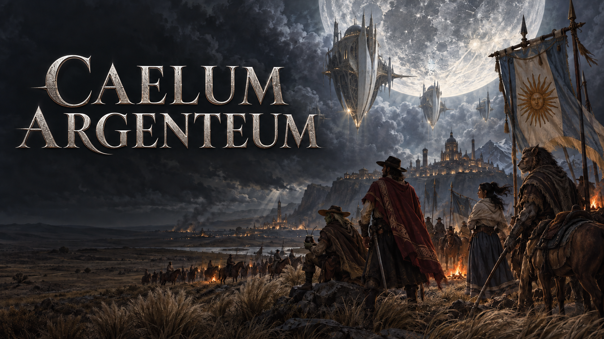

# Caelum Argenteum

An independent dark fantasy FPS-RPG inspired by nineteenth-century Argentina.
Author and game designer: **Damian Curti**. Development target: **GZDoom 4.14.2**
on Windows 11. The final game is intended to be independent of Doom assets.

**Current release: 5.13.6.** Obtain and update the complete repository, validate
it, then rebuild with `run_dev.bat` as described below.

#597's standalone setup is in PR609: a localized Multiplayer menu, separate
match configuration/saves and the four resident presets. The launcher uses Python
to start GZDoom's native host/join process and returns to the title afterward.
Individual Deathmatch (#598) and Team Deathmatch (#599) have native scoring, respawn, recovery and rematch
evidence. Team/capture/hunt #599–601 and final author acceptance remain pending.

V5.13 is in progress. #440 now has ordered Tarot loadouts, additive capacities,
Star volume admission, direct furniture collection, original storage contents and saved safe-drop queues,
per-card timers, Hermit duration, Devil payment, Temperance, Tower, voted Fool sequences,
borrowed racial abilities, Strength object lifting, Chariot movement, Priestess traps,
Empress restraint, local Death contamination and Hierophant purification pulses
and World dispatch. Lovers also shares damage in coupled, read-only journey
forecasts before committing individual costs and results. This is an
implementation checkpoint; Chariot reuses the original cart at its approved width,
and Empress plants have native visual evidence using owned vegetation materials.
Its equipped passive also enables individual vegetation traversal.
Death's equipped passive destroys explicitly marked living obstacles through Use.
Priestess identifies authored false walls; Hierophant purifies permitted cursed passages.
The mansion example annex has reversible geometry, usable return portals and placed
passage examples. Wheel changes its room's water, light and routes persistently.
The false-wall example has the mansion's original stone surface and native visual checks.
A placed living obstacle also exposes Death's equipped Use action without a new charge.
Emperor now pacifies reached actors and temporarily controls existing summons,
restoring original allegiance on expiry, cleansing or departure. Validation is
recorded separately from the still-pending full-version author suite.
Moon adds two temporary clones with existing character sprites, independent gear
and resources, native combat and a collision-checked swap. Its native checkpoint
and retained failures are recorded in HISTORY; it is not full-version acceptance.
Judgement now dispels nearby Emperor control and Moon illusions through their
existing cleanup paths, preserving protected scenes and unrelated effects.
Its equipped passive opens the demonstration spirit's bilingual dialogue; equipped
Justice permits damage to that explicitly marked immortal spirit.
Sun now has identity-preserving rock containment, Star gating, Box mass/slots
and bounded safe release. Its two rock examples reuse the owned boulder:8kW
through the thermal system, or environmental contamination100 within4m/LOS.
Containment suppresses their emissions without cleaning existing contamination. The
contained original also appears in the inventory with its raw mass and release
status. Use, Box and Drop request the same safe release. Star also applies to
supported furniture cargo, preserving original contents and documented volume;
it does not make arbitrary fixed scenery portable.
For existing saves, `build_dev.ps1 -LegacyTarotMaps` preserves pre-Justice maps;
`-LegacyTarotExamples` preserves the Justice-era mansion before the annex.
Justice now supports simultaneous pairs, safe returns and cancellable travel waits,
with an explicit legacy-map package for prior saves. Lovers now shares active-map
Health damage/healing through real group membership and overlapping-aura deduplication.
The automaton now uses its owned 3D model in native combat: one controlled body per
caster, timed commands, inseparable equipment and persistent Health. Its control
ends before travel; body destruction remains possible.
Accelerated waiting advances existing Tarot world effects once per shared step.
All22 Major handlers and their approved examples are integrated; combined native
sequence/recovery/annex regression passed118 assertions on the final package.
Frame-presentation review remains pending after Windows denied ETW access.
Standalone modes #596-601 remain unfinished. #441 capture/unified power and #442 equipment awakening
have separate tested PRs. Author scenarios remain deferred until all work is ready.

The 5.12.7a correction (#602) lets valid mansion spirits confirm and restore
native dialogue pages. New multiplayer session configurations initialize controls
from the packaged preset, including T for Tarot. These changes do not revive
characters automatically. All V5.12 author checks, including the death-interface
correction, passed on 2026-10-31. All seven issues and their focused PRs are
closed and merged. Generated indexes use the canonical LF checkout bytes.

Native review found and corrected a client-local travel camera that changed shared
RNG. Final checks include the engine's own inconsistency flag; earlier log-only
passes are not a synchronization clearance. Unsynchronized saves cannot overwrite
common recovery. The installed engine and original saves remain unchanged.

**V5.12 sessions (#435, author checks accepted 2026-10-31):** profile-bound native launches now check
ordered package hashes and character slots, reserve campaign custody and retain
valid common recovery checkpoints. Four/eight-peer identity and common restart
pass on the complete package; wrong identities leave recovery unchanged. Actual application-presentation measurements are recorded below;
the combined manual suite is accepted and `pending_test.txt` is empty. Native movement,
melee impact attribution and owned Tarot cost/cooldown pass with 2/4/8 clients.
Concurrent trade and personal crafting pass with 2/4/8 native clients.


Final native integration also excludes prediction from the shared time barrier:
two participants can finish the agreed accelerated rest without a false clock-jump
interruption. Card results close independently. New managed-session configurations
explicitly use windowed rendering; retained native save failures and subsequent
passes are documented in `assets/validation_v5_12_7/handoff-results.json`.

`run_multiplayer.bat` opens the ES/EN profile/session menu after validation and
packaging. The registry defaults to `%LOCALAPPDATA%/CaelumArgenteum/profiles.sqlite3`,
separate from regenerable builds. Use `--language en` or `--store PATH` as needed.
Register an existing current native save, prepare one common session, then open
that bundle as the selected host/guest in its displayed connection order. Transfers
are verified on copied worlds before custody is published; recovery retains originals.
Menu option11 creates a new mansion with empty slots; transfer a character into
every slot before playing. Option12 retries a pending transfer; option7 cancels
it while preserving the original checkpoints. Creation, outward/return transfer,
normal imported gameplay and vacancy refusal pass, including a fresh eight-client
combat regression. The review candidate uses a private GZDoom 4.14.2 build with
an upstream timer-lifetime fix; the installed engine is unchanged. Both builds
and failed attempts remain documented. Repeated native passes do not establish
that every earlier native crash has the same cause or is fixed.

Actual Vulkan presentation is now measured for two clients on one shared GPU:
about 60 FPS mansion,199-201 sewers,112-114 city and75-76 ground-facing city. The siege
remains poor at 1.33-6.48 FPS, with p99 gaps 475-868ms; this is a known performance
limitation, not acceptance. These are application presentation calls, not monitor
scanout or an Internet test. Evidence and exact builds:
`assets/validation_v5_12_7/native-sync-presentation-results.json` and
`engine-timer-results.json`; see CA-KP-202/203.

**V5.12 profiles (#434, awaiting author review):** staged campaign transfers
and return now preserve a single active owner, packed inventory and each world's
shops/properties. Native narrative checkpoints save complete transactions without
replaying rewards on load. Whole-coordinator backup/recovery and deceased-profile
transfer in actual Barracas pass. Native hub travel and portable/world quest
boundaries pass, including pending rewards on return. Managed native transfer
integration and manual-launcher verification pass; author acceptance remains.
Transfers reject active conversations while allowing finished dialogue references.
`caelum_new_campaign.py` creates a separate native MAP01 with 1–8 vacant slots
using a private 640 × 480 window configuration
for imports, without replacing a save or granting placeholder equipment. The
coordinator retains the native world and registers no character until a transfer.

**V5.12 table-card PvP (#590, awaiting author review):** human Truco and Trucazo
use actual seats at the same table and preserve inventory/world health. Native
two-player invitations, play, active-hand common-save restart and stand-up
forfeit pass; agent UI review confirms private hands in both games. Argento
regression passes. Lifecycle, arena and managed profile/session dependencies pass
together; the combined author suite is ready, with the measured siege limitations above.
No asset redesign or new balance.


**V5.12 organized combat (#438):** Palomo and a Domingo-appearance
organizer in the Buenos Aires plaza offer the approved ring and sewer maze.
The shared consent mechanism governs entry and return. Combat keeps actual
attributes, equipment, friendly fire and ordinary death. Native multi-peer and
save recovery checks pass; author acceptance remains pending.
For pre-arena saves, `python migrate_arena_save.py original.zds migrated.zds`
creates a separate revisioned copy with the approved friendly-fire rule, without
overwriting the original. The coordinated session launcher applies this adapter.

**V5.12 lifecycle (#437):** cooperative death retains the original pawn, inventory
and identity through native map travel. The Fool now requests a unanimous mansion
visit; only the activator pays after consent. Dead visitors move and converse as
spirits, with material rewards pending until resurrection. Palomo returns the
group to its recorded departure without another payment or automatic revival.
Death/departure cancel shared consent, including native saves predating the lifecycle
handler. Coordinated recovery and the combined dependencies pass native checks;
author acceptance is still pending.

**V5.12 cooperative world (#436):** native peers now share one campaign clock and
weather seed, with individual nonaccelerated rest. T/the time menu opens an
exact-duration proposal: everyone must consent, edits clear votes, silence
waits and any participant may cancel. Personal resources remain individual.
Walking routes and house doors now require unanimous destination consent;
walking uses the slowest pace and each character pays their own provisions.
Vehicle boarding also requires unanimous consent and independent ticket payments;
shared stops and resumption retain the original trip. Initial mansion departure
also requires everyone's consent and each living character's completed trials
and own equipment, checked before any personal completion or packing.
Rescue objectives now capture the present character roster; each eligible
character claims their own reward once. Late-ready records keep their personal
progress and see unavailable-world objectives in the Journal. Solo campaigns
also retain their own objective ledger; returning characters keep earned
eligibility through independent snapshots of their persistent legal identity.
Recovering the central house grants shared access to the present characters;
only the actual payer receives the single refund of recorded payments.
Two cooperative players can use the same tent with their own sleeping bags;
sharing shelter does not transfer ownership or packing permission. Waking one
player cancels shared acceleration while the other may continue ordinary rest.
Profile portability and lifecycle integration are verified under their focused
issues. This is not full cooperative campaign acceptance.
The grouped checks are available in `pending_test.txt`; issues remain open until author review.

Author clarification: the comparison is Leonor versus Caella. Caella carries
22.0184kg (armor plus pickaxe, utility staff and bolas); Leonor carries5kg.
Native mansion speeds are6.26658 versus7.93925m/s respectively, a26.69%
difference explained by the approved load penalty. Their base profile matches;
no duplicated motion was found. Seven focused native assertions pass.

**Companion speed review (#430):** native equal-condition measurement found no
duplicate movement. Leonor accelerates sooner because her body and equipment
weigh less; her final speed is below Rufino and Leandro in this fixture.
Evidence: `assets/validation_v5_11_4/speed-results.json`. Balance is unchanged.

**V5.11 is complete and author-accepted (2026-10-30).** The final confirmation
accepts the Caella/Leonor load comparison (#430) and Mandinga/Zupay disease
immunity (#586), and authorizes integration and issue closure. All author checks
are recorded in HISTORY; `pending_test.txt` is empty. Focused delivery: issues
#429-433, #580-582 and #586; PRs #575-579, #583-585 and #587-588. Native upgrade,
reload and rollback passed. Acceptance changes no gameplay or version number.
The distant-search candidate was evaluated but not adopted; large-siege
presentation stalls remain a documented limitation.

**V5.10 is complete and author-accepted (2026-10-30).** Issues #425-428 are
closed and their focused PRs #570-573 are merged into main with commit ancestry
preserved. Vision, anonymous noise, private memory/search and audible reports/
orders are accepted. Evidence: validation_5100-5103; final communication/save/
migration assertions: 53 PASS, combined regression: 91 PASS. HISTORY records
CA425-01 through CA428-01; `pending_test.txt` was empty at that closure. The release remains
5.10.3 because acceptance changes no gameplay. The large siege remains slow:
its final render-callback
mean is 653.63 ms versus 601.96 ms on the accepted baseline; these are not monitor
FPS. Peaceful comparisons and all tails are in validation_5103/summary.json.
See SYSTEMS, HISTORY and TASKS.

**V5.9 is complete and author-accepted (2026-10-30).** Issues #418-424 are
closed; focused PRs #561-568 are merged into main with their commit ancestry.
Quest coordination, factions, private conversation knowledge, Barracas story,
house/siege investigations, wardrobes and explicit faction services are accepted.
Evidence: `assets/validation_590` through `assets/validation_597`; per-test author
confirmations are in HISTORY. The tracked `pending_test.txt` was empty at that closure.

V5.9 acceptance does not turn render-callback evidence into a claim of
60 monitor-presented FPS.

**V5.8 remains complete and author-accepted (2026-10-29).** Its issues #410-417,
#496 and #502 are integrated into main; acceptance records remain in HISTORY.
Multiplayer rest authority/verification remain deferred to V5.12. Long-absence
loading remains expensive; no new displayed-FPS guarantee is made here.

### Historical delivery checkpoints

The entries below preserve the original stage evidence. Their pending statements
are superseded by the completion and acceptance record above.

5.8.52 completes the four-mode transport network (#416): Buenos Aires,
Barracas al Sud and Mar del Plata, with six playable Buenos Aires blocks,
shops, workshops and domestic water. Paid tickets retain progress through
scheduled departures, interruption and save/resume. Real travel time consumes
personal resources. Historical references and authorized estimates are explicit
in SYSTEMS; native evidence is in `assets/validation_5852`. Original horse and
steam-train artwork retains provenance in ASSETS. #417 incidents are separate;
author corroboration remains grouped for the complete V5.8 handoff.

5.8.51 completes the #415 calendar/combat/theft infrastructure. Unloaded sieges
retain actual combatants, resources, casualties, prepared attacks and loot.
Explicit thieves require proven physical access and transfer real owned stacks
at chronological hourly boundaries. The #417 bandit content is delivered separately.

Original 5.8.50 saves remain reversible inputs; native upgrade/reload checks and
paused partial-work saves are retained in `assets/validation_5851`. Tests distinguish
335 combat assertions, 21 original-save checks, ownership/access/dispatch evidence
and the final loading comparison. Author checks remain grouped for the final V5.8
handoff; #417 remains a separate focused PR.

One actual city-day catch-up takes 77.45 seconds versus 124.07 seconds in the
preceding checkpoint, with identical recorded Life, Anima, Air, contamination,
thermal exposure and shots. Three validated 8-ms pulses can run per paused UI tic.
This trades smoother loading-screen callbacks for shorter loading: p95 rises from
29.35 to 50.80 ms; it does not change active gameplay cadence. These are renderer
callback intervals, not presented-frame/FPS measurements. Long absences remain
computationally expensive; individual simulation and resources are retained.

## 5.8.50 - Remaining physical contact adapters (#502)

Common physical inventory retains contamination through native quantity changes,
including currency and reusable cloths. Carried furnishings, deployed sleeping
bags and tent packing preserve their existing dirt. NPC outer equipment now
contacts the same floor/wall tiles as players; exposed table food has an isolated
contact forecast. Unlinked physical actors use a local spatial index beside the
native blockmap. Final native checks: 136 current PASS plus 2 original-runtime
checks; static validation clean. Evidence: assets/validation_5850.
The whole V5.8 handoff remains grouped; #415-417 are still being implemented.

## 5.8.49 - Physical inventory contamination (#502)

Physical materials and food use documented additive surfaces. Food exposure,
age, contact, consumption and forecasts share their existing FIFO lots.
Native ground contact, independent legacy records and absent NPC food clocks
are integrated. Native verification passes1190 current assertions plus2 original-runtime checks; evidence is in assets/validation_5849;
author checks remain grouped until the remaining V5.8 implementation is complete.

## 5.8.48 - Vessel exterior contamination (#502)

Bottles, canteens, mates and the camp pot retain exterior contamination through
native inventory, immersion, camp mounting and transport inside dining sets.
Surfaces reuse the approved physical/thermal dimensions; contents and artwork
are unchanged. The interrupted private test is repaired: packed fixtures now
complete the native parking step, and missing saves are rejected before launch.
Native validation: 674 current and 2 original-runtime checks pass;
zero failures/static errors. Evidence: assets/validation_5848. Author checks stay grouped for V5.8.

## 5.8.47 - Abstract inventory contamination lots (#502)

Magical essences, abstract ammunition preparations and the nine prepared doses
retain distinct contamination lots through native pickup, splitting, storage
and saving. Their approved equivalent surface uses the existing mass per unit;
merging a pile never changes its total surface or washes its older units.
Inventory details show the oldest lot and lot count. Native verification is in
assets/validation_5847: 168 current checks and two original-runtime checks pass,
with zero failures/static errors. Author checks stay grouped until V5.8 is implemented.

## 5.8.46 - Native NPC absence physiology (#502)

Preserved NPC bodies continue contamination exposure, disease and natural
recovery using their source-map clock and climate. Household workers that die
while absent cannot continue cleaning or deploy to the siege. Native death and
loot occur once in the body's restored map. Validation passes155 current native
checks and4 original-runtime checks, with zero failures/static errors. Evidence
and pending author status are recorded in assets/validation_5846 and HISTORY;
V5.8 remains in progress.

## 5.8.45 - Dining contamination ownership (#502)

Dining tables now share one contamination state with their collision helpers.
Exposure uses the complete table envelope, and contact with adjacent helpers is
counted once. Packing, cleaning, saving and migration preserve the real state.
Validation passes 104 current native assertions and 8 original-runtime checks,
with zero failures/static errors (assets/validation_5845); author checks stay grouped until
all remaining V5.8 implementation is ready. This does not complete V5.8.

## 5.8.44 - Decorative furniture (#410)

Wall-mounted River Plate landscape paintings and freestanding carved botanical
statues now use the approved furniture crafting, commerce and transport rules.
Original painted inventory sprites and world models retain source provenance.
Validation: 186 current native checks and 30 prior-runtime checks pass, with
zero final failures/static errors (assets/validation_5844). Author tests remain
grouped until the remaining
V5.8 issues are implemented; this is not a complete-version acceptance claim.

## 5.8.43 - Household work during absence (#502)

Visited households clean reachable surfaces while unloaded, share one daily
hour and pay from their own real inventories against actual shop stock.
Source-home clocks respect the Limbo's frozen exterior calendar. 78 current and
11 prior-runtime native checks pass; static validation is clean. Native evidence
and recovery checks: assets/validation_5843. Author checks remain grouped until
all V5.8 issues are implemented; the version is not complete yet.

## 5.8.42 - Persistent household furnishing contamination (#502)

Visited-home tables, chairs, beds and bathroom fixtures keep their contamination
and natural exposure history across Limbo travel and save/load. Restoring a home
does not undo later cleaning. Validation: 335 current native assertions and
18 original-runtime checks, zero failures/static errors (assets/validation_5842);
manual corroboration remains grouped with the unfinished V5.8 implementation.
Automatic unloaded housekeeping and the other remaining issues are still pending.

## 5.8.41 - Persistent household coffers (#502)

Visited households retain their actual coffer and supplies across map and Limbo
travel. Stored food/water keep the home's climate; partial cleaning progress
survives returning to recreated installations. Validation: 164 current native
assertions plus 40 original-runtime checks; zero final failures/static errors
(assets/validation_5841).
This prepares unloaded household work; its automatic scheduler remains pending.
Manual checks remain grouped with the unfinished V5.8 implementation.

## 5.8.40 - Complete portable dining sets (#410)

Four purchasable/craftable sets carry their actual table, 2/6/12/6 chairs and
stored food/water together. Contents retain weight, ageing, water quality and
temperature through the Box, storage, saves and hub travel. Painted inventory
sprites accompany documented period dimensions; existing mansion tables remain.
Validation passes 1,201 current native assertions and22 prior-runtime checks,
with zero failures/static errors (assets/validation_5840). Author checks stay
grouped until the remaining V5.8 issues are implemented.

## 5.8.39 - Shared aim estimates (#415)

Native carbine/spell attacks now share their existing accuracy parameters with
an analytic estimator for unloaded combat. The estimator preserves the different
carbine and signed-offset distributions without creating projectiles or drawing
random numbers. Validation:194 current native assertions and16 original-runtime
checks pass;36 logged shot samples match the prior runtime exactly. See
assets/validation_5839. Unloaded rounds, casualties and transport remain unfinished.

## 5.8.38 - NPC illness (#502)

Living NPCs now take contamination illness damage through the existing native
combat pipeline and depurate through their current idle health recovery, including
potential recovery at full Life. Body concentration remains authoritative; saved
fractional damage starts at migration without retroactive injury. Validation passes
71 current native assertions and two original-runtime checks, with zero failures
or static errors (assets/validation_5838). All V5.8 author checks remain grouped.

## 5.8.37 - Climate-seal object history (#502)

Physical objects preserve the contamination interval of an active climate seal,
including rain washing. Departure settles that interval and records natural
weather for the absent map; a temporary seal does not persist remotely. Native
validation passes 53 current assertions and four original-runtime checks, with
zero failures/static errors (assets/validation_5837). Wider V5.8 remains open;
author checks stay grouped until implementation of the complete version.

## 5.8.36 - Portable study furniture (#410)

A writing desk and empty bookcase gain approved learned fabrication and supply.
The bookcase holds25 piles/100kg and travels as the same physical storage with
its books, lock, owner, contamination and saved reading progress. The desk keeps
its original body. Reading still requires accessible books within96 units/LOS;
active readers block packing. Used bookcase cargo follows the existing chest
rule and stays outside the Box; unused furniture items and the desk may enter it.
Original mansion library/desk stay fixed. Validation: 468 current native PASS
plus 19 original-runtime checks, zero failures and zero static errors, recorded
in assets/validation_5836. Table acquisition and wider V5.8 remain unfinished.
Author checks stay grouped until implementation of the whole version.

## 5.8.35 - Portable sofas (#410)

Two- and three-seat sofas gain normal fabrication, Provisions supply and painted
inventory icons. Transport retains the complete native assembly: the same body,
individual seats, title and contamination. An occupied seat blocks carrying;
packed seats leave no invisible collision or duplicate environmental exposure.
Validation:357 current native PASS plus17 original-runtime checks, zero failures
and zero static errors; assets/validation_5835 records exact package identity.
Table/study
acquisition and the remaining V5.8 issues stay open; manual handoff remains grouped.

## 5.8.34 - Ordinary furniture acquisition (#410)

The corrected wooden chair and raised cot join Provisions and learned fabrication.
Painted inventory sprites retain their physical designs. Placing, resting, carrying,
Box storage and travel preserve the real item and furniture identity. Existing
recipe knowledge and sold stock survive the appended catalogue revision.
Static validation and 206 final native assertions plus 12 original-runtime checks
passed under assets/validation_5834. Remaining
furniture and unloaded-world/transport work keep V5.8 open; author checks stay grouped.

## 5.8.33 - Ordinary chair and raised cot (#410)

The ordinary chair/cot use documented human dimensions; the cot rests on four
legs with its sleeping surface at chair-seat height. Sleeping bags stay on the
floor. Old actors, occupied saves and native rest keep their identity.
Validation:85 native PASS plus9 original-runtime checks; zero static errors.
Evidence: assets/validation_5833; author check CA410-BASIC-REST-01 is pending.
V5.8 remains incomplete; grouped manual handoff waits for the remaining work.

## 5.8.32 - Portable luxury rest furniture (#410)

The existing luxury chair and bed now have learned recipes, Provisions supply and
painted inventory sprites. Placement preserves a real furniture body; crouch +
Use carries an unoccupied, owned piece. Its identity, title and contamination
survive Box storage, saving and travel. Ordinary rest benefits remain unchanged.
Static validation and 107 native assertions passed under assets/validation_5832.
Other furniture and V5.8
work remain open; manual checks stay grouped for the final implementation.

## 5.8.31 - Storage furniture purchase and fabrication (#410)

Wardrobes and movable cupboards can be learned, crafted and bought through the
existing workshop, library and Provisions systems. Three units per type and ten
recipe copies use material-derived prices and manufacturing replenishment.
The inventory representation places one real storage owner, then uses native
chest transport for its actual contents, locks, title and contamination. The
mansion kitchen installation remains fixed. Existing art/icons are reused.
Other furniture acquisition and V5.8 issues remain unfinished. Static validation
and 107 selected native checks passed; evidence and its presentation-only retest
are recorded in assets/validation_5831. Author checks remain pending until the
final grouped V5.8 handoff.

## 5.8.30 - Functional luxury furniture catalogue (#410)

Original period armchair, four-post bed and dining table models now have native
rest/seating, collision and item ownership. Their bills follow delegated physical
calculations and documented museum envelopes; luxury adds no rest bonus.
This catalogue stage is available in the isolated native gallery. Campaign
purchase/fabrication, portable inventory artwork and broader furniture placement
remain the next #410 integration; they are not delivered by spawning diagnostics.
V5.8 remains incomplete. Native/static evidence: assets/validation_5830.
Author checks remain grouped for the final V5.8 handoff, as requested.

Validation:96 executed native PASS across fourteen runs against one immutable
final30c runtime/addon; zero native failures and zero static errors. Current
save/load, hub return, the original5.8.26 save, actual item transfers, ordinary
furniture regressions and English/Spanish presentation pass. No author
acceptance is inferred; exact hashes and line-ending qualifications are recorded
in assets/validation_5830/RESULTS.md and report.json.

## 5.8.29 - Two- and three-seat sofas (#410)

The mansion reading room gains two period sofas with independent usable seats.
Each uses the existing seated-rest rules, preserves the player's physical size,
and shares one saved furniture contamination value. Historical museum dimensions
and delegated material calculations are recorded with the original owned meshes.
The wider furniture catalogue/acquisition and other V5.8 issues remain unfinished.
Native evidence is in assets/validation_5829; CA410-SOFAS-01 remains author-pending.
Manual checks stay deferred until the full V5.8 implementation is ready.

Validation:113 executed native PASS, zero static errors; current/old saves, hub,
all five seats, shared contamination, native Use and bilingual aim text. The
101-assertion seating suite is reused after target normalization and a Spanish
encoding correction;12 further assertions cover those changes. Package hashes
and reuse boundaries are recorded in assets/validation_5829/RESULTS.md.

## 5.8.28 - Regional weather history for objects (#502)

Exposed physical objects now reconstruct natural temperature, humidity and rain
for elapsed civil minutes after save/hub restoration or a loaded clock jump.
Their recorded region, weather seed, shelter, environmental category and surface
area drive the existing exposure/washing rules. Cleaning settles prior exposure
before replacing dirt. Revision-2 exterior saves retain their concentration and
begin history now; their existing constant Limbo intervals remain valid.

A transient shared cache holds at most32 date/location weather pages. Eviction
only recomputes deterministic samples; it never truncates elapsed time or merges
object concentrations. No recurring actor scan, new balance, map or artwork.
Temporary climate-seal history, NPC physiology, unloaded household routines and
remaining stackable/contact adapters are still open in #502; V5.8 is unfinished.

Validation in assets/validation_5828 records71 executed native PASS, zero
failures/static errors, current/prior saves and hub return, preserved storage
ownership, and a matched1,000-object callback comparison. Shared weather reduces
the measured1,000-receiver/day replay from9,868.688 to86.9435ms with identical
results; this is not a displayed-frame/GPU FPS claim.
CA502-WEATHER-HISTORY-01 awaits author corroboration. The author requested that
manual checks and questions wait until the entire V5.8 implementation is ready.

## 5.8.27 - Indoor furniture placement (#411)

Movable storage furniture can now be rearranged inside the mansion, under the
approved land permission. Wardrobes and ordinary carried chests use the same
land checks; city streets and expired/unacquired property do not grant placement.
Campfire/tent permissions remain separate. All placements still require the
complete dry, stable, clear footprint, preserving doors, stairs and passages.
Moving a filled object preserves its native contents, title and physical mass;
existing fixed kitchen/water installations remain fixed. No new saved fields,
map geometry, artwork, recipe or economic values are introduced.

Validation in assets/validation_5827 records96 executed native PASS,
zero failures/static errors, and16,980 source-matching package members. CA411-INTERIOR-01
awaits author corroboration; all earlier outstanding checks remain pending.
This permission patch does not finish the wider furniture catalogue or V5.8.

## 5.8.26 - Stored-book reading (#410)

The mansion library now stores actual objects in 25 stacks / 100 kg. Its adjacent
reading desk opens the stored recipe books without transferring or copying them.
Reading requires the approved 96-unit desk/shelf distance, line of sight and
actual access. Existing recipe learning and personal-book reading remain shared.
Closing the menu pauses; saving or returning from hub travel preserves progress.
Existing owned shelf/table artwork and all map geometry are retained.

Validation in assets/validation_5826 records113 executed native PASS, zero failures,
zero static errors, and16,980 source-matching package members. Author corroboration
is pending; manual tests remain deferred until the whole V5.8 implementation is
ready. Remaining furniture/acquisition and other V5.8 issues stay open.

## 5.8.25 - Finite garden water sources (#410)

The mansion garden now contains an iron drinking fountain and a cistern.
The fountain holds200 L of potable water and replenishes1 L/world-minute;
the1000-L cistern starts empty and accepts manual transfers, preserving water
quality and temperature. Both support ordinary container filling and the
existing soap bath when potable. The kitchen/bathroom reserve remains separate.

Original meshes and painted icons follow nineteenth-century construction
references. Revision1 preserves source identity and reserves across saves and
hub travel without changing map geometry. Validation: 96 native assertions pass,
static validation reports zero errors, and all 16,978 packaged files match source.
Evidence is in assets/validation_5825; CA410-WATER-FURNITURE-01 awaits author review.
Other #410 furniture/acquisition and the remaining V5.8 issues stay open.

## 5.8.24 - Native wardrobe storage (#410)

The northwest first-floor mansion bedroom now contains a period wardrobe,
with original closed/open/locked models and a painted inventory icon. Native
storage preserves the approved 25 stacks/1,000 kg of contents, food lots,
locks, ownership and carried contents. Empty mass is153.8955961 kg, calculated
from the delegated historical construction, rather than from storage capacity.

Revision1 installs one actor without changing map geometry or replacing the
accepted beds, tables and bathroom fixtures. Moving it does not spawn a duplicate.
Placement reuses the approved camp/property land permissions and complete dry,
stable, clear footprint checks. The current mansion permission covers gardens;
it does not yet authorize rearrangement inside bedrooms. Ordinary chest placement
and capacity remain unchanged. Acquisition/crafting and other furniture are still
open work; this patch does not close #410 or V5.8.

Agent evidence:145 executed native PASS,zero static errors. Original artwork provenance and scoped evidence are in assets/validation_5824
and assets/art_source/wardrobe. CA410-WARDROBE-01 awaits author corroboration.

## 5.8.23 - Constant Limbo exposure across absence (#502)

Physical objects now preserve their constant mansion exposure interval across
save/load and hub absence. The first query or cleaning operation settles it
before reading or replacing contamination. Previous saves retain their dirt
and start history at migration, without retroactive exposure. Existing geometry,
art, transmission rates and normal loaded-world behavior remain unchanged.

This delivery handles the established constant Limbo climate only. Variable
exterior weather, temporary climate seals, NPC physiology and unloaded household
cleaning still require their own historical adapters. Evidence is recorded in
assets/validation_5823: 78 executed native PASS, zero static errors, current/prior
save and hub checks, and a matched 1,000-object callback-timing comparison.
CA502-LIMBO-HISTORY-01 awaits author corroboration.

## 5.8.22 - Shared-water mansion bathroom fixtures (#410)

Each existing first-floor mansion bedroom now contains a washstand, bathtub
and toilet. All twelve fixtures share the kitchen sink's existing 200-L reserve,
replenished at 1 L per world minute. Native filling, bathing, toilet use and
seated/lying poses reuse the accepted systems. There are no new map walls,
room identities, artwork or hygiene costs.

The installation follows the existing beds/tables, retries occupied positions,
and retains its actors across save/hub return. Native evidence, visual captures
and the matched render-callback comparison are in assets/validation_5822.
CA410-MANSION-BATH-01 awaits author corroboration, separately from the previous
kitchen and camp-cooking checks. Other furniture/acquisition and V5.8 issues
remain open; multiplayer rest corroboration stays deferred to V5.12.

## 5.8.21 - Attended camp cooking and fuel interruption (#411)

Campfires now cook the learned roast beef, roast fish and puchero recipes.
Food receives only actual attended burning time; the fire spends wood, not coal.
Fuel exhaustion preserves progress. Refuel and relight for one world minute to
resume the same batch. Cancellation keeps ingredients and their accumulated age,
but does not refund burned wood. Puchero requires the empty mounted pot and
500 mL potable water from carried containers. Additional pot water is not heated
while the useful power is assigned to food.

Focused native checks and live menu review are in assets/validation_5821.
CA411-COOKING-01 and the earlier two #410 checks await author corroboration.
This patch does not complete #411 or V5.8. Remaining furniture/placement,
off-map simulation, transport, encounters and contamination work stay separate;
#412 multiplayer corroboration remains deferred to V5.12.

## 5.8.20 - Mansion kitchen sink and wall cupboard (#410)

The sink and cupboard names use the game's Spanish locale; the focused native
language check accompanies the fixture evidence below.

The kitchen now has a usable sink and an overhead cupboard. The potable
200-L mansion reserve replenishes 1 L per world minute and persists across
saves and travel. The cupboard uses native storage, ten stacks / 100 kg,
real food lots and existing padlocks/keys. These fixed actors preserve map
geometry and the kitchen approach. Portable furniture acquisition remains open.

Evidence: assets/validation_5820. Static validation, deterministic exports and
selected native storage/water/save/hub/previous-save checks pass. Author checks
CA410-FIXTURES-01 and the inherited CA410-COOKING-01 remain pending. This is a
focused #410 delivery; neither #410 nor V5.8 is complete.

## 5.8.19 - Attended cooking and shared bread proofing (#410)

The mansion kitchen now supplies a stove, oven and shared proofing counter.
The four learned recipes make ten 100-g portions using the approved ingredients,
fuel and world time. Bread first proofs unattended for two hours; the collected
1.141-kg dough retains its age when carried to the oven. Cancelling attended
cooking releases reserved supplies without rejuvenating them.

Native engine evidence, save migration/rollback and export checks are recorded
in assets/validation_5819. CA410-COOKING-01 awaits author corroboration; no prior
acceptance is extended to this new workflow or artwork. Remaining #410 work
includes the broader furnishing catalogue, remaining kitchen fixtures and
acquisition. The #411 campfire adapter and #412 furniture/rest integration stay
in separate patches. V5.8 also retains #415, #416, #417 and #502 work; multiplayer
corroboration remains deferred to V5.12.

## 5.8.18 - Prepared meal items and consumption (#410)

Bread, roast beef, roast white fish and puchero now have distinct 100-g native
portions, painted inventory/world sprites, approved nutrition and food-lot
ageing. Inventory use, dining tables, waiting and travel preserve the selected
meal's dose; travel water intake retains its independent existing calculation.
The four items retain their identity and contamination through transfers,
saves and hub travel. Their prices use approved ingredients and fuel plus 25%.

This is the consumable integration slice: kitchen stations, attended cooking,
proofing and campaign acquisition remain unfinished. No prepared-meal stock or
recipe access was invented. Evidence: assets/validation_5818. Author visual and
interaction check CA410-MEALS-01 passed on 2026-10-26, without qualifications. Native evidence: 291 executed PASS / zero FAIL in 21 selected runs; four
matched-control nutrition comparisons also pass. Static validation passes.
Engine checks remain separate from author acceptance; #410 and V5.8 stay open.

## 5.8.17 - Kitchen ingredients (#410)

The approved flour, raw beef, raw white fish, vegetable mix and culinary salt
are integrated into Provisions as gram-based materials. Raw meat, fish
and vegetables use full 100-g portions and the approved distinct nutrition.
Food lots retain age through storage and native transfers; flour remains a
preparation ingredient and salt does not acquire biological spoilage.
Painted inventory/world sprites follow SPRITE_ART_DIRECTION, with original
sources and exact built-in imagegen prompts retained. Technical packing only
crops/masks/resizes the retained sources; no existing art is replaced.
Native checks: 174 executed PASS / zero FAIL in 21 selected runs; paired
digestion, old-save rollback and 500-stack timing also pass within their recorded
limits. Evidence: assets/validation_5817. CA410-INGREDIENTS-01 passed author
acceptance on 2026-10-26, without qualifications. Cooking/proofing, finished
dishes and remaining furniture were
still unfinished #410 work.

## 5.8.16 - Non-solid physical scenery exposure (#502)

Mansion shrubs, decorative cave gems and shop signs now use an explicit physical
scenery type. They receive the existing ambient exposure and rain washing without
new collision, art or balance rules; cameras and transient effects stay excluded.
The fieldless base preserves native actors and saved contamination. Registration
uses existing spawn events and one load census; there is no recurring global scan.

Validation: 232 executed native PASS / zero FAIL in ten selected runs, including
old-save migration, rollback, original solid-object regression and MAP03 census.
All 16,919 current03 package members match source. With 1,000 peaceful non-solid
objects, callback p99 was 17.2022 ms before and 18.1962 ms after; 700 simulation
tics completed in about 20 s. These callbacks are not measured displayed frames;
PresentMon capture was unavailable. See assets/validation_5816/RESULTS.md.
CA502-SCENERY-01 passed author acceptance on 2026-10-26, without qualifications.
Other adapters, stackable items and unloaded history remain open in #502.
This patch does not complete V5.8.

## 5.8.15 - Usable sleeping bag inside the tent (#412, in progress)

Using the owned deployed tent from outside opens Rest / Pack actions. Rest
uses the existing duration menu and places the character's original unboxed
sleeping bag in a clear berth. Native crouching fits the approved roof; body
radius, full height, tent art and recovery rules are unchanged. Waking returns
to the recorded entrance, with native collision checks and safe fallbacks.
Pre-sleep cleaning reserves the same berth and cannot be bypassed by packing.

The corrected flow passes 73 executed assertions in 11 native runs, including
actual Use/menu reply routing, normal and solo accelerated rest, Limbo untimed
rest, cancellation, blocked exit, exact cleaning costs and old/new save loads.
Static checks and the package/source comparison pass. Evidence and limits:
assets/validation_5815/RESULTS.md. CA412-BAG-01 passed author review on2026-10-26, including the outside
interaction correction. The retained launcher starts outside the tent.
The existing cooperative admission/shared-clock implementation and author test
are deferred to V5.12. Remaining #410 furniture integration is still open.


## 5.8.14 - Native ration lots (#410, in progress)

The author launcher verifies scenario/control readiness; F1-F4 and Tab/T are
loaded directly from the canonical controls and recorded in its native log.

Existing 200 g rations now retain separate contamination lots in native
inventories, the Box, dropped items, tables and coffers. World time ages them
with storage temperature/humidity, including unloaded-storage climate replay;
eating consumes the oldest lot and applies the approved body-mass dose.
Commercial stock stays fresh and shops reject contaminated resale. Journey
and wait previews use independent lots; confirming a journey installs the
aged remainder once. Inventory details show the next portion and lot count.

Evidence: assets/validation_5814; 57 native PASS, no failures, clean static checks.
CA410-FOOD-01 passed author review on 2026-10-26.
New food catalogue/recipes, cooking and the remaining furniture are still open;
this delivery does not complete #410 or V5.8. No art or map geometry changed.

## 5.8.13 - Campfire and mounted pot (#411, in progress)

Carried wood opens campfire assembly on permitted clear ground. The fire stores
10 kg, burns 1.92 kg per world hour, supplies the approved thermal power and
extinguishes on map departure while retaining fuel. A mounted original pot
heats, boils and cools without losing its identity, water quality or volume.
Only biological contamination is removed by a completed boil. Camp cooking
recipes still depend on the unfinished #410 food/cooking integration.

Native checks, persistence and rendering evidence: assets/validation_5813.
CA411-FIRE-01 passed author review in full on2026-10-26, including the integral
trivet correction. The approved empty pot and support weigh 7.1 kg. #411/V5.8 stay open.
The author launcher now verifies that its scenario and diagnostic controls load.
F1-F4 and the normal Tab/T controls are recorded in the native startup log.

## 5.8.12 - Metabolic toilet sessions (#502, in progress)

Domestic-cleaning continuation (2026-10-25, #502): available residents clean
accessible floors and furniture in the loaded home, sharing one world hour per
household/day. Household coffers buy a reusable cloth and up to300g soap from
real Provisions stock with their own coins; player supplies are not used.
Cleaning spends the approved water/soap per area and preserves partial soap,
daily quota and actual merchant stock through saves and hub travel. Native
walking and calendar acceleration are integrated. Evidence:
assets/validation_5812/domestic; CA502-HOUSEKEEPING-01 passed author review on2026-10-25.
Unloaded-house history and the remaining #502 adapters are still unfinished.

Object-exposure continuation (2026-10-25, #502): physical scenery and loose
native equipment now receive ambient contamination and repeating rain washing.
Objects retain their concentration through pickup, storage, saves and hub travel;
occupied chairs remain exposed when temporarily lending their collision. Spawn
registration and staggered per-object clocks replace any routine world scan.
Evidence: assets/validation_5812/objects; CA502-OBJECTS-01 passed author review on2026-10-25.
Unloaded-map history and non-solid/stackable object coverage
remain unfinished; this continuation does not complete #502 or V5.8.

Solid-contact continuation (2026-10-25, #502): native player/NPC collisions
now create one shared, saved contact per touching pair. Brushing exposes the
outer garment/armor or bare body, using the approved contact areas and world
clock. Separation stops transfer; repeated active/passive callbacks cannot
charge twice. Generic solid objects retain received contamination. Evidence:
assets/validation_5812/contact; CA502-CONTACT-01 passed author review on2026-10-25.
Object ambient exposure and loaded-home housekeeping are delivered above;
unloaded-map history remains unfinished. This is not completion of #502 or V5.8.

NPC-exposure continuation (2026-10-25, #502): living NPCs supported by the
thermal system now share the player's environmental/equipment/immersion balance.
The existing staggered thermal clock drives exposure, including accelerated
world time, without global actor scans. Modeled armor, sidearms, shields and
native carried equipment retain their existing identities; boxed gear is protected.
Native-backed resident weapons are counted once. Evidence: assets/validation_5812/npc.
CA502-NPC-01 passed author review on2026-10-25. Generic solid-object/loose-equipment exposure is delivered above;
loaded-home housekeeping is delivered above; unloaded-map exposure remains
unfinished; this continuation does not complete #502 or V5.8.

Combat-contact continuation (2026-10-25, #502): native melee now transfers
contamination between the actual weapon/natural attacker and the struck exterior
piece or blocking shield, after evasion. Body dose follows mass; non-contact
attacks do not transmit. NPC modeled gear saves its own clean-start states.
Evidence: assets/validation_5812/combat. CA502-CALENDAR-01 is author-accepted;
CA502-COMBAT-01 passed author review on2026-10-25. Actor ambient/solid contact and loaded-home cleaning are delivered above;
unloaded-house history remains unfinished; this does not complete #502 or V5.8.

Live demonstration (2026-10-25): the diagnostic menu now handles its F keys and
shows work/supplies/contamination above the live panel.31 native rechecks pass;
agent-operated craft/read/existing-wash/no-soap demonstrations pass. The production
package is unchanged; CA502-CALENDAR-01 passed author review on2026-10-25.

Calendar-sleep continuation (2026-10-25, #502): approved pause/clean/sleep/resume
sequence implemented with saved progress and no duplicate charge for an existing
wash. Rules and compatibility: SYSTEMS; evidence: assets/validation_5812/calendar.
160 native assertions across22 serial runs pass, including save migration/rollback
and previous cleaning regressions; static validation passes.
CA502-CALENDAR-01 passed author review on2026-10-25. Exact-date forecasts explicitly reject
pre-sleep queues. Contacts and loaded-home housekeeping are delivered above.

Author-reported wake-laboratory water shortage corrected (2026-10-25): the
manual fixture pauses the existing rest food/water top-up to100, retaining the
ordinary50 threshold. Waiting before F2 therefore preserves the test water instead
of automatically drinking it. Seven focused native assertions pass after a
30-second real-time delay, including supplied cleanup and the no-soap case.
Evidence: assets/validation_5812/wake/water. Production code/package is unchanged;
CA502-WAKE-01 passed author review on2026-10-25 with the corrected laboratory.

Exhaustion-wake continuation (2026-10-25): the author approved cleaning after
waking from involuntary exhaustion sleep. Collapse and the existing wake lock
remain immediate. Once awake and safe, clean the selected weapon followed by
equipped armor/clothing, using the accepted progressive costs and queue. Missing
supplies skip pieces without blocking awakening; external damage/combat awakening
does not begin a new cleanup. Completion leaves the character awake. Cancelling
or travelling keeps paid progress and discards the remaining queue.

Cleaning task revision2 preserves old targets, remaining work, soap and water;
old exhaustion saves start no cleanup until waking. Forecast revision17 invalidates
cached predictions and retains the explicit unsupported exact-date guard for
multi-piece wake/sleep queues. Ordinary world-clock completion remains available.
Evidence: assets/validation_5812/wake; 97 native assertions, genuine
old-save migration/rollback and static validation pass. All169 maps and13,826 art
members remain unchanged. CA502-WAKE-01 passed author review on2026-10-25.
Calendar sleep is now integrated above. Contacts and loaded-home housekeeping are delivered above; unloaded-house
history remains unfinished; this continuation does not complete#502 or V5.8.

Surface-contamination continuation (2026-10-25): player contact now uses saved
one-square-metre floor and wall zones. Feet touch0.04m2; torso brushing touches
0.10m2. Armor/clothing receives contact before the uncovered body; the cleaner
side gains contamination, preserving the dirtier source. Adjacent zones, wall
faces and stacked supports retain separate identities. Slopes use plane distance.

Exposed zones lose the approved10/20 degrees per30 world minutes of light/heavy
rain, repeatedly while rain persists; temperature/humidity exposure continues.
Roofed interiors are excluded. Washing survives dry weather, saves and travel;
regional weather during absence is evaluated lazily by civil minute. Active
contact uses the actual local microclimate. The sparse revision1 registry starts
new maps at zero when first observed, with no retroactive old-save dirt. Existing
body/equipment contamination remains untouched. Waiting copies zone state and
matches real execution; forecast revision16 invalidates older predictions.

Evidence: assets/validation_5812/surfaces. 157 executed native checks
and static validation pass. All169 maps and13,826 art members are unchanged.
CA502-SURFACE-01 passed author review on2026-10-25, including the corrected F2/F4/F5 laboratory. F2 now opens
the in-game console with "Tu contaminacion"; F6 returns to play. The diagnostic
reading was verified in a native capture after the author's visibility report.
Following the author's F4/F5 hitch report, manual F5 now yields between short
batches instead of simulating the whole half hour in one event. F1/F3/F4 reset
the laboratory's body/equipment and surface history for independent scenarios.
Rain readings compare exterior/interior surfaces; remaining ambient/contact
exposure may still raise body contamination. Rain is not a body-bathing action.
Other-actor
and combat contact, resident housekeeping and calendar-triggered pre-sleep
cleaning remain follow-up; this does not complete#502 or V5.8.

Equipment-cleaning continuation (2026-10-25): select an owned weapon, shield,
garment or armor piece and choose **Clean (J)** in the inventory. Cleaning uses
potable water carried outside the Box, soap and a reusable cloth, without a station:
1L and5g per square metre, over60 world seconds/m2. The approved fixed surface
by type/size determines cost, independent of tier and current wearer. Costs and
cleansing progress together; cancelling retains both. A full piece's budget is
required to start; a later shortage retains only the affordable progress.

The shared H shortcut preserves boiling for selected water; other selections
retain bathing. Native UI dispatch is tested.

Successful repair starts cleaning the repaired piece when supplied. Voluntary
sleep first cleans the selected weapon, then equipped armor/clothing in slot order;
unaffordable pieces are skipped with notice and do not prevent sleep or repair.
Sleeping-bag support survives the queue. Explicit cancellation discards queued
sleep; partial work saves/loads and map departure cancels without refund. Existing
soap fractions retain their mass and identity. The independent wait forecast
matches single-piece execution; its revision15 invalidates older cached forecasts.
The multi-piece queue followed by sleep keeps the unsupported exact-date guard,
while ordinary/accelerated live time remains available. Calendar-triggered sleep remains follow-up; exhaustion cleanup is now covered
by the separate post-wake continuation above.

Evidence: assets/validation_5812/cleaning;134 executed native assertions and static
validation pass. The final package has16,892 source-identical members;169 maps
and13,826 art members remain unchanged. CA502-CLEAN-01 passed author review on2026-10-25 without qualifications. Bath/posture acceptance stands;
this continuation does not close#502 or complete V5.8.

Soap bathing continuation (2026-10-25): use soap or the inventory's **Bathe (H)**
action while reclining in a bathtub, facing an accessible potable fixture, or
immersed in potable water. Select the desired contamination reduction; the menu
shows the current resource limit and actual mass-scaled costs. Each degree takes
10 world seconds and uses0.5L at80kg, scaled by body mass, with5g soap/L.
Consumption and cleansing are progressive. Cancellation, loss of access or source
quality, external damage and map departure retain completed work and spent
resources. Disease damage continues; a bathtub bath retains the accepted lying
pose and releases it on completion/cancellation. Merely reclining still does not wash.

The opened gram's unused fraction persists with its mass and is spent first next
time, including when no whole soap grams remain. It follows the carrier separately
from unopened integer material stacks. Household bathing draws the shared reserve;
connected reservoirs lose actual volume. The independent waiting model snapshots
soap/water and matches accelerated execution without consuming live resources.
Existing dynamic-water and unsupported-effect forecast guards remain in force.
Evidence: assets/validation_5812/bathing;121 native assertions and static validation pass.
CA502-BATH-01 passed author review on2026-10-25 without qualifications.

Author-requested posture continuation (2026-10-25): using a toilet seats the
character; using a bathtub reclines them. Reuse the existing RestSeated/RestLying
artwork and clipped orbit-camera pattern without starting a rest or sleep session.
Use/movement/external damage releases the pose; disease damage continues. Toilet
completion stands up automatically. Safe entry/exit retains the player's actual
collision volume; blocked exits leave the fixture nonblocking until clear.
Save/load preserves occupancy and camera; a pre-pose toilet save adopts the seat
without restarting its timer. Bathtub reclining alone does not wash, charge water
or consume soap. Progressive soap bathing is supplied by the continuation above.
Evidence and separate author check: assets/validation_5812/postures, CA502-POSE-01.
74 native checks pass; static validation passes. CA502-POSE-01 was accepted by the author on2026-10-25 without qualifications.

Household toilets now perform the approved one-world-minute hygiene action.
Completion removes up to20 contamination, bounded by current contamination and
metabolic capacity, and spends10L from that house's shared potable reserve.
Starting spends nothing. Use again, leave reach/map, or take external damage to
cancel without spending or cleansing. Recheck access, water and capacity at
completion; insufficient or no-longer-needed cleansing spends nothing.
Disease damage continues without cancelling the action, as approved2026-10-25.

The action uses ordinary world time and the existing accelerated/wait controls.
Save/load retains partial progress; map departure cancels it. Independent wait
forecasts include completion and same-tic nutrition credit without changing live
resources. Existing unsupported-effect forecast guards remain in force.
Static validation and55 native checks pass;16,885 package members match src.
Evidence: assets/validation_5812. CA502-TOILET-01 passed author review on 2026-10-26.
Calendar-triggered sleep cleaning, supported contacts and loaded-house cleaning
are delivered by the continuations above; remaining #502 scope stays in TASKS. V5.8 remains incomplete.

## 5.8.11 - Domestic bathrooms (#410, in progress)

The160 existing house interiors now install one sink, bathtub and toilet each.
Sink and bathtub share a saved200-L potable household reserve; different houses
remain independent. Refill is1L/world-minute, evaluated lazily across absence.
Use shows available water; collect into the selected inventory container while
facing the fixture. Capacity, carried weight, Box placement, boiling locks,
contamination mixing and residence permission retain their existing guards.

Revision1 state and a transient load check install missing fixtures in old saves
without resetting water or duplicating objects. All169 map files, including160
houses, remain byte-identical. Static validation and repeated art generation
pass;220 executed native checks cover selected houses, shared/partial collection,
blocked placement, save/hub, old-save migration and rollback. Final package has
16,884 source-matched members; evidence: assets/validation_5811.

CA410-BATH-01 passed author review on 2026-10-25 without qualifications. The toilet is installed visually; its
metabolic action, soap bathing and resident cleaning remain#502. Mansion kitchen,
remaining furniture/crafting and food integration remain unfinished#410 work.
V5.8 is not complete.

## 5.8.10 - Protect resting tent occupants (#412, in progress)

Tent packing now rejects a resting occupant and rechecks occupancy throughout
packing and at completion. A late rest pauses work without losing progress or
the deployed inventory item; packing can resume once the rest ends. The check
uses bounded player slots and preserves existing recovery, shelter and clock
restrictions. 30 native assertions cover the guard and old-save/rollback
continuity; see assets/validation_5810/RESULTS.md. Full sleeping-bag/two-occupant
rest integration and #410 furniture remain pending. No author acceptance is claimed.


Approved on 2026-10-25: the two occupants are two players, each with their
own sleeping bag. Normal rest may run while another player remains active.
World-time acceleration requires every living player to rest and accept the
same duration; waking, cancellation or loss of safety stops acceleration for
everyone. Costs/recovery remain individual. This cooperative policy is pending
implementation; the packing guard does not provide two-player admission.


## 5.8.9 - Severe contamination (#502, in progress)

Metabolic capacity now accrues from actual Hunger/Hydration restored by
rations, water, mate and direct potable-source drinking:20 restored percentage
points earn1 degree, fractional contributions combine, stored capacity caps at20.
Full bars earn no excess credit. Save migration initializes capacity at0 without
changing existing contamination or pending damage. Forecasts copy capacity and
journeys commit their independent result; current waiting schema12 invalidates
earlier projections. Native waiting now includes the existing direct potable-water
hydration, so its recovered needs and metabolic credit match actual immersion.
Thirty-six native assertions pass, including full bars, overflow, copies, native
pulses, prediction parity, save/hub and prior-save migration. All16,870 metabolism01
members match src; evidence: assets/validation_589/metabolism. The toilet action,
its60-second session and10-L domestic withdrawal still need furniture integration.
No new author test is queued for an unfinished toilet interaction.

Clean-water immersion now removes one body-contamination degree per world
minute per submerged square metre, multiplied by80kg/body mass. The existing
anatomical water samples distinguish potable, salty, biological, chemical and
unknown water. Only potable rows cleanse; leaving the water stops cleansing.
Gear retains its contamination and can transmit it again; this does not replace
the separate approved soap bath or equipment-cleaning actions. Independent
waiting forecasts include the same washing; journey departure clears origin
water coverage. Waiting schema11 invalidates earlier cached projections.
Sixty native assertions pass across rules, real geometry, mass/partial contact,
native waiting parity, water-exposure regression, saves, hub return and a prior
save. All16,869 wash01 members match src. Evidence:
assets/validation_589/immersion_wash. CA502-WASH-01 passed author acceptance on2026-10-25, without qualifications.

At contamination 90 or above, the existing disease damage doubles and the
survival HUD reports Sick. Toughness immunity still prevents damage without
turning it into healing; natural depuration below 90 removes the multiplier.
Travel/wait forecasts share the same rule. Existing saved body contamination
and fractional damage survive updating; wait forecast schema12 invalidates old
cached models after adding immersion washing.

Native checks cover exact boundaries, actual Life loss versus prediction,
depuration, immunity, saves, hub return and original-package rollback. See
assets/validation_589/RESULTS.md. CA502-SEVERE-01 was accepted on 2026-10-25.
Actor and equipment contamination now persists through pickup, storage, saves
and hub return. Thirty further native checks cover that state, protected storage,
explicit contact and old-save migration/rollback. Weapon/shield areas use the
approved size conversion. The player and equipment carried outside the Box now
accumulate environmental contamination; clothes and armor receive covered
exposure first. The World journal shows the local index. Sixty-six further native
assertions cover independent forecasts, actual waiting, travel commit and save/hub
continuity; see `assets/validation_589/exposure`. CA502-EXPOSURE-01 was accepted on 2026-10-25.
NPC/furniture exposure, surface/combat contact and washing/bathing remain pending. The expanded issue and V5.8 remain open.
Four painted hygiene item sources/previews are prepared in
`assets/art_source/hygiene`; runtime registration and author review are pending.

Immersion now exposes the player's submerged skin, outer garments and carried
equipment according to known water quality. The Box remains protected; clean or
salt-only water does not cause this contact disease or wash existing contamination.
71 further native assertions cover real water, wait parity, travel, save/hub and
legacy rollback (assets/validation_589/immersion). CA502-IMMERSION-01 passed author
acceptance on 2026-10-25. Dynamic reservoir levels retain an explicit exact-wait
forecast limitation; manual/native waiting remains available.

Hygiene acquisition continuation, 2026-10-25: Provisions now sells animal fat,
caustic soda, soap and reusable cotton cloth; the library sells both recipes.
Soap uses the approved attended two-world-hour Chemistry process and reserves
300 mL potable water without consuming its container. Cloth uses normal Workbench
fabrication, cotton tier 2 and existing waste/time rules. Prices and replenishment
derive from the approved inputs. Recipe-book migration 16 appends locked IDs
203/204 while preserving existing knowledge; catalogue revision 1 adds only
missing supplies without refilling depleted stock or resetting existing deadlines.
92 executed native assertions cover fabrication, cancellation, trading, Box/chest,
current saves/hub, an unfinished soap task, prior saves/rollback and immersion
smoke checks. See assets/validation_589/supplies/RESULTS.md. Manual
CA502-SUPPLIES-01 and CA502-IMMERSION-01 passed author acceptance on 2026-10-25. Washing/bathing,
NPC/furniture exposure and solid/combat contact remain unfinished.

Medkits and hot, active-yerba mate now remove one contamination degree per
10% maximum Life of potential healing, including at full Life. The reduction
follows recovery pulses and preserves fractional doses; washed/cold mate and
Anima/energy items do not cleanse. Natural regeneration retains its own rate.
Native treatment checks: 31 executed PASS; save/hub and prior-save
coverage in assets/validation_589/treatment. CA502-TREATMENT-01 passed author review on 2026-10-26.

The ambient rain reduction is integrated into actual player/equipment exposure,
the World journal and independent waiting forecasts. It subtracts the approved
0/10/20 points at0/2/10mm per hour after temperature/humidity, only on uncovered
urban ground, clamped at zero. Roofs/tents, natural and industrial references
retain their prior rules. Waiting schema10 invalidates old cached projections.
This does not yet implement persistent floor washing or resident cleaning.
Native evidence:22 assertions in assets/validation_589/rain, including an
actual rainy-hour wait and prior-save loading. Author acceptance is not implied.


## 5.8.8 - Safe placement and persistent tents (#411, in progress)

Carried chests now require dry, stable support and a free complete collision
volume. Placement preserves door/transition access and rejects narrow liquid
strips, with atomic failure that keeps the actual chest and contents carried.
46 native assertions cover geometry, real storage, save/hub and original-save
rollback; see [validation_588](assets/validation_588/RESULTS.md).
Tent deployment now uses the approved ten/five game minutes, including native
waiting and accelerated attended work. It preserves the original inventory
instance across mounting, packing, save/load and hub return. Complete footprint
checks require mansion garden ground, a held current home contract or the
authored countryside rectangles; unknown land grants no permission. Existing
chest placement keeps its separately tested geometry policy. The entrance faces
the nearest cardinal direction towards the placing character, preserving the
approved rectangular footprint. Local solid roof/back pieces leave crouched access.

Rain is excluded and ambient wind is multiplied by 0.1 inside; existing air
temperature and humidity are retained. An event-maintained shelter registry
skips blockmap queries when no tents exist. Its only typed census runs on
map/save/hub load; normal updates use spawn/destruction bookkeeping and local
queries. This adds no rest recovery bonus or two-occupant sleeping arrangement.
Fire deployment, cooking and the remaining furniture work are still pending.
The original tent stage passed 112 native assertions; the enlarged correction
passes 125 assertions across 13 selected runs;
see assets/validation_588/deploy/RESULTS.md. CA411-TENT-01 passed behavior except the original narrow shape. The author
approved an enlarged 4 x 3 x 1.8 m tent, 18.8 kg and revised materials;
CA411-TENT-01 is fully accepted as of 2026-10-25, including the final model binding correction.

CA411-PLACEMENT-01 was accepted by the author on 2026-10-24.
The deployed tent model has a deterministic source and four inspected native
views. Gameplay registration is active; final author visual review passed on 2026-10-25.


Author follow-up, 2026-10-25: the enlarged dimensions and other terminal checks
passed; a miniature old tent rendered inside the new one. This was the known
CA-KP-009 MODELDEF multi-slot overlay, not a second deployed actor. Separate
single-slot blocks now bind legacy frame A and enlarged frame B. Meshes, size,
collision, costs and saved state are unchanged. Native before/after captures use
the production actor and its actual MODELDEF, including the legacy state; the
earlier substitute gallery did not exercise that binding. Evidence is in
assets/validation_588/binding. The author accepted the corrected visual on 2026-10-25.

## 5.8.7 - Food illness in travel and waiting forecasts (#410, in progress)

Forecasts now preserve contamination, fractional damage and natural depuration,
including its existing costs at full Life. Confirmed travel commits the same
independent state. Native parity, save/hub and original-save rollback checks
pass: 68 assertions in eight runs, documented in
[validation_587](assets/validation_587/RESULTS.md). Actual food ageing, cooking
and furniture integration remain pending. Author checks are deferred during the
requested absence; V5.8 is not complete.

## 5.8.6 - Central property access (#411, in progress)

One existing central Barracas dwelling supports purchase and prepaid rental. Its previous residents and their chest move to the neighboring dwelling with their real identities and belongings. Expiry blocks residential use while retaining access to retrieve property. Camps and player furniture placement remain pending. CA411-PROPERTY-01 was fully accepted on 2026-10-24. Evidence: `assets/validation_586/RESULTS.md`. Tent/pot acquisition and persistence are now implemented and engine-tested separately; see `assets/validation_586/camp/RESULTS.md`. Author equipment checks are deferred until return.

## 5.8.5 - Regional event discovery (#415, in progress)

Scheduled outcomes now remain authoritative while remote results wait for discovery in their region. The calendar and quest journal preserve what the character knows; returning reveals outcomes once. This production step does not complete unloaded siege simulation or the remaining V5.8 work. CA415-DISCOVERY-01 was fully accepted on 2026-10-24. Evidence and limitations: `assets/validation_585/RESULTS.md`.

## 5.8.4 - Second map soundtrack (#496)

Nineteen author-supplied Suno tracks are packaged as complete Ogg Vorbis recordings, with original WAV masters, destination catalogue and reproducible preparation. The author confirmed each filename as its intended destination; future destinations remain reserved. Existing map assignments are unchanged. Native playback and author listening results are recorded in `assets/validation_584`; CA496-MUSIC-01 was fully accepted by the author on 2026-10-24. V5.8 gameplay work (#410-417) remains tracked separately.

5.8.3 is the ongoing #410 food/furniture patch. Its first implemented slice is
the persistent contamination resource, mass-scaled intake rules, Toughness-
resisted illness, natural-regeneration depuration and survival presentation.
40 focused native assertions cover core/live behavior, save/load, hub travel,
old-save migration and rollback. Food lots, actual food consumption,
cooking, shop acquisition and the furniture catalogue are still being integrated;
this is not completed #410 or V5.8. The private core terminal and evidence are
in [validation_583](assets/validation_583/RESULTS.md). CA410-CORE-01 passed all
author checks on 2026-10-24.
The saved food-lot metadata model now also passes 38 isolated native checks;
its pickup/storage/cooking adapters and environmental clock remain to be wired.
The author has also approved cupboard/wardrobe capacities and fountain/cistern
water rules; SYSTEMS records these pending implementation values.

5.8.2 integrates connected water into the mansion (#414): two nominal 32,000 L
deposits east of the pool, a usable gate, service steps, conservative transfer,
source quality and finite withdrawal. Game time also advances the installation
while its map is absent. The existing pool retains its geometry and supply.
New campaigns use the installation. For campaigns that already visited the
previous mansion, use `run_dev.bat --legacy-map01` (or `build_dev.ps1 -LegacyMap01`)
to retain its exact geometry with current code; this is compatibility, not a
conversion to the new mansion. Keep original saves and their original package.
CA414-01 passed all author checks on 2026-10-24. The earlier isolated
CA414-PROTOTYPE-01 was separately accepted on 2026-10-24.
Evidence and the interactive terminal: [validation_582](assets/validation_582/RESULTS.md).

5.8.1 implements altitude and persistent acclimatization (#413). Relative
atmospheric pressure modifies Air recovery and exertion for characters and NPCs;
Caelith halve the penalty and Resilience accelerates the approved adaptation.
Wait/travel forecasts share the model. Limbo remains atmospherically neutral.
67 native assertions, old-save rollback and player/NPC save/hub checks pass.
CA413-01 passed author review on 2026-10-23; see
[evidence](assets/validation_581/RESULTS.md). Other V5.8 issues remain open.

5.8.0 begins #414 with an isolated native connected-water feasibility test.
Two swimmable volumes equalize through a gate, stop when it closes, and retain
levels across save/load and hub return. Production changes only synchronize two diagnostic release labels.
This is the required technical gate, not completed campaign water simulation;
its original quality limitation and fixture boundary remain recorded. Production integration is delivered separately in 5.8.2.
The approved deposit dimensions and fill/drain calibration are recorded in SYSTEMS.
Author review CA414-PROTOTYPE-01 passed on 2026-10-24. See
[evidence and reproduction](assets/validation_580/RESULTS.md).

5.7.14 implements reusable gourd, silver-clad and gold-clad mates (#472), with
individual contents, temperature, twenty hot uses, additive ten-second recovery,
recipes and commerce. Inventory preparation shows the source and action keys.
The functional package passed 163 native assertions; the corrected historical
sprites passed 21 focused checks. CA472-01 passed full author acceptance on
2026-10-23, completing the approved V5.7 test scope; see
[evidence](assets/validation_5714/RESULTS.md). #471 is already accepted.

5.7.13 implements #471 Chemistry recipes, shared fermentation batches, partial
collection, protected water reservations and recipe-derived prices/imports.
The final package passes 267 native assertions and source/archive comparison.
CA471-BATCH-01 passed author acceptance on 2026-10-23. See [evidence](assets/validation_5713/RESULTS.md).

5.7.12 adds the Fermentation Barrel infrastructure (#487), connected to Chemistry
in both workshops, with 3,402 L useful capacity from the approved large-tun model.
Actual fermentation batches and recipe values remain #471.
[Evidence](assets/validation_5712/RESULTS.md); the author passed CA487-01 in full
on 2026-10-23, without qualifications.

5.7.11 renames the existing station to Chemistry / Química (#486), preserving
its appearance, rules and saved identity. The extra Fermentation Barrel (#487)
is tracked separately. See [focused evidence](assets/validation_5711/RESULTS.md).
The author passed CA486-01 in full on 2026-10-23, without qualifications.

5.7.10 moves existing cartridge assembly to Workbench + Chemistry (#471),
preserving old in-progress tasks at their original station. The remaining #471 recipes are implemented in the 5.7.13 stage above. Static checks and 186 native assertions pass; the author
passed CA471-AMMO-01 in full on 2026-10-23, without qualifications.
[Evidence](assets/validation_5710/RESULTS.md); acceptance is recorded in HISTORY.
The remaining #471 fermentation design now defines one batch per barrel,
ingredient consumption at start, discard on cancellation and continued progress
without Chemistry. Finished product may also be collected without Chemistry,
in partial withdrawals; the barrel stays occupied until empty. Recipes and
batch gameplay are implemented in 5.7.13 and accepted through CA471-BATCH-01 on 2026-10-23.

V5.7.9 implements #409 water boiling: atomic station work, biological-only
purification, temperature and hot-drink guards. The author approved ordinary
glass density at 2,500 kg/m3, completing the bottle/canteen cooling model.
The completed package passes 117 native checks and static validation;
CA409-01 passed author gameplay acceptance on 2026-10-23, without qualifications.
See [current tasks](docs/TASKS.md) and [agent evidence](assets/validation_579/RESULTS.md).

V5.7.8 integrates the approved support implements (#479): native selectors,
local targeting, health/damage/movement effects, fabrication and merchant
catalogues. Quintessence is support only; Scepter/Orb preserve the old offensive
roles for the four elements. Painted inventory/world/first-person sprites follow the author's correction.
Initial runtime validation passed 176 native assertions and two baseline/rollback
checks. The sprite correction passes 75 native checks and includes visible
inventory row icons. [Evidence](assets/validation_578/RESULTS.md). The author
accepted five corrected designs and requested a baseless Orb floating above the
Book's open palm. That focused follow-up passes 23 native checks and the author
accepted the Orb retest on 2026-10-22, completing visual approval. The author
passed all remaining CA479-01 checks on 2026-10-23, without qualifications.
The 2026-10-23 gameplay retest exposed a lethal-curse crash. The corrected
support tick checks its owner again after native damage. The author passed the
lethal-curse/F2 retest and then all gameplay, acquisition and save/load checks.
Acceptance is recorded in HISTORY; review/integration remains separate.

V5.7.7 adds the centered target panel (#481): aimed objects, contextual actions
with current key bindings, and authoritative character resources. Attributes
are revealed individually only below the viewer's Insight; resources remain
visible. Native selection respects walls and includes actor/line interactions.
Evidence: [target-panel checks](assets/validation_577/RESULTS.md).
Author check CA481-01 passed on 2026-10-22. Magic implement changes remain separate (#479).

V5.7.6 prepares Chemistry ingredient artwork (#471): 11 transparent icons and
10 new 3D models, including regional saltpeter/sulfur deposit candidates. Iodine
now uses its own icon from the accepted model. Other assets await approved
gameplay data; deposits are not placed in MAP03. Static validation and 24 native checks pass; 33 model views were inspected.
The author passed CA471-ART-01 on 2026-10-22. [Art evidence](assets/validation_576/RESULTS.md).

V5.7.5 adds dried cachiyuyo imports in MAP03 and the abstract iodine recipe
at Workbench + Chemistry (#407), with owned 3D material models and additive save
migration. Existing learning and efficiency rules apply. Static validation and
263 native checks pass, plus 19 baseline/rollback checks. A resumed live check
adds 80 passing assertions in six runs. The author passed all CA407-01 checks
on 2026-10-22. [Marine evidence](assets/validation_575/RESULTS.md).

V5.7.4 adds the fixed 3D Chemistry station at Ronnie's workshop and beside the
MAP03 Workbench (#470), including additive old-save installation. Concrete
recipes remain separate patches. Static validation and 216 native assertions
pass; author check CA470-01 passed on 2026-10-22. [Chemistry evidence](assets/validation_574/RESULTS.md).

V5.7.3 prevents duplicate source recovery after a backward calendar observation
(#406). The existing 0.1%-daily rate, capacities and finite tutorial quotas stay
authoritative. Native checks: 100 PASS in fourteen selected runs; CA406-01
passed author review on 2026-10-22. [Recovery evidence](assets/validation_573/RESULTS.md).

V5.7.2 adds approved land resources (#405): collectible marcela, flowers and
honey outside MAP03's west gate, decorative counterparts in MAP01, and yerba,
irupe, cane and cotton imports. Plants, hives, dropped new materials and existing
shrubs use owned 3D models. [Evidence](assets/validation_572/RESULTS.md).
The author passed CA405-01 on 2026-10-22; processing, boiling and mate remain separate.

V5.7.1 records the reviewed regional resource contract (#404), including
existing sources, approved plant/hive reserves and separate implementation
gates. New MAP01 plants/hives are decorative; collection belongs in MAP03.
This data patch changes no gameplay. [Resource audit](assets/validation_571/RESULTS.md).

V5.7.0 implements persistent water quality (#408). Bottles and canteens retain
contamination when mixed; unsafe water cannot be consumed through drinking,
rest or travel. Inventory adds Collect water (R) and Empty (V), with mouse
buttons and ES/EN quality labels. Existing quantities and potable automatic
refill remain. Tests: [water evidence](assets/validation_570/RESULTS.md).
Author check CA408-01 passed on 2026-10-21; the remaining V5.7 issues are separate work.

V5.6.11a records the author-directed clothing appearance deferral (#387).
PRs #397–401 are merged, including the accepted object sprites, cartridge contract
and assembly, city catalogues and calendar replenishment. All V5.6 author
tests passed; their acceptance remains recorded in HISTORY. Worn clothing, character-preview and
first-person garment appearance will resume when the 3D character models are
available, under the V5.17 modular presentation roadmap. This is a documentation
closure, not implementation or visual acceptance of those deferred views.

V5.6.11 implements calendar-based city shop replenishment (#385): sequential
units per product and simultaneous products, using fully mastered recipe chains
from raw materials with Technical attributes zero. Books replenish too; prepared
kits and eleven provisions lack recipes and remain finite. Vendor money and
player-sold unique items are never copied. Evidence: assets/validation_5611.
CA385-01 passed on 2026-10-21. Worn/preview/first-person clothing is deferred to the 3D-model stage (#387).

V5.6.10 adds the city library and clothing shop (#383), with matching signs,
all approved recipe/tier books, sized clothing, sealed cartridge kits and matched
padlock/key pairs. Purchases deliver only missing notebook sheets and require
study; duplicate books cannot charge money. See assets/validation_5610.
CA383-01 passed on 2026-10-21; merchant replenishment remains #385.

V5.6.9 implements carbine/shotgun cartridge assembly (#380) using the approved
prepared kits, native reservations and existing ammunition identities. Both kits
have their own inventory/world sprites. Native evidence is recorded in
assets/validation_569; CA380-01 passed on 2026-10-21. Commerce remains #383.

V5.6.8 records the author-approved sealed cartridge-kit contract (#379): one
40 g/45 g game kit per carbine/shotgun cartridge at 100% efficiency, worth 80%
of the existing finished-cartridge base value. Batches, stations and learning
reuse approved rules. Assembly is implemented separately under #380.

V5.6.7 gives each of the 25 garments its own inventory/crafting icon and dropped-item
sprite (#387). Original source artwork, exact prompts and deterministic exports
are retained. [Evidence](assets/validation_567/RESULTS.md) and the
[contact sheet](assets/art_source/clothing/contact-sheet.png) distinguish this
object-art stage from unfinished worn-character, preview and first-person coverage.
CA387-01 passed author review on 2026-10-21. #386 was accepted and merged in PR #396.

V5.6.6 implements the 25 approved ordinary garments (#386), with a separate
four-region clothing layer under armor, native inventory/Box/chest transport,
T1 recipes, exact material grades and persistent moisture. New and legacy players
receive the approved summer outfit once; its real mass counts toward load.
See [validation](assets/validation_566/RESULTS.md). CA386-01 passed author playtest on 2026-10-21;
library/vendor availability remains #383 and garment models remain #387.

V5.6.5 implements approved padlock/key crafting, lawful chest title and local
theft witnesses (#382). Each city house receives one small locked household chest
with ten gold coins. The [validation](assets/validation_565/RESULTS.md) records
20 native runs and 134 passing assertions.
The author's remaining chest-push defect is corrected: manual combat impulse now
respects the chest's DONTTHRUST flag for player and NPC hits. CA382-01 passed
author review on 2026-10-21, including the corrected retest. New vendor/library
stock belongs to #383.

V5.6.4 preserves current loot tables and prevents repeated native death/drop
callbacks, including frozen resurrected bodies (#384). Old pending/spent claims
and frozen timers migrate locally. See [validation](assets/validation_564/RESULTS.md)
for 16 native runs / 113 passing assertions and test boundaries. CA384-01 passed author review on 2026-10-20.

V5.6.3b records the requested clothing catalogue proposal (#386) in SYSTEMS.
The author approved its garment, thermal and migration values on 2026-10-20.
Gameplay follows in 5.6.6; separate garment art remains #387.

V5.6.3a records the requested lock-tool and ownership proposal for #382 in
SYSTEMS. The author approved those values on 2026-10-20; implementation follows
in 5.6.5. The subsequent 32-meter witness rule supersedes warning-only theft.

V5.6.3 adds physical recipe sheets, per-tier learning and capped reading/practice
bonuses (#378). Receive a recipe book with the first sheet and read beside a
table or the new mansion bookshelf opposite the training dummy. Intelligence
uses M3 for reading speed. Existing knowledge remains; library commerce belongs
to #383. See [validation](assets/validation_563/RESULTS.md); CA378-01 passed author review on 2026-10-20.

V5.6.2 adds ordinary native chest storage (#381): three authored capacities,
exact deposit/withdrawal, full carried mass, safe placement and spilled contents
on destruction. Each larger tier doubles every linear dimension; the existing
chest remains medium. Native locks and tutorial/labyrinth allocation remain.
See [validation](assets/validation_562/RESULTS.md); CA381-01 passed author review on 2026-10-20.

V5.6.1 isolates merchant coordination (#377) while retaining Palomo's character
record and each city vendor's native inventory/wallet. Transactions reject
foreign sessions and stale selections before payment; product and currency
instances are prepared together. See [validation](assets/validation_561/RESULTS.md).
Author check CA377-01 passed on 2026-10-20; no author checks remain queued.

V5.6.0 extracts crafting planning, task and session coordination (#376),
preserving native inventory commits and save fields. Baseline/revised native
and persistence checks are recorded in [validation](assets/validation_560/RESULTS.md).
Manual check CA376-01 passed with author confirmation on 2026-10-20. Other V5.6 issues
remain separate deliveries with their own design prerequisites.

V5.5.8a records the author-requested closure of deferred avalanche issue #316
as not planned. No avalanche implementation is claimed. PRs #370-373 are
merged; all five issues from the batch are closed and pending_test.txt is empty.

V5.5.8 replaces the bull presentation with the author's cleaned, rigged 3D model
(#369), including the MAP01 tutorial bull. Native combat, timings and collision
remain authoritative. Original sprites are retained; see the reversible-save
procedure in SYSTEMS and [validation](assets/validation_558/RESULTS.md).
The revised face has defined eyes and a bovine muzzle; its fur now reuses the
body coat, with modeled brows/forelock. The author approved a 50% visual size
increase. The author accepted CA369-01 on 2026-10-20 and authorized integration.
#316 is closed as not planned; future work needs a suitable authored map and a new issue.

V5.5.7 documents the future melee-energy contract (#315). The author deferred
conversion and retained current damage. No new combat balance or save schema
is implemented; missing physical inputs require a separate approved follow-up.
See [design validation](assets/validation_557/RESULTS.md).

V5.5.6 adds approved ice/lava contact through the shared temperature model (#314),
limited to a private test room. Ice is -40 C; lava is 1,000 C. Clothing insulates
the lowest 1/16 body row; jumping/flight and water interrupt dry contact.
See [evidence](assets/validation_556/RESULTS.md). The author accepted CA314-01 on 2026-10-19.

V5.5.5 restores equipped-Seal User2 input while unarmed (#363), preserving the
shared channel costs, toggle and cooldown rules. Native input/save checks pass;
the author accepted CA363-01 on 2026-10-19. See [evidence](assets/validation_555/RESULTS.md).

V5.5.4 separates complete cartridge mass: 40 g carbine / 45 g shotgun (#313),
author-approved design approximations. See [ammunition evidence](assets/validation_554/RESULTS.md).
Native validation: 12 runs / 1,323 checks pass; build/static checks pass.
The author accepted CA313-01 on 2026-10-19; #309-313 are approved.

V5.5.3 completes sustained pressure interruption and native crusher descent accounting (#312).
See [pressure validation](assets/validation_553/RESULTS.md). The author accepted CA312-01 on 2026-10-19.

V5.5.2 fixes a zero release distance in persistent body contacts (#311).
Local revision-1 migration repairs older live contacts without replaying damage.
Multiple contacts and anatomical armor retain their accepted rules.
See [native audit](assets/validation_552/RESULTS.md); CA311-01 was accepted on 2026-10-18.

V5.5.1 isolates three combat dispatch routes in a stateless service (#310),
preserving native weapon execution, saved state and existing combat rules.
See [extraction and native comparison evidence](assets/validation_551/RESULTS.md).
Author check CA310-01 passed on 2026-10-18, separately from accepted #309.

V5.5 begins with the weapon/input audit (#309). Holding Reload now completes
one action per press; empty-magazine Fire no longer restarts the reload timer.
The giant-gauntlet uppercut correctly counts as blunt damage. The canonical
matrix includes tools and the accepted twelve-projectile Bell.
See [audit evidence](assets/validation_550/RESULTS.md); the author accepted
CA309-01 on 2026-10-18. Later V5.5 issues retain separate scope and deliveries.

Only siege NPCs and monsters in active MAP03 remain at their existing maximum
adrenaline (#361). The player keeps ordinary adrenaline and finite seal-channel
costs everywhere. NPC wound/pain penalties are suppressed; real damage and
thermal/elemental effects remain. FPS evaluation is deferred.
The author accepted the revised NPC-only rule (CA361-01) on 2026-10-18;
its author checks are complete.
See [correctness evidence](assets/validation_5447/RESULTS.md).

Mandingas no longer breathe fire at their invisible route markers (#357).
The author's saved siege reproduces 20 stuck artillery operators; all 20 resume
movement after correction. Real attacks, cold, restraints and finite resources
retain their rules. See [native evidence](assets/validation_5445/RESULTS.md).
CA353-01, including the artillery follow-up, was accepted on 2026-10-18.
House doors now request Melt in both directions, following the revised author
decision (#334). Arrival autosaves and global video settings are retained.
See [native transition evidence](assets/validation_5446/RESULTS.md);
the author accepted the corrected exit (CA334-02) on 2026-10-18.

The structural-cache investigation (#354) is complete: native mutation checks
and matched combat replays pass, but the additional guard removal does not
provide a consistent FPS gain. The conservative production caches remain.
See [research evidence and recommendation](assets/validation_5444/RESULTS.md).

Production actor maintenance (#353) adopts the author's selected #318 changes:
derived-statistics/carried-weight caches, redundant full-resource recovery skips,
and staggered port attacker group targeting. They activate automatically at
500 living combatants map-wide. Individual bodies, active recovery, physics and
35-tic thermal updates remain. Target response changes deliberately; native
attack visibility/range checks remain. See [evidence](assets/validation_5443/RESULTS.md).
Author acceptance CA353-01 is complete; #354 remains a private research result.
The earlier [prototype](assets/validation_5442/RESULTS.md) does not substitute for
measurements of this integrated runtime.

The earlier siege update investigation (#318) includes 66 isolated workload windows,
with 600 soldiers and 998 Mandingas retained. Target selection and the residual
combatant update dominate these controls. No gameplay system is removed; native
FPS snapshots are not presented-frame averages. See the
[measured costs and limitations](assets/validation_5441/RESULTS.md).

Rest and time advance now share safety checks (#325): visible enemies within
32 m and active arcane cloud block both. Existing periodic injuries continue
during acceleration; new attacks and death interrupt it. Native checks pass (28 runs, 278 assertions), along with validation and normal
packaging. The author accepted rest (CA325-01) on 2026-10-18.

A confirmed voluntary jump now retains biological cushioning against walls through
its descent (#339), using the existing capacity. Falls and pushes without a jump
do not create it. Native checks pass (135 current assertions, 41 baseline); CA339-01 was accepted
by the author on 2026-10-18.

Prisoner behavior (CA322-01) was accepted by the author on 2026-10-18.
The previously documented packed-row obstruction remains a known limit.

The map legend now stays at the top. Hiding it removes the complete cartography
panel, leaving only its localized show hint and current key (#321). Native checks pass (five runs, 28 assertions); CA321-02 was accepted by the author
on 2026-10-18. Evidence: assets/validation_5438.

Current MAP03 attribution covers eight native peaceful/siege runs (#318).
The unprofiled engine reports FPS snapshots of 546/177 looking forward/down,
and 48/35 during the city/front-line siege views. These are not ETW averages or
a stable 60-FPS result. The author confirmed all older functional checks
(CA318-01..05/CA327-01) on 2026-10-18; FPS evaluation is deferred.
[Measurement and limits](assets/validation_5437/RESULTS.md).

House doors now clear unfinished vehicle presentation (#334). Native door,
vehicle and autosave reload checks pass: 8 runs/64 assertions;
[evidence](assets/validation_5436/RESULTS.md). Loading icons and arrival autosaves
remain. The author approved house transitions (CA334-01) on 2026-10-18.

Prisoner escorts now use one movement owner, stable waiting/dialogue poses,
player-formula walking with individual modifiers, local navigation and checked
recovery placement (#322). Native validation passes 23 runs/375 assertions,
including the full rescue route and saved rewards;
[evidence](assets/validation_5435/RESULTS.md). Author check CA322-01 passed on 2026-10-18.

Automatic saves are requested every five minutes of real active play (#324).
The interval restarts after the latest autosave, including map transitions and
checkpoints. Pause, menus, console and loading time do not count. Native settings
and slot rotation remain authoritative; loading a save starts a fresh interval.
Native validation passes 36 runs/138 assertions, including the full interval and
actual file reloads; [evidence](assets/validation_5434/RESULTS.md). The author approved
autosave on 2026-10-18, completing CA324-01.

MAP02's western crusher now owns its original 128x128-MU panel (#323), instead
of the shared western ceiling. Fresh MAP02 geometry is revision 5. Native walking,
all nine crushers and save/load checks pass; [evidence](assets/validation_5433/RESULTS.md).
Author preview CA323-01 passed on 2026-10-17.
For a save that already visited revision 4, rebuild with `-LegacyMap02Revision4`:
this restores the exact old geometry, including its defect, solely for recovery.
Rebuild without that switch and start a fresh MAP02 to use the correction.

Mandingas and Zupay now aim fire/stone projectiles directly at the target at
release (#320, author decision). Other weapon dispersion remains unchanged.
[Evidence](assets/validation_5432/RESULTS.md); author check CA320-01 passed on 2026-10-17.

Automap help starts collapsed (#321); use its displayed key to toggle the legend.
L is the new-install/reset default; existing bindings remain configurable under
Automap Controls. [Evidence](assets/validation_5431/RESULTS.md); CA321-01 accepted 2026-10-17.

The sleeping bag is now available in the quick-item selector (#319). Use opens
its existing rest interaction without consuming it; retrieve it from the Magic
Box first. [Focused evidence](assets/validation_5430/RESULTS.md); CA319-01 accepted on 2026-10-17.

The current campaign is **MAP01 -> MAP02 -> MAP03**. MAP03 is the city with the
adopted roof-height sky (184 MU in residential/shop districts, 1,024 MU around
the exterior walls/towers), original house footprints and private interiors.
The remaining standalone scenarios are **TRESERV, TTAROT, TMAINT, TCOAST,
THAZARD and TACTORS**, retained as tests. The historical localization keys do
not determine map numbers.

The normal siege now admits groups of 100 every 350 simulation tics, up to
1,000 living Mandingas before admitting more, from a reserve of 6,600 plus
Zupay. The 600 soldiers remain. Resurrection may exceed the cap; new groups
wait. Existing victory stops unused reserves. No diagnostic CVar is required.

Start a fresh campaign. Recover old catalogue saves with the complete
`b9fd71ce` checkout/package; MAP06 compatibility flags reject the new catalogue.
Current validation: [#327 evidence](assets/validation_5429/RESULTS.md).
Manual checks remain in pending_test.txt. This adopts geometry and deployment
rules, not a guarantee of 60 FPS. Never run 6,000 simultaneous attackers again.

The following performance summaries retain their original #318 scope and map
names; references to unchanged normal geometry or undecided production budgets
describe the stage before #327 adoption above.

Variable-height sky follow-up (#318): the isolated city uses 184-MU physical sky over house/shop districts and retains 1,024 MU around walls, towers and the nonresidential exterior. Original house footprints, roof heights and street widths remain. Normal source MAP06, gameplay code and the normal package are unchanged.

Fresh paired ETW means (tall opaque walls versus zoned sky): exterior forward 280.79-284.08 versus 330.73-337.53 FPS; exterior ground 103.47-114.89 versus 121.75-123.65.
Within the residential street, forward means are 268.93-272.96 versus 261.85-268.56 FPS; ground-facing means are 205.90-244.94 versus 219.61-252.60.
With 600 defenders, the 1,000-attacker city view measures 3.85-5.05 versus 6.42-7.16 FPS and the front line 3.72-4.44 versus 3.53-4.39. The unchanged opaque control is substantially slower than in the earlier session despite identical package/config/population records; the cause is not established. Compare fresh pairs only, not historical FPS as a new baseline.

During this batch the author permanently retired the 6,000-simultaneous-attacker scale. The final active test was stopped immediately; three already-completed runs and the interrupted fourth remain archived outside the current comparison. Never rerun that scale. Continue with peace and 1,000/600 controls; do not invent a new production budget.

The low sky limits flight and removes standing room on closed house roofs. Streets remain thermally outdoors; shops retain their real roof and windows. These are diagnostic geometry choices pending author review (CA318-05), not adopted production restrictions. No new army budget or playable full-siege guarantee follows. See the [full comparison](assets/validation_issue318/RESULTS.md#variable-height-physical-sky-over-house-districts).

House-interior prototype (#318): MAP06 now keeps the 160 original house
footprints and roof heights as solid exterior shells. Front-door Use loads one
private hub interior; the same soldier bodies and inventories return through
their house doors for the siege. Shops retain their geometry and receive six
painted trade-sign designs. Exterior geometry is 765 sectors / 42,945 lines;
each house interior has five sectors / 194 lines. Native transition, state,
save/reload, status and 600-defender deployment checks pass in 13 isolated runs.
The 28-window ETW comparison measures 36.62-37.03 FPS in the peaceful forward
view and 28.54-29.76 looking down. Diagnostic opaque walls improve these to
402.03-405.19 and 165.66-166.03 FPS, but the 1,000-attacker central siege still
averages only 27.97-29.88 FPS and 6,000 attackers remain near 0.7 FPS / 12 tics/s.
The private CAH158 interior exceeds 1,000 FPS with three residents. Tall walls
remain diagnostic; normal roof heights are unchanged. Normal attacker deployment
and author acceptance remain open. See the audit and pending_test.txt.

Earlier native door checkpoint: 230 new native assertions pass, including current save/hub,
obstruction/roof behavior and 600 NPC home references. ETW forward 18.46-18.84 FPS
and ground-facing 12.61-12.69 FPS improve on old-door repeats 10.30-14.58 and
8.46-9.57 FPS; MAP06 remains below its playability target. Detailed controls,
limitations and failed iterations: assets/validation_issue318/RESULTS.md.

The flat 1,000-Mandinga/600-soldier battle maintains normal simulation speed,
but its sustained application FPS averages 53.54 (sprites) or 43.76 (Domingo 3D).
The 6,000/1,000 battle remains near 1 FPS. All 40 diagnostic comparisons,
inventory controls, frame distributions and limits are in the linked audit;
these are not MAP06 playability acceptance or new production army/art rules.

5.4.28 records the [#318](https://github.com/damiancurti/Caelum-Argenteum/issues/318)
performance audit, contact-only demon-breath heat, native city doors, map reduction
and standing engineering lessons. The original ordinary MAP06 remains
unresolved: the peaceful city presents about 8-12 application frames/s in the
measured views despite maintaining about 35 simulation tics/s. Removing the
960 door leaves and 7,680 blockers in an isolated control improves it to about
12-19 frames/s; large geometry costs remain. Matched entrance references measure
65-90 frames/s in MAP01 and 240-262 in MAP02. These are application presentation
rates on the recorded hardware, not whole-map acceptance or compositor refresh.
See [evidence and limits](assets/validation_issue318/RESULTS.md) and
[performance lessons](docs/KNOWN_PITFALLS.md#ca-kp-110---simulation-throughput-does-not-establish-playable-frame-presentation).
Breath now heats only bodies it touches. Burning receivers retain the power
absorbed at contact and feed it into their normal thermal update; revisioned
migrations preserve prior applied heat without replaying old radiation. The
1,000-attacker benchmark is a diagnostic control, not a production count change.
Routine global actor scans are prohibited without a narrow, measured exception.
The conservative MAP06 pass reduces 86,382 lines to 61,817 and
1,574 sectors to 1,563 while preserving physical walls, roofs, materials and actors.
Native geometry checks match at 3,006 locations, including saved reloads. Its
measured improvement is modest; #318 remains open for deployment, further
geometry work and author acceptance. The opaque-house experiment reaches a much
faster native counter by changing upper space and is excluded from production.

MAP06's 960 visible door leaves now use finite-height native PolyObjects, removing
all 7,680 scripted collision helpers. The existing models, paired opening,
NPC requests and obstruction protection remain. Closed pairs have no movement
controller; active pairs inspect only nearby bodies. Adding their native contours
leaves the final map at 1,565 sectors and 65,661 lines. Other maps retain their
existing doors. This is automatic in a fresh or previously unvisited MAP06.

The author waived previous-save compatibility for this replacement on 2026-10-17.
Use a new campaign for acceptance. Original map/save backups and the optional
`--legacy-map06-furnished` / `-LegacyMap06Furnished` recovery build remain available;
they retain old geometry rather than converting it. Current-game save/reload and
hub behavior are still tested. See the detailed audit for measured gains and limits.

5.4.27 implements [#307](https://github.com/damiancurti/Caelum-Argenteum/issues/307):
freed prisoners follow at their normal resolved speed, including health,
temperature and elemental modifiers. They seek the existing 96-unit proximity;
the author confirmed retaining recovery teleport beyond 1024 units. Native movement,
collision and save/hub checks pass (334 current-runtime assertions, 14 legacy
control assertions); project validation and packaging pass. Evidence:
[validation_5427](assets/validation_5427/RESULTS.md). CA307-01 passed author review
on 2026-10-16 without reported exceptions. Delivery: [PR317](https://github.com/damiancurti/Caelum-Argenteum/pull/317).

5.4.26 implements [#305](https://github.com/damiancurti/Caelum-Argenteum/issues/305):
a transient registry of seal channels removes repeated whole-map searches while
preserving NPC thermal simulation and every local climate rule. Native lifecycle
and save/hub compatibility checks pass. Repeated MAP06 controls improve from
18.0-18.3 to 28.7-29.3 simulation tics/s during approach, and from 5.2-5.3 to
9.7 tics/s in saved combat. These are simulation rates, not displayed FPS; see
[evidence and limits](assets/validation_5426/RESULTS.md). Delivered in
[PR308](https://github.com/damiancurti/Caelum-Argenteum/pull/308), accepted by the
author on 2026-10-16.

5.4.25 implements [#304](https://github.com/damiancurti/Caelum-Argenteum/issues/304):
a controlled siege performance study and a production MAP06 budget of 100 visible,
active corpses. Older bodies remain hidden and suspended for resurrection.
Native archive, saved-game and resurrection checks pass. The controlled study
identifies expensive climate-seal lookups and compares target refresh and soldier
sprites/models. See [methods and results](assets/validation_5425/RESULTS.md).
CA304-01 passed author review on 2026-10-16 without reported exceptions.
Delivery: [PR306](https://github.com/damiancurti/Caelum-Argenteum/pull/306).
Production thermal rules and target timing remain unchanged.

The author confirmed all tests passed and authorized merge and issue closure for
#304, #305 and #307 on 2026-10-16. No author checks remain in
[pending_test.txt](pending_test.txt). That acceptance retained release 5.4.27
and its tested runtime; #318 records the subsequent performance defect.

The 24 issues in the requested V5.4 batch (#237-254, #259-261 and #282-284)
are implemented and accepted within their documented scopes. Their individual
PRs are merged; [PR303](https://github.com/damiancurti/Caelum-Argenteum/pull/303)
delivers the complete batch to main while preserving recent roadmap changes.
That batch has no pending author checks.
The #283 prototype remains the accepted boundary;
full modular character migration belongs to the future roadmap.

5.4.24 implements [#284](https://github.com/damiancurti/Caelum-Argenteum/issues/284):
Mandinga retains its base attributes and adds magical Fire to its physical machete
impact, with the same critical/evasion and one weighted Toughness reduction.
Approved demon personalities use saved shared profiles. Zupay's projectile uses
a cosmetic 3D rock without changing its combat or flight. Focused native checks and
packaging pass; [PR302](https://github.com/damiancurti/Caelum-Argenteum/pull/302)
is merged after author acceptance of CA284-01 on 2026-10-15. See [validation_5424](assets/validation_5424/RESULTS.md).

5.4.23 completes the author-accepted **opt-in Domingo 3D prototype** for
[#283](https://github.com/damiancurti/Caelum-Argenteum/issues/283), delivered in
[PR301](https://github.com/damiancurti/Caelum-Argenteum/pull/301). It includes editable
Blender source, native MD3 animation, corrected hand-held shield, ten-tic jump
preparation and one-second landing. CA283-02 is accepted on 2026-10-15.
Default gameplay retains its existing appearance. The future V5.17 presentation
roadmap owns migration from sprites to **modular 3D models**, interchangeable
weapon/shield/armor/hair/face parts, remaining rest/provision transitions and polish.
The current fixed-surface prototype does not implement that migration. Evidence:
[validation_5423](assets/validation_5423/RESULTS.md).

5.4.22 implements [#282](https://github.com/damiancurti/Caelum-Argenteum/issues/282):
the bottom-center quick-use selector displays the selected item's name and
quantity above its icon, with smaller previous/next icons alongside it. Native
inventory commands retain remapping and existing use rules; individual water
containers show their remaining liters. Static/build checks and 47 assertions
across 11 final native runs pass; CA282-01 passed author review on 2026-10-15; PR300 is ready. Evidence:
[validation_5422](assets/validation_5422/RESULTS.md), [pending_test.txt](pending_test.txt).

5.4.21 implements [#252](https://github.com/damiancurti/Caelum-Argenteum/issues/252):
local accumulating Seal climate, grounded earthquake force/damage, temporary
Quintessence gravity, and a third-person channel view with the Seal at the feet.
The revised presentation projects all five registered emblems onto the ground
and adds a cosmetic elemental orb above the head, matching Arcane Sun's size.
Original gameplay validation passed 233 assertions; visual revisions add 230
assertions and rendered comparisons. CA252-01 passed author review on 2026-10-15.
PR299 is ready for review, without merge or closure. Evidence and limitations: [validation_5421](assets/validation_5421/RESULTS.md).

#237's attribute audit now reflects the accepted class/racial consumers; its
160 native checks pass on this baseline. PR272 is ready. #282 is accepted in PR300; #283 is the accepted prototype
described above. Separately scoped #284 adds Mandinga fire damage, demon
personalities and a cosmetic 3D Zupay rock. The author withdrew
the proposed Mandinga attribute increase; existing base attributes are preserved.

5.4.20 implements Investigator Arcane Cloud (#251): seated native flight on a
reusable translucent 3D cloud, restorative rain below it, and enemy-only Air-seal
lightning. Current rules and focused test scope are in
[validation_5420](assets/validation_5420/RESULTS.md). CA251-01 passed author
review on 2026-10-15; PR281 is ready. No merge or closure is claimed.

5.4.19 implements [#250](https://github.com/damiancurti/Caelum-Argenteum/issues/250):
Pilgrim Redemption, a mobile resurrection area and living-ally Toughness benefit.
Static/build and focused native evidence are recorded in
[validation_5419](assets/validation_5419/RESULTS.md). CA250-01 passed author review on
2026-10-15; PR298 is ready for review. No merge or issue closure is claimed.

5.4.18 implements [#249](https://github.com/damiancurti/Caelum-Argenteum/issues/249):
Battle Mage Summoning creates an allied Zupay at the aimed ground or nearby valid
space, scales its attributes/duration with Empathy and preserves it across maps.
Static checks, packaging and 132 qualified assertions in 19 native runs pass.
[Evidence](assets/validation_5418/RESULTS.md). CA249-01 passed author review on
2026-10-15; PR297 is ready for review. Earlier accepted issues are unchanged.

5.4.17 implements [#248](https://github.com/damiancurti/Caelum-Argenteum/issues/248):
Cleric Rally restores allied Adrenaline in a moving visible area and scales final
damage with each beneficiary's current bar. Static checks, packaging and 74
qualified assertions in 15 native runs pass. [Evidence](assets/validation_5417/RESULTS.md).
CA248-01 passed author review on 2026-10-15; PR296 is ready for review.

5.4.16 implements [#247](https://github.com/damiancurti/Caelum-Argenteum/issues/247):
Mercenary Formation Breaker empowers forward ground double taps with an upright,
fixed-direction dash, temporary collision defenses and fading appearance trails.
It uses the shared class preparation; normal running Air drain remains. Native
validation passes with 124 qualified assertions. [Evidence](assets/validation_5416/RESULTS.md).
CA247-01 passed author review on 2026-10-15; PR295 is ready for review.

5.4.15 implements [#260](https://github.com/damiancurti/Caelum-Argenteum/issues/260):
player acceleration reaches full current speed linearly in 3 seconds per 100 kg.
A movement-direction double tap within 0.4 seconds reaches the current mode's
maximum immediately, paying the full acceleration-time equivalent of running Air.
Ground, swimming and flight are supported; ordinary jumps/falls are excluded.
[Evidence](assets/validation_5415/RESULTS.md). CA260-01 (ordinary acceleration)
and CA260-02 (impulse) passed author review on 2026-10-15. PR294 is ready for review.

5.4.14 fixes [#253](https://github.com/damiancurti/Caelum-Argenteum/issues/253):
anchored mansion residents recover missing movement bases so they can pursue and
fight while the living player remains at MAP01's protected 1 HP. Their own downing,
finite resources and encounter progression remain unchanged. Old instances migrate
without replacement. [Evidence](assets/validation_5414/RESULTS.md).
CA253-01 passed author review on 2026-10-15; this PR stacks on accepted #246.

5.4.13 implements [#246](https://github.com/damiancurti/Caelum-Argenteum/issues/246):
Mage Arcane Sun launches a large fire orb that burns nearby visible enemies,
emits homing fire and explodes into 25 shots. It uses the shared paid preparation
and preserves native elemental defenses. [Evidence](assets/validation_5413/RESULTS.md).
CA246-01 passed author review on 2026-10-15; this focused PR stacks on accepted #245.

5.4.12 implements [#245](https://github.com/damiancurti/Caelum-Argenteum/issues/245):
Priest Miracle restores Health, Lucidity, Anima and Air each second in an area
that follows the caster. It benefits visible allies and the caster, uses their
current maxima and keeps the strongest overlapping effect. Empathy scales healing
and duration; Eloquence scales radius and cost. [Evidence](assets/validation_5412/RESULTS.md).
CA245-01 passed author review on 2026-10-15. PR291 stacks on accepted #244.

5.4.11 implements [#244](https://github.com/damiancurti/Caelum-Argenteum/issues/244):
Explorer Survival Instinct multiplies current evasion, physical/magical precision
and critical chance, and earned Adrenaline by three before existing limits.
Empathy scales the entire factor and duration. Tutorial/development reserves are
excluded. It uses the shared three-second class preparation and preserves other
effects when it expires. [Evidence](assets/validation_5411/RESULTS.md).
CA244-01 passed author review on 2026-10-15. PR290 stacks on accepted #243.

5.4.10 implements [#243](https://github.com/damiancurti/Caelum-Argenteum/issues/243):
Warrior Battle Cry stops every attack by enemies visible within its area when
the shared three-second preparation completes. Movement and defense remain;
already released projectiles and applied periodic damage continue. Duration and
radius use the approved social scaling. Native evidence and save compatibility:
[validation_5410](assets/validation_5410/RESULTS.md). CA243-01 passed author review on 2026-10-15. PR289 stacks on accepted #239.

5.4.9 implements [#239](https://github.com/damiancurti/Caelum-Argenteum/issues/239):
Beast Man Hunter's Instinct triples current stealth and rear critical chance,
within existing limits, for 10 Anima/second before modifiers. Stealth reduces
actual movement noise. Projectiles retain eligibility from firing and check
rear position at impact; critical damage is unchanged. Native weapon, damage,
noise and persistence checks are recorded in [validation_549](assets/validation_549/RESULTS.md).
CA239-01 passed author review on 2026-10-15. This focused PR stacks on accepted #240.

5.4.8 implements [#240](https://github.com/damiancurti/Caelum-Argenteum/issues/240):
Human Socialization doubles current Dialogue skill and Persuasion, preserving
existing limits. User1 toggles it; the base drain is 10 Anima/second even during
conversation. Displayed choices retain their multiplier after stopping; resolved
checks never reroll. CA240-01 passed author review on 2026-10-14.
[Evidence](assets/validation_548/RESULTS.md). This focused PR stacks on #241.

5.4.7 implements [#241](https://github.com/damiancurti/Caelum-Argenteum/issues/241):
Duende Telekinesis holds one living body or movable scenery object with User1.
Force is 1,000 N times magical power; cost is 1 Anima/kg/s before normal modifiers.
The target follows the aim at its captured distance, cannot act, and retains
native gravity/collision. A second press, lost sight/range or exhaustion releases
it. CA241-01 passed author review on 2026-10-14:
[validation_547](assets/validation_547/RESULTS.md).
The #241 PR stacks on the accepted #242 branch and contains only #241.

5.4.6 implements [#242](https://github.com/damiancurti/Caelum-Argenteum/issues/242):
Caelith Supernatural Breathing substitutes every Air expenditure with Anima at
1:1, followed by the usual Anima cost reduction. It has no flat drain or cooldown.
An unaffordable effort switches the power off and uses ordinary Air in full,
retaining the remaining Anima. Native input/resource checks and persistence are
tracked in [validation_546](assets/validation_546/RESULTS.md); CA242-01 was accepted
by the author on 2026-10-14.
This branch builds on #238; 5.4.5 remains assigned to the separate #251 cloud asset.

5.4.4 implements the shared lifecycle, ability HUD and revised Sleep in **#238**. Production User4 now prepares
Arcanist Sleep with progressive payment, cancellation, release-only reuse and
combat/input guards. Revised Sleep counts actual damaging hits and scales final
enemy damage. Saved casts/effects and native hub return pass focused checks.
The author passed CA238-01 (preparation and HUD) on 2026-10-14.
Class/racial icons now use a smaller 64-unit square, close to Tarot/Seal size.
Rat/Bull now lie naturally; Mandinga/Zupay use living supine poses with eight
views. Native pose/hit/expiry and saved-pose checks pass; the author passed
CA238-02 on 2026-10-14. The shared racial controller now handles User1, per-tic
payment, interruption and saved effects; concrete powers remain in #239-242.
Focused native controller/save/hub and paid-state rollback checks pass. The optional
5.4.3 schema bridge retains new data for returning to this runtime; it does not
execute the new powers. Concrete racial/class effects retain their own issues.
[Evidence and limits](assets/validation_544/RESULTS.md). PR280 is ready for review;
CA238-01/02 retain their recorded acceptance scopes. No merge or closure is inferred.

5.4.3 repairs [#254](https://github.com/damiancurti/Caelum-Argenteum/issues/254):
MAP02 rats recover their authored movement speed, including existing saves,
and use four original procedural alert/bite/pain/death cues. Population, combat
statistics and one-time drops are preserved. [Evidence](assets/validation_543/RESULTS.md)
records native movement, audio triggers and save compatibility. The author passed
CA254-01 movement/listening review on 2026-10-14.

5.4.2 implements [#261](https://github.com/damiancurti/Caelum-Argenteum/issues/261):
the equipped Seal reduces damage from its elemental pair by 50%; Quintessence
reduces the four elemental families by 15%; Quintessence has no resistance of
its own. Direct hits, explosions and
harmful status pulses share the rule. Character resistances and bilingual item
details reflect it. [Native evidence](assets/validation_542/RESULTS.md) separates
native checks from author acceptance: CA261-01 passed on 2026-10-14 after the
four-element correction. The linked PR awaits review; no merge is inferred.

5.4.1 implements [#259](https://github.com/damiancurti/Caelum-Argenteum/issues/259):
weapon dispersion combines its base category, equipment tier and strict Lucidity
thresholds, capped at category 7. Player and applicable NPC weapon attacks share
the rule; book homing and existing attribute/stance modifiers remain.
CA259-01 passed author acceptance on 2026-10-14. [Evidence](assets/validation_541/RESULTS.md)
separates native checks from manual acceptance; PR273 is ready for review.
No ability changes or merge are included.

5.4.0 delivers [#237](https://github.com/damiancurti/Caelum-Argenteum/issues/237):
the twelve-attribute audit now distinguishes live player/NPC consumers, partial
systems and pending design. It preserves accepted gameplay and save schemas.
The focused GZDoom audit passed 160 assertions; [evidence](assets/validation_540/RESULTS.md).
The remaining 5.4 abilities and balance issues retain separate branches and PRs.

5.3.9 implements [#236](https://github.com/damiancurti/Caelum-Argenteum/issues/236):
Explore connects the existing Journal, Inventory, World, local map, notes and
owned Keys/Documents. Open it from the pause menu or the Journal's Explore
button (N); optional direct controls remain unbound until configured. Legacy
mission/key/status commands open Caelum views. No new travel or inventory state.
CA236-01 passed full author acceptance on 2026-10-14.
[Evidence](assets/validation_539/RESULTS.md).

5.3.8 implements [#235](https://github.com/damiancurti/Caelum-Argenteum/issues/235):
track several active missions independently from Journal > Missions with T or
the Track button. The map reuses their current objectives and personally known
places; the current known destination uses the target symbol directly on the map,
updated as its stage changes. Unknown positions and other maps remain textual. Completed history,
rescue payments and quest progression remain authoritative. CA235-01 passed full author acceptance on 2026-10-14.
[Evidence](assets/validation_538/RESULTS.md). CA235-01 and the subsequent spatial-marker
check CA235-02 passed author review on 2026-10-14.

5.3.7 implements [#234](https://github.com/damiancurti/Caelum-Argenteum/issues/234):
authored mansion rooms/services, observed sewer grates and the fortified city's
exits, towers, shops, beds and transport. Entry or interaction records personal
knowledge; sector warnings remain deferred by author decision. Geometry checks
protect older layouts. Static/build and focused native checks passed. CA234-01's
mansion handoff passed author review on 2026-10-14. The reported open-grate
padlock is corrected: observed-open grates use a dedicated open-padlock icon,
following the author's clarification after the initial hand-symbol retest.
The author accepted the closed/open artwork and save/load on 2026-10-14.
Further city feedback exposed generic gate icons and missing factory stations.
City gates now remember access on use and share the padlocks; all 96 existing
factory stations gain individual identities and appear only after interaction.
The author accepted the focused city gate/station retest and save/load on 2026-10-14.
CA234-01 passed full author acceptance on 2026-10-14.
[Evidence](assets/validation_537/RESULTS.md).

5.3.6 implements [#233](https://github.com/damiancurti/Caelum-Argenteum/issues/233):
manual named/category notes at the native map center, edited through a native
list and text-entry menu. Notes remain separate from discoveries and numbered
marks. [Evidence](assets/validation_536/RESULTS.md). CA233-01 passed full author acceptance on 2026-10-14.

5.3.5 implements [#232](https://github.com/damiancurti/Caelum-Argenteum/issues/232):
personal knowledge of registered beds, stations, merchants, exits and transport,
with conditional native icons/names. Service use records the last known place;
map-specific registrations follow in #234. [Evidence](assets/validation_535/RESULTS.md).
**CA232-01 passed author acceptance on 2026-10-14** using the corrected MAP04
fixture after the reproduced MAP03 handoff failure.

5.3.4 implements [#231](https://github.com/damiancurti/Caelum-Argenteum/issues/231):
native local cartography with paper/ink colors, location, local time and current
control hints. Native exploration/settings remain authoritative; mansion floor
overlap remains explicit. [Evidence](assets/validation_534/RESULTS.md).
**CA231-01 passed author acceptance on 2026-10-13.**

5.3.3 implements [#258](https://github.com/damiancurti/Caelum-Argenteum/issues/258):
zero Sleep makes the character lie down in place, including in air/water.
Standing unlocks only above 10%; normal recovery, support and hazards remain.
[Evidence](assets/validation_533/RESULTS.md). **CA258-01 passed full author acceptance on 2026-10-14.**

5.3.2 implements [#257](https://github.com/damiancurti/Caelum-Argenteum/issues/257):
food and water start below 50%, or fill toward 100% while seated/lying.
F/G pause the rest filling; below 50% remains automatic. Native sources,
portions and digestion are preserved. [Evidence](assets/validation_532/RESULTS.md).
**CA257-01 passed author acceptance on 2026-10-13.**

5.3.1 implements [#256](https://github.com/damiancurti/Caelum-Argenteum/issues/256):
Character shows survival resources, live combat chances and mean elemental
resistances. The HUD uses Load/Lucidity/Health on the left and Adrenaline/Anima/Air
on the right; adverse survival states remain beside powers. [Evidence](assets/validation_531/RESULTS.md).
**CA256-01 passed author acceptance on 2026-10-13.**

5.3.0 implements [#255](https://github.com/damiancurti/Caelum-Argenteum/issues/255):
Seal/Tarot indicators use twice their former reference dimensions and stay
anchored to the right viewport edge. The whole column fits above the resource
bars at large native scales. [Evidence](assets/validation_530/RESULTS.md);
**CA255-01 passed author acceptance on 2026-10-13.**

5.2.27 implements [#229](https://github.com/damiancurti/Caelum-Argenteum/issues/229):
the empty Magic Box weighs **1 gram (0.001 kg)**. Contents retain the existing
capacity-based reduction and gram truncation. Palomo's bilingual reward/help
text matches the new empty mass. Native evidence: [validation_5227](assets/validation_5227/RESULTS.md).
Author checks CA229-01 and CA227-01 passed on 2026-10-13, without qualifications.

5.2.26 addresses [#227](https://github.com/damiancurti/Caelum-Argenteum/issues/227):
the rest menu now shows action feedback that was hidden while menus were open.
F/G and Eat/Drink now use owned provisions from chairs and sleeping bags,
as requested; acceleration labels correctly say **x105**. Existing time safety
and finite consumption remain. Native input/scene
checks: [evidence](assets/validation_5226/RESULTS.md). **CA227-01 passed author
acceptance on 2026-10-13**; PR228 is merged and #227 is closed.

5.2.25 implements [#222](https://github.com/damiancurti/Caelum-Argenteum/issues/222):
the magical staff now shares the statuette's **2-20 degree** base dispersion,
half its former 4-40 range. Insight and stance modifiers remain; the book keeps
its existing homing. [Native evidence](assets/validation_5225/RESULTS.md);
CA222-01 passed author acceptance on 2026-10-13.

5.2.24 fixes [#220](https://github.com/damiancurti/Caelum-Argenteum/issues/220):
MAP02 Mandingas without an assigned key/ammunition drop now release one remaining
potion under the existing rule. Assigned loot, exhaustion and death latches stay
unchanged. [Native evidence](assets/validation_5224/RESULTS.md); CA220-01 accepted 2026-10-13.

5.2.23 implements [#219](https://github.com/damiancurti/Caelum-Argenteum/issues/219):
sleeping in the owned bag on dry, clear MAP02 ground permits T fast-forward
and Y time skip outside marked safe zones. Combat, nearby enemies and hazards
still block acceleration; waking outside a safe zone stops Y. Normal clock and
comfort rates remain. [Evidence](assets/validation_5223/RESULTS.md); CA219-01 accepted 2026-10-13.

5.2.22 implements [#215](https://github.com/damiancurti/Caelum-Argenteum/issues/215):
menu options show their existing keyboard controls in parentheses, including
native engine options, character creation, Journal, crafting and dialogues.
Remappable actions use current bindings; shadowed contextual keys show Click.
[Native evidence](assets/validation_5222/RESULTS.md) is separate from CA215-01
author acceptance, passed 2026-10-13. No direct shortcuts or input preferences are added.

5.2.21 fixes [#216](https://github.com/damiancurti/Caelum-Argenteum/issues/216):
the tutorial gold rock now uses its existing 3D model instead of being invisible.
Its single 2 kg supply and collision remain. [Native evidence](assets/validation_5221/RESULTS.md)
is separate from CA216-01 author acceptance, passed 2026-10-13.

5.2.20 implements [#213](https://github.com/damiancurti/Caelum-Argenteum/issues/213):
resource bars at the lower screen edges, **95% larger**, with descriptions above.
Native HUD scaling remains adjustable; measured viewport limits prevent clipping.
[Native visual evidence](assets/validation_5220/RESULTS.md) is separate from
CA213-01 author acceptance, passed 2026-10-13. All six checks for releases
5.2.20-5.2.25 passed without qualifications; merges and issue closures are
complete. Their test queue was cleared at acceptance; [pending_test.txt](pending_test.txt)
is empty after acceptance of the subsequent #227 and #229 checks.

5.2.19 implements [#211](https://github.com/damiancurti/Caelum-Argenteum/issues/211):
eligible horizontal impacts subtract **150% of the recipient's landing speed
capacity**, for both player and charging bull, before anatomy and defenses.
The active buckler enhancement applies once. The same 150% now applies to
falls for every biologically cushioned body; actual jumping and crushing stay
unchanged. Evidence: assets/validation_5219; 350 native checks passed.
CA211-01 passed author acceptance on 2026-10-12 without qualifications;
no checks remain in [pending_test.txt](pending_test.txt). The author authorized
[PR212](https://github.com/damiancurti/Caelum-Argenteum/pull/212) merge and #211 closure.

5.2.18 implements [#209](https://github.com/damiancurti/Caelum-Argenteum/issues/209):
authored run/punch/supine/death poses, modular head and furniture alignment,
distinct female first-person hands, seated food/drink controls and a 3D table
canteen. [Native evidence](assets/validation_5218/RESULTS.md) is separate from
author visual acceptance: CA209-01 and CA209-02 passed on 2026-10-12 without
qualifications; no #209 checks remain in [pending_test.txt](pending_test.txt).
Combat timings, saved identity and inventory rules are preserved.
The author authorized [PR210](https://github.com/damiancurti/Caelum-Argenteum/pull/210)
merge and #209 closure.

5.2.17 implements [#207](https://github.com/damiancurti/Caelum-Argenteum/issues/207):
the player stays alive at a minimum of **1 HP in MAP01**, retaining the same
character and appearance. Combat, status, survival, temperature and scripted
damage follow this rule. Other maps retain normal player mortality.
[Native test evidence](assets/validation_5217/RESULTS.md); author gameplay check
CA207-01 passed on 2026-10-12 without qualifications. The author authorized
[PR208](https://github.com/damiancurti/Caelum-Argenteum/pull/208) merge and issue
closure; no #207 checks remain in [pending_test.txt](pending_test.txt).

5.2.16 records the accepted fullscreen cursor workaround for
[#204](https://github.com/damiancurti/Caelum-Argenteum/issues/204). On the author's
Windows/Vulkan installation, enabling native **Vertical sync** restores the
cursor from startup. The approved local `build/gzdoom.ini` now has
`vid_vsync=true`; other preferences are preserved. The launcher does not force
this setting on other installations. Two starts, menu clicks and gameplay
capture transitions passed author check CA204-01 on 2026-10-12.
[Evidence and limits](assets/validation_5216/RESULTS.md); setup is under
[Build and run](#build-and-run). No outstanding #204 author checks.
Accepted delivery: [PR205](https://github.com/damiancurti/Caelum-Argenteum/pull/205).
The checkout follow-up refreshes the LANGUAGE index fingerprint for Git's
canonical LF source, preserving all text and indexed locations.

5.2.15 implements [#150](https://github.com/damiancurti/Caelum-Argenteum/issues/150):
native UI/HUD/message scaling, configurable crosshair and a bilingual
**Options > Readability and comfort** section. Existing motion preferences keep
combat unchanged. **Journal > Notices** retains the last 20 complete messages;
recent notices wrap on the HUD. Global preferences survive character loads.
[Technical evidence and limits](assets/validation_5215/RESULTS.md) distinguish
engine checks from author acceptance: CA150-01 passed on 2026-10-12 without
qualifications. No #150 checks remain in [pending_test.txt](pending_test.txt).
Accepted delivery: [PR203](https://github.com/damiancurti/Caelum-Argenteum/pull/203).

5.2.14 implements [#149](https://github.com/damiancurti/Caelum-Argenteum/issues/149):
native grouped controls and binding-aware English/Spanish hints. Open
**Options > Customize Controls** to change or clear an action. **Defaults** uses
the native confirmation, restores engine controls and applies Caelum's accepted
preset: Tab Journal, M automap, B Seal, R reload/charge, F block/aim, T Tarot,
Y time skip. Existing configuration remains intact on startup/load. The launcher
applies the preset only when creating its first INI. M's native automap marking
conflict is removed only by that preset/reset; marking remains remappable.
Hints list all normal bindings, or a localized unbound label. Native double
bindings remain preserved; GZDoom 4.14.2 does not expose them to ZScript hints.
[PR202](https://github.com/damiancurti/Caelum-Argenteum/pull/202),
[evidence and limitations](assets/validation_5214/RESULTS.md); CA149-01 passed author acceptance on 2026-10-12. PR202 merged b36ef830; #149 closed;
no #149 author checks remain in [pending_test.txt](pending_test.txt).

5.2.13/#148 is accepted: modular race/sex appearance, native character preview,
editable faces/hair/tones/forms and equipped-glove-dependent first-person hands.
CA148-01 passed on 2026-10-12. PR201 merged as b21e0632; #148 is closed.
[Sprite art direction](docs/SPRITE_ART_DIRECTION.md), [asset coverage](docs/ASSETS.md)
and [original evidence](assets/validation_5213/RESULTS.md) retain the full scope.
The earlier fullscreen cursor report is retained in that evidence; the
verified native-setting workaround is delivered separately in #204 above.

5.2.12/#195 is accepted: the bull uses its approved tracking acceleration and
biological cushioning; residents own finite tools. CA195-01 passed 2026-10-11;
[PR200](https://github.com/damiancurti/Caelum-Argenteum/pull/200) merged as
74c31ca5 and the issue is closed. Evidence remains in assets/validation_5212.

5.2.11 collision energy and the 5.2.10 ranged amendment are author-accepted.
PR198/PR199 are merged; #192/#194 are closed. Their original evidence remains
in assets/validation_5210 and assets/validation_5211.

5.2.10 applies the reopened #192 ranged amendment: longbow armor bypass is
20/30/40%, crossbow 40/50/60%; carbine 70/80/90% and shotgun 60/70/80% stay
unchanged. All four exclude offensive ideology against both armor and shields.
Active identifiers, descriptions and retained resource paths use shotgun names.
[Evidence](assets/validation_5210/RESULTS.md); CA192-02 passed author
gameplay acceptance on 2026-10-11 without qualifications. Commit/push are complete and #192 is closed again as requested;
[PR198](https://github.com/damiancurti/Caelum-Argenteum/pull/198) merged into main on 2026-10-11.
Use fresh test saves for the renamed selector, as authorized by the author.

5.2.9 adds four personality choices and a twelve-projectile bell. Magical power
bonuses affect damage, push and heat; ideology modifies equipped armor/shields.
Old saves receive Normal/Normal/Normal/Center as requested. Native projectile
impacts retain their final mitigation and prepare damage/wear once.
[Evidence and comparisons](assets/validation_529/RESULTS.md). The author accepted
CA192-01 and CA188-01 on 2026-10-11 without qualifications.
[PR193](https://github.com/damiancurti/Caelum-Argenteum/pull/193) and
[PR196](https://github.com/damiancurti/Caelum-Argenteum/pull/196) are merged;
#188 is closed; #192 was reopened for the subsequent amendment above.
HISTORY records both earlier confirmations.

5.2.8 applies mass-based Toughness after armor, at half strength for direct
magic, and Type-1 burn/poison/disease resistance with immunity and above-100
healing. Active states recalculate when Toughness changes; gates use structural
mass. [Evidence](assets/validation_528/RESULTS.md). CA188-01 passed author acceptance
on the combined 5.2.9 build, including the #192 native projectile correction.

5.2.7 moves all interactive overlay screens into native menus while preserving
existing images and gameplay actions. NPC conversations keep the world running
and support guarded clicks; cards retain pause. Rest uses right-button dragging
for camera orbit and left clicks for controls. [Evidence](assets/validation_527/RESULTS.md).
The author accepted CA184-01 and CA189-01 on 2026-10-11 without qualifications
and authorized PR190/PR191 merges and #184/#189 closure. The later CA188-01/CA192-01 acceptance is recorded above.

5.2.6 adds mouse interaction to Truco/Trucazo, time skip and crafting,
including visible controls, hover and guarded click release. Keyboard shortcuts
and existing pause/time/gameplay rules remain. [Evidence](assets/validation_526/RESULTS.md);
CA184-01 passed author acceptance. The #189 native-menu follow-up is implemented in 5.2.7.

5.2.5 organizes conversations into per-NPC sources under
[`src/dialogues/`](src/dialogues/INDEX.md), preserving all IDs and node order.
The [LANGUAGE index](src/localization/INDEX.md) locates English/Spanish text and
shared UI keys without reading the full catalogue. Run
`python build_dialogue_index.py build` after editing either source; validation
and packaging reject stale output. [Evidence](assets/validation_525/RESULTS.md).
The author accepted #185 on 2026-10-11 and authorized PR187 merge/issue closure.
That acceptance cleared the author queue; subsequent #184/#189 acceptance is recorded above.

5.2.4 simplifies character creation and tutorial equipment: editable recommended
stats, profession gifts, a finite gold exchange and three utility crafts. The
larger Box carries the actual starting kit into MAP02, whose finite supplies
match its ammunition and repair needs. **Start a new test game**, as authorized
by the author; pre-release saves are not migrated in this patch.
[Evidence](assets/validation_524/RESULTS.md); CA183-01 passed on 2026-10-11.
PR186 is merged and #183 closed. The source organization requested in #185
is implemented in 5.2.5.

Earlier release summaries below record their original accepted behavior; the
5.2.4 onboarding contract in SYSTEMS supersedes conflicting tutorial rules.

5.2.3 prevents accidental allied Mandinga retaliation while preserving fire damage.
Existing saved fights recover without replacing actors or healing them.
[Evidence](assets/validation_523/RESULTS.md); CA180-01 passed author acceptance
on 2026-10-11. Delivery: [PR182](https://github.com/damiancurti/Caelum-Argenteum/pull/182).

5.2.2 accelerates time-skip forecasting and validates stationary crafting networks
once per simulation batch. Per-tic resources and interruption boundaries remain.
[Evidence](assets/validation_522/RESULTS.md); CA178-01 passed author acceptance
on 2026-10-11; PR181 is merged and #178 closed.

5.2.1 corrects tutorial weapon selection, Bull-room boundaries and Palomo's
choices. The basement chest supplies confirmed equipment materials once;
mansion tables provide unlimited food/water in large canteens. Palomo adds a
sleeping bag for MAP02, where fixed beds retire. [Evidence](assets/validation_521/RESULTS.md).
CA177-01 passed author acceptance on 2026-10-11; PR179 is merged and #177 closed.

5.2.0 unifies character identity under its saved inventory record, preserves
unconfirmed creator drafts for the session and reconciles native player setup.
Normal controls now use native categories; diagnostic commands remain in the
console. Existing saves migrate without changing progress or equipment.
[Evidence](assets/validation_520/RESULTS.md); CA147-01 passed author acceptance
on 2026-10-11; PR176 is merged and #147 closed. At that acceptance the author test queue was empty;
the four confirmations are recorded under their originating releases in HISTORY.
Appearance/preview 5.2.13 passed author acceptance on 2026-10-12. PR171/PR174/PR175 are merged and
issues #164/#172/#173 closed, with author acceptance recorded in HISTORY.

5.1.20 adds MAP06 bedroom/bathroom doors without replacing map geometry or old
saves, and enables peaceful-city time skip until the existing siege starts.
[Evidence](assets/validation_5120/RESULTS.md); CA173-01 passed author acceptance
on 2026-10-10. PR175 is merged and #173 closed.

5.1.19 adds saved NPC information history and a bottom **Repeat dialogues**
option, preserving actions and native reply mappings. [Evidence](assets/validation_5119/RESULTS.md).
CA172-01 passed author acceptance on 2026-10-10; PR174 is merged and #172 closed.

**5.1.18 / [#164](https://github.com/damiancurti/Caelum-Argenteum/issues/164):**
MAP01 grants permanent Tarot deck, utility staff, Pickaxe and bolas in resident
order. Only the chosen weapon must be crafted; other crafting and Channel are
optional. The assisted Bull fight creates a native pre-fight checkpoint without
healing; death uses manual loading. Old gifts/loans and progress survive migration.
Evidence: [validation_5118](assets/validation_5118/RESULTS.md). CA164-01 passed
author acceptance on 2026-10-10; PR171 is merged and #164 closed. All three
confirmed checks are recorded in HISTORY.
#162/#163/#169 are closed; PR167/PR168/PR170 are merged.

**5.1.17 / [#169](https://github.com/damiancurti/Caelum-Argenteum/issues/169):**
Health kits now display as **medikit / botiquín**, including medium and large
sizes, inventory details and pickup text. Saved items and healing rules remain
unchanged. Author accepted on 2026-10-10; merge/closure authorized. Native evidence: [validation_5117](assets/validation_5117/RESULTS.md).

**5.1.16 / [#163](https://github.com/damiancurti/Caelum-Argenteum/issues/163):**
Recoverable Boleadora / Bolas joins family 1. Hold secondary to improve accuracy
for one second, then throw with primary; earlier throws are allowed. Ropes block
movement and attacks for up to five seconds. Fire, a Reload cutting action or
one Strength roll can destroy the piece. Original artwork and the approved
bronze/leather recipe are integrated. The corrected ready pose hangs from the
grip, spin runs at 3 Hz, and the body occludes the rear rope arcs. Extended
forearms cover every bolas pose; a brief visible flame identifies immediate
paid demon escape. Native/static evidence:
[validation_5116](assets/validation_5116/RESULTS.md). CA163-01 accepted by the
author on 2026-10-10; merge/closure authorized. Rulo's permanent gift remains #164.

**5.1.15 / [#162](https://github.com/damiancurti/Caelum-Argenteum/issues/162):**
A bronze-tipped Utility staff / Bastón joins family 1 beside the Pickaxe. Hold
primary for fire or secondary for ice; both spend Anima continuously while
natural regeneration continues. The tool shares the Pickaxe recipe/durability
and wears once per second of contact. Existing magic staffs are now Wands /
Varitas, retaining their saved identities. Original tool art now leans right as requested; native thermal,
crafting, controls and save tests are included. Evidence:
[validation_5115](assets/validation_5115/RESULTS.md). Author handling/art check
CA162-01 passed author acceptance on 2026-10-10; merge/closure authorized. Caella's permanent gift
and tutorial integration belong to [#164](https://github.com/damiancurti/Caelum-Argenteum/issues/164).

**5.1.14 / [#165](https://github.com/damiancurti/Caelum-Argenteum/issues/165):**
Damage flashes no longer carry a previous map's timestamp into a new map and
cover the screen in red. The protected `loco-map02` save repairs its transient
visual state automatically; Health, inventory, arrival and Tarot are retained.
Thirty-four native checks pass, including airborne MAP01/MAP02 travel, grounded
hub travel and save/reload. Evidence: [validation_5114](assets/validation_5114/RESULTS.md).
The author accepted CA165-01 on 2026-10-10 and requested #165 closure/PR166 merge.
Acceptance is recorded in [HISTORY](docs/HISTORY.md). #158/#160 are closed, with PR159/PR161 merged on 2026-10-10.

**5.1.13 / [#160](https://github.com/damiancurti/Caelum-Argenteum/issues/160):**
Argento can hand over his existing silver key after the required practices.
The authorized transfer releases the key's prior ownership before the inventory
check and restores it to Argento if capacity is insufficient. Generic foreign-item
protection, quest gates and key identity remain intact. Twenty native checks pass,
including retry, ownership, lock access and save/reload. Evidence:
[validation_5113](assets/validation_5113/RESULTS.md). The author accepted CA160-01 and CA158-01 on 2026-10-10 and requested
#158/PR159 followed by #160/PR161 closure/merge. Acceptance: [HISTORY](docs/HISTORY.md).

**5.1.12 / [#158](https://github.com/damiancurti/Caelum-Argenteum/issues/158):**
Crafting remembers the equipment size when browsing or completing fixed-size
recipes. Seals, amulets and ammunition no longer silently select M for the next
staff or shield. Existing saves retain their selected size: in `materiales-palomo`,
choose **XS / T1 / 100%** once to match Palomo's recorded plan. Native checks
crafted both items from the remaining stock without adding supplies. Recipes,
allowances and fixed-size outputs are unchanged. Evidence:
[validation_5112](assets/validation_5112/RESULTS.md); the author accepted CA158-01 on 2026-10-10; see HISTORY.

**5.1.11 / [#156](https://github.com/damiancurti/Caelum-Argenteum/issues/156):**
Fix Q/R in the time-skip panel. Enter still requires a future destination; the
supplied checkpoint had already finished crafting. Work and inventory are kept.
Native dispatch/save checks passed; the author accepted CA156-01 on 2026-10-10.
Evidence: [validation_5111](assets/validation_5111/RESULTS.md). Delivery: PR157,
following #154 / PR155. Both issues are closed and both PRs are merged.
The original #154/#156 author checks are recorded in HISTORY.

**5.1.10 / [#154](https://github.com/damiancurti/Caelum-Argenteum/issues/154):**
Shared attribute curves, Earth gravity, calibrated walking/running, energy-based
jumps and muscular efficiency now use the approved SI contract. Physical
projectiles fall; NPC shots compensate drop at launch. Older saves migrate resource
percentages once, preserving attributes and ownership. Keep an original save and
its matching package for rollback; save the upgraded game under a new name.
Rules: [SYSTEMS](docs/SYSTEMS.md). Evidence: [validation_5110](assets/validation_5110/RESULTS.md).
Native checks passed; the author accepted CA154-01/02 on 2026-10-10 and requested
issue closure and PR155 merge. Acceptance details: [HISTORY](docs/HISTORY.md).

**5.1.9 / [#152](https://github.com/damiancurti/Caelum-Argenteum/issues/152):**
Shotgun cartridges now leave the world when collected, including repaired owned
stacks in existing saves. Ranged alternate aim toggles once per press. The shotgun
draws a single pair of hands below the weapon in ready/open poses; loading stays
foreground. Revised gloves use Domingo's brown leather, red cuffs and dark bracers.
Cartridge world art uses the author-approved 6 cm reference.
Thermal observations are documented while the author considers the next model;
thermal balance is unchanged. Evidence: [validation_519](assets/validation_519/RESULTS.md).
The author accepted CA152-01/02/03 on 2026-10-09 and requested closure and merge
of [PR #153](https://github.com/damiancurti/Caelum-Argenteum/pull/153).
The #152 author queue was cleared; acceptance is recorded in HISTORY.

**5.1.8 / [#137](https://github.com/damiancurti/Caelum-Argenteum/issues/137):**
Animated elemental projectiles share original artwork, light, trails and impacts
between player weapons and NPCs. The Federal prisoner uses the staff's electric
ray. Arrows, bolts, bullets, pellets and flying javelins have original 3D models;
native momentum controls their pitch. Demon breath follows its actual mouth axis.
Damage flashes use the percentage of maximum Health lost and the approved damage
colors. Wounded/critical borders and animated Lucidity feedback retain a clear
center and legible HUD. Domingo/giant-rat deaths now use the recovered original
sheets; nine minor rat movement/pain cuts are also repaired. All 118 bull sprites
were audited without finding clipping. Old assets, gameplay and saves are preserved.
Native evidence, comparisons and limitations: [validation_518](assets/validation_518/RESULTS.md).
Delivery: [PR #151](https://github.com/damiancurti/Caelum-Argenteum/pull/151).
Author acceptance: CA137-01/02/03 passed on 2026-10-09; see [history](docs/HISTORY.md).

**5.1.7 / [#136](https://github.com/damiancurti/Caelum-Argenteum/issues/136):**
The shotgun holds two cartridges and fires twelve pellets; the longbow remains.
It shares carbine costs, reload, crafting and Maximum spread, with half its range.
Firearms bypass the approved portion of equipped armor, preserving innate defense
and Toughness. Independent cartridges are stocked in armories and six MAP02 drops.
Original weapon and hand sprites are separate reusable first-person layers.
The inspection follow-up reduces/mutes the gloves and matches carbine aiming.
It also corrects thermal effort: actions heat only while performed, without the
old lingering activity peak. Existing saved exposure and health are preserved.
The final energy model assigns fixed work to jumps, physical attacks and firearm
cycles, distance-based locomotion work, and separate sustained isometric heat.
Body heat is three times positive work at 25% efficiency. Enhanced jump height
does not multiply other efforts. Resilience now uses base plus Type 2 for climate
adaptation: at 100, +/-10 C and 2 C/day. Air costs remain unchanged.
Migration, save/hub/rollback and focused native evidence are in
[validation_517](assets/validation_517/RESULTS.md). Follow-up reproduction is in
[FOLLOWUP_RESULTS](assets/validation_517/FOLLOWUP_RESULTS.md), followed by
[ENERGY_RESULTS](assets/validation_517/ENERGY_RESULTS.md). The author confirmed
CA136-01/02 and carried CA143-01 passed on 2026-10-08 and authorized #136 closure
and [PR #146](https://github.com/damiancurti/Caelum-Argenteum/pull/146) integration.
No author checks for #136 remain pending. #143/PR #145 merged as `abd4f578`.

**5.1.6 / [#143](https://github.com/damiancurti/Caelum-Argenteum/issues/143):**
Stationary soldiers now crouch and aim before firing their carbines. Physical
height and muzzle follow the posture; the existing crouch and aim bonuses apply
once. Original Domingo artwork covers aim, fire and reload in eight directions.
Movement, melee, recovery and interruptions release the pose; standing requires
clearance. The player's stationary crouched carbine uses the same artwork.
Native mechanics, ordinary AI, player input and saved-game evidence are recorded
in [validation_516](assets/validation_516/RESULTS.md). PR #145 is merged;
the author separately confirmed CA143-01 passed on 2026-10-08. Acceptance and
its original release/issue are recorded in [HISTORY](docs/HISTORY.md).

**5.1.5 / [#135](https://github.com/damiancurti/Caelum-Argenteum/issues/135):**
Mandingas and Zupay gain sustained racial fire breath, finite automatic potions
and weighted single-unit death loot. Both demons have dedicated exhalation
animations; Zupay's reversed action directions are corrected. Nine potion
variants share exact timed doses and distinct tier artwork. Native behavior, persistence, reported-crash
regression and final gates are recorded in [evidence](assets/validation_515/RESULTS.md).
The author accepted CA135-01/02 on 2026-10-08.
[PR #144](https://github.com/damiancurti/Caelum-Argenteum/pull/144) merged as
`5e550484`; #135 is closed. Soldier crouched aiming is the separate #143 patch.

**#140 is closed; [PR #142](https://github.com/damiancurti/Caelum-Argenteum/pull/142)
was merged as `5f9202ad` on 2026-10-08**, including the requested thermal label colors.

**5.1.4 / [#140](https://github.com/damiancurti/Caelum-Argenteum/issues/140):**
thermal coefficients are cached per actor while heat/water flux remains dynamic.
Bulls and giant rats now sweat using the approved surface-scaled profile.
Heat or fatigue increases ventilation and Air recovery to 150% or 200%, with
male/female breathing audio. Player Air/Anima recovery each costs one quarter
of a full Health bar's food/water expenditure. Cold shivering adds heat and
proportional player Hunger use. Carbine fire now has dagger-scale Air cost and
separate light-effort heat for firing/reloading. Exposure text follows the
thermal bar's colors. See [rules](docs/SYSTEMS.md#breathing-and-thermal-coefficient-cache-140)
and [native evidence](assets/validation_514/RESULTS.md).
Original #140 audio/gameplay checks are author-accepted; expanded firearm,
shivering and wet-armor controls pass their focused native gates; the author
authorizes integration and closure. Large-load performance retests were deferred at the author's request.

**5.1.3 / #133:** 160 furnished homes, 24 factories covering T1 production,
64 independent shops and 600 housed soldiers. The siege starts on 15 November
1889 at 13:00; surviving soldiers walk to their posts and use normal carbine
magazines with infinite reserve. Original world sprites also follow the player's
equipped carbine. The authorized extension adds regulated humanoid sweating,
finite hydration and coupled travel water forecasts; carbine action heat remains.
The author authorized #133 closure and [PR #141](https://github.com/damiancurti/Caelum-Argenteum/pull/141)
merge on 2026-10-08, carrying thermal follow-up into
[#140](https://github.com/damiancurti/Caelum-Argenteum/issues/140).
[Native evidence](assets/validation_513/RESULTS.md) retains its measured limits.
The author confirmed CA133-01/02/03 passed on 2026-10-08;
[HISTORY](docs/HISTORY.md) records their scope and current recovery rules.
For a save that already visited the 5.1.2 southern city, build with
`-LegacyMap06SouthCity`; keep the original package/save pair for rollback.

Issue [#132](https://github.com/damiancurti/Caelum-Argenteum/issues/132) adds an
opt-in MAP06 reinforcement test: 100 Mandingas when the siege begins, then one group per
350 simulation tics, at most 2,000 alive and 6,000 successfully spawned overall.
The 74 initial machine operators are included in the first group. In the console,
enter `ca_test_siege_reinforcements true`, then `map MAP06` for a fresh test.
Set the switch to `false` before a fresh map to reproduce the full-army setup.
The choice is saved per encounter; loading an existing army never removes it.
See the [contract](docs/SYSTEMS.md#staged-siege-reinforcement-test-132).
The [native measurements](assets/validation_512/RESULTS.md) include 22 lifecycle
assertions, 52 save comparisons and complete-budget/presentation captures.
Arrival improves substantially; a short foreground cap control reaches 53.1 FPS
and 34.8 tics/s, but long-run stability is not established. The author accepted
CA132-01 on 2026-10-07 and authorized #132 closure and PR #139 merge. This experiment does not adopt permanent encounter balance
or change the automatic 500-combatant AI.

Issue [#131](https://github.com/damiancurti/Caelum-Argenteum/issues/131) adds a
signed thermal exposure bar directly above Load. Constitution now reduces
Sleep loss just like Hunger/Thirst; Resilience instead scales climate adaptation
rate and range (updated by #136 to Type 2: at 100, 2 C/world day, +/-10 C,
five days from the racial base).
Long journeys transition between endpoint climates by distance, preserving
passenger shelter and stopping walking progress while asleep. See the
[thermal contract](docs/SYSTEMS.md#thermal-exposure-and-energy-transfer-130),
[5.1.1 evidence](assets/validation_511/RESULTS.json) and
[author acceptance](docs/HISTORY.md). All #131 tests, including the revised
diagonal flame/snowflake icon, passed on 2026-10-07; merge and closure authorized.

Issue [#130](https://github.com/damiancurti/Caelum-Argenteum/issues/130) adds
thermal exposure, persistent wetness, clothing insulation, activity heat and
fire/ice energy for players and supported NPCs. Journal > World > **T** shows
the thermal state in English/Spanish. Dangerous journey forecasts prevent
departure; carts and ships provide enclosed shelter. See the
[thermal contract](docs/SYSTEMS.md#thermal-exposure-and-energy-transfer-130)
and [native evidence](assets/validation_510/RESULTS.json).
Old character records migrate without resetting inventory, quests or resources;
the contract documents a tested 5.0.6 rollback bridge. The author confirmed
CA130-01/02/03 passed on 2026-10-07 and authorized PR #134 merge and issue #130
closure; no author checks remain for this patch. Normal army AI and populations
remain active; this feature does not claim a performance improvement.

Issue [#128](https://github.com/damiancurti/Caelum-Argenteum/issues/128) brings
high-density optimizations into normal gameplay at 500 living combatants
across the map. Siege members follow their leader's target while retaining
individual combat, movement, collision and resource updates. Candidate reuse,
spatial guards and bounded/pruned cannon queries are selected; background group
staggering is rejected after repeated measurements. Final late simulation
improves from 3.27 to 26.64–27.04 tics/s versus production 5.0.5, but the extreme
late scene still falls to about 1–2 FPS. Compared directly with #121's combined
algorithm, common simulation improves about 1.6–1.7% and frame callback rate
about 9–10%; stable 35-tic/30-FPS fluency remains future work.
Native boundary, target/RNG, guard, save and travel checks pass. See the
[contract](docs/SYSTEMS.md#automatic-high-density-ai-128),
[measurements](docs/PROJECT.md#506--automatic-high-density-ai-and-shared-work-128)
and [evidence](assets/validation_506/NATIVE_VERIFICATION.json).
The author confirmed CA128-01 passed on 2026-10-07 and authorized merging
PR #129 and closing #128. The recorded performance limits remain unchanged.

Issue [#121](https://github.com/damiancurti/Caelum-Argenteum/issues/121) profiles
the complete MAP06 army and tests the author's shared groups of 100 in isolated
packages. Repeated target searches and visibility checks dominate the measured
slowdown. The experiment records both CPU savings and changed trajectories,
formation breakdown and artillery interactions. See the
[diagnosis](docs/PROJECT.md#505--siege-subsystem-diagnosis-and-shared-group-experiments-121)
and [recorded measurements](assets/validation_505/RESULTS.json).
That diagnostic release kept its existing AI, population, balance and save state.
The test launcher runs in the background without pausing or reducing priority,
with audio enabled at 5%. This delivery supplies evidence and focused next steps;
it did not ship a siege performance fix. #128 above is its production follow-up.
The combined combat prototype improves late simulation from about 3 to 24–25
tics/s. The combined march reaches about 35, with 20–23 frame callbacks/s;
neither meets the author's stable 35-tic/30-FPS target. Positive findings and
their limits are retained in [KNOWN_PITFALLS](docs/KNOWN_PITFALLS.md).
The author accepted this diagnostic stage on 2026-10-07 as sufficiently close
for now and authorized #121 closure / PR #127 merge. Further fluency work is
deferred; the recorded measurements and production boundary remain unchanged.

Issue [#120](https://github.com/damiancurti/Caelum-Argenteum/issues/120) completes
the bounded five-issue architecture implementation with explicit per-player
authority across player, inventory and Tarot services. Invalid/predicted commands
and foreign records, items or crafting previews are rejected. Native event
handlers resolve the requesting player without fallback; saved fields, input
bindings and compatible adapters remain. See the
[authority contract](docs/SYSTEMS.md#per-player-authority-and-modular-migration-boundary-120)
and [integrated evidence](assets/validation_504/RESULTS.json).
The author accepted all #119/#120 tests on 2026-10-06; PRs #125/#126 are merged
and both issues are closed. Native two-pawn owner checks use
a local player plus a bot; full co-op/PvP, network lifecycle and shared campaign
time are not implemented. Native UI/campaign expansion and measured AI
optimization remain separate work. Architecture organization claims no speedup.
Matched MAP06 pairs versus the original Architecture 1 reference vary from
+4.09% to -8.72% throughput; no stable improvement is established.

Issue [#119](https://github.com/damiancurti/Caelum-Argenteum/issues/119) centralizes
Tarot collection, powers and capture checks in `CaelumTarotService`, retaining
saved fields and compatible adapters. It also restores an already-active Fool
flight after map travel if the engine removed its native instance, without a
new payment or timer reset. Physical inventory and both card-game match states
keep their own authority. See the [contract](docs/SYSTEMS.md#tarot-service-and-retained-save-contract-119)
and [evidence](assets/validation_503/RESULTS.json). Author acceptance passed on 2026-10-06;
#120 adds integrated authority checks above. Earlier performance regressions
remain recorded below.
Native before/after checks match all 936 card/attribute contributions and the
saved record/match state. MAP06 measures 12.997/13.091 tics/s (+0.72%); this
single pair does not establish a meaningful performance gain.

Issue [#118](https://github.com/damiancurti/Caelum-Argenteum/issues/118) consolidates
inventory and equipment in `CaelumInventoryService`: 157 player operations and
three physical Box/deck operations retain compatible entry points. Native items
remain the owned instances; no new collection or save schema is introduced.
Queries, equipment, storage, projections, reservations and transaction commits
share the service. Foreign owned references are rejected before mutation.
See the [inventory contract](docs/SYSTEMS.md#inventory-and-equipment-service-118)
and [native/static evidence](assets/validation_502/RESULTS.json). Game rules,
crafting catalogues and Tarot power rules remain unchanged.
The author confirmed all #118 tests passed on 2026-10-06 and authorized merge/closure.
Matched MAP06 runs observe **3.7–6.1% lower throughput than 5.0.1**, including
an order-reversed repeat. The cause remains unresolved; this patch claims no
performance improvement. Exact measurements and limitations accompany the evidence.

The accepted [#117](https://github.com/damiancurti/Caelum-Argenteum/issues/117) moves 39
character/resource operations behind the existing `CaelumPlayer` adapters.
The pawn retains every serialized field, native lifecycle hook and input path;
stateless services reuse the existing profile, attribute and resource rules.
Inventory and Tarot were consolidated in #118/#119. See the
[player contracts](docs/SYSTEMS.md#player-character-and-resource-adapters-117)
and [validation evidence](assets/validation_501/RESULTS.json). This is an
organization change with no new gameplay or claimed performance gain.
Repeated MAP06 samples are **4.9–6.0% slower**; the overall cause remains
unresolved and is recorded for review with the native evidence. The author
confirmed all #117 tests passed on 2026-10-06 and authorized merge/closure.

Issue [#116](https://github.com/damiancurti/Caelum-Argenteum/issues/116) starts V5.0
with a dependency/state-ownership audit and the first extraction from the player:
three HUD/Journal routines now share a stateless presentation service. Existing
game rules, controls, maps and assets remain. The author expanded the original
audit-only scope and waived older-save compatibility for this work; existing
player fields are retained, but old-save acceptance is not claimed.
[Architecture plan](docs/PROJECT.md#500--architecture-audit-and-first-presentation-extraction-116),
[state and compatibility contract](docs/SYSTEMS.md#v50-state-ownership-and-compatibility-contract-116),
and [native/static evidence](assets/validation_500/RESULTS.json).
MAP06 performance is measured again; this organization change claims no speedup.
The author confirmed all delivery tests passed on 2026-10-06.

Issue [#82](https://github.com/damiancurti/Caelum-Argenteum/issues/82) is the
author-accepted closing V4.37 delivery (2026-10-05): the integrated MAP01 -> MAP02 -> MAP06
campaign, physical Tarot deck and three earned essence powers, and NPC Trucazo.
The new portable export starts with **Tab** Journal, **M** automap, **B** Seal,
**R** Reload, **F** Zoom and **T** Tarot, then preserves the player's remapping.
The accepted #17 export remains historical. Remaining campaign/card/team/network
expansion stays in V5, beginning with V5.0 modular architecture.
[Closing validation and export identity](assets/validation_43724/RESULTS.json).

Issue [#112](https://github.com/damiancurti/Caelum-Argenteum/issues/112) adds
**contextual character-creation descriptions** in English and Spanish. Race,
class, family and attribute choices update a readable right-hand panel before
confirmation. The second class lists the resulting professions; the summary
shows that same profession. Planned abilities are identified as unavailable.
With the author's approval, the creator now shares the real profile's family
distribution, correcting the old Human/Priest Social-Mental preview mismatch.
Point budgets, formulas, existing saves and the accepted introduction remain
unchanged. [Validation and captures](assets/validation_43723/RESULTS.json).
Native checks passed in Spanish/English at 4:3, 16:9 and 21:9, including
confirmation, introduction, MAP01 start and save/reload (1,236 assertions).
[Browse the captured screens](assets/validation_43723/gallery.html).

Issue [#106](https://github.com/damiancurti/Caelum-Argenteum/issues/106) gives
the kite, tower and magic shields distinct **first-person interiors and grips**,
selected from the real equipped item. The round shield keeps its approved art.
Shared native layers cover equip/lower, rest, attacks and held block across
supported tiers/sizes and compatible equipment, including fists. Gameplay and
save schemas are unchanged. The author also requested a closed boxer guard
for giant gauntlets; all three tiers now have a dedicated held-block sprite.
His follow-up adds thicker attack-like proportions and two-glove inventory icons.
The author accepted the revised gauntlet guard and two-glove icons on 2026-10-05
(CA-43722-GAUNTLET-ART-01). Manual gameplay confirmation also passed on 2026-10-05.

The author approved the sprites and positions;
the final muted palette was also explicitly accepted on 2026-10-05.
Sources: [shield composition](assets/first_person_shields/COMPOSITION.json).
Tests: [4.37.22 evidence](assets/validation_43722/RESULTS.json).
All #106 author checks passed on 2026-10-05; merge and closure authorized.

Issue [#103](https://github.com/damiancurti/Caelum-Argenteum/issues/103) adds
the author's banner and a **single-page introduction after character creation**.
Text appears gradually: one key reveals it all, the next starts MAP01. It shows
your actual controls, survival guidance and the author's awakening text, with
the former MAP01 music (CA_MUS01). Loading a save never repeats it.
Normal confirmed exit uses the same approved illustration before shutting down;
cancel still returns normally. No inherited Doom II ENDOOM follows.
Sources: [provenance](assets/branding/PROVENANCE.json). Agent verification and
limits: [4.37.21 evidence](assets/validation_43721/RESULTS.json).
The author accepted all three checks on 2026-10-04 and authorized issue closure
and [PR #111](https://github.com/damiancurti/Caelum-Argenteum/pull/111) merge.
Results are in HISTORY; no #103 author checks remain outstanding.
#98 is accepted and closed; PR #110 merged as 2ec2405c.

Issue [#98](https://github.com/damiancurti/Caelum-Argenteum/issues/98) replaces
the training dummy's billboard with an original textured **3D mannequin**.
Its colored targets, articulated body and round base follow the existing art.
Collision, practice credit and saved progress retain their existing rules.
Editable sources: [design](assets/training_dummy/DESIGN.json) and
[generator](assets/generators/generate_training_dummy_model.py).
Static/native evidence: [4.37.20](assets/validation_43720/RESULTS.json).
The author accepted all three checks on 2026-10-04; results are in HISTORY.

Issue [#96](https://github.com/damiancurti/Caelum-Argenteum/issues/96) lets you
choose and receive one existing **T1 amulet from Palomo upstairs**. Caella teaches
that same amulet's recipe. The gift respects carried/Box capacity, stays
unequipped and recognizes an already owned matching T1 without duplication.
Previous choices and active crafting are preserved. All four shield dialogues
now use the inventory names in English and Spanish. Other equipment keeps its
existing crafting flow. Evidence: [4.37.19](assets/validation_43719/RESULTS.json).
The author accepted all three checks on 2026-10-04; #96 is closed and PR #109
is merged (76757fd7). Results are in HISTORY.

Issue [#91](https://github.com/damiancurti/Caelum-Argenteum/issues/91) separates
**Craft / Repair / Dismantle** in the Journal. Craft lists learned recipes;
Repair and Dismantle list exact owned weapons, including the Pickaxe and
accessible Box contents, with durability and unavailable-action reasons.
Use **1/2/3**, Left/Right or the mouse to choose; **Enter** confirms;
Up/Down or the wheel scroll details. Existing costs, stations and task rules
remain. **Y** still opens time skip. Tarot now labels **Passive**, **Active**
and **Trucazo** effects separately, with scrolling and unchanged timers.
The existing silver frames, laurels, fonts and C moon pointer are reused.
Evidence: [4.37.18](assets/validation_43718/RESULTS.json).
The author accepted all three checks on 2026-10-04; #91 is closed and PR #108
is merged. Results are in HISTORY.

Issue [#89](https://github.com/damiancurti/Caelum-Argenteum/issues/89) adds the
**Pickaxe / Pico**, a single-tier T1 tool in weapon family **1**. Primary chops,
secondary mines; numerical statistics and recipe reuse the T1 axe. Successful
chopping yields ×10 and mining ×100, bounded by the source and tutorial quotas.
Ronnie gives the owned tool and recipe; the chosen weapon still must be crafted.
Every eligible tool now plays the material-specific extraction sound and shows
a centered success message in CaelumText. Original sources/credits and native
evidence: [4.37.17](assets/validation_43717/RESULTS.json). All three author checks
passed on 2026-10-04, including art/audio; issue #89 is closed and PR #107 merged.

Issue [#87](https://github.com/damiancurti/Caelum-Argenteum/issues/87) adds a
top-left compass driven by the rendered view, with eight directions and a
numeric bearing (north = +Y). Spanish uses O; English uses W. The menu selector
is a 32-ray Sun of May; the mouse pointer adapts the logo's silver C moon.
HUD scale controls apply; notifications reserve the compass's left strip.
The author's refinement centers the visible cardinal letters and adds silver
laurels around a dark-metal dial with a subdued Sun of May behind the needle.
Evidence: [4.37.16](assets/validation_43716/RESULTS.json). Author acceptance,
including physical pointer click/drag, passed 2026-10-04.

Issue [#101](https://github.com/damiancurti/Caelum-Argenteum/issues/101) adds
**traditional Truco (ranked)** against Argento beside the Trucazo practice.
Choose **Flor ON/OFF** before starting: 40 playable cards, three each, first
to 30 points (15 malas / 15 buenas), traditional pardas, Envido/Real/Falta,
Truco/Retruco/Vale 4 and optional Flor raises. No attributes, health, powers,
rating, wagers or rewards apply. Saved matches retain the chosen rules and
pending calls. Evidence: [4.37.15](assets/validation_43715/RESULTS.json).
Author checks passed 2026-10-04; the accepted Trucazo practice remains available.

Issue [#99](https://github.com/damiancurti/Caelum-Argenteum/issues/99) places
Argento's Trucazo practice after the ordinary story/service choices, immediately
before goodbye. Rules and dialogue page identities are unchanged.
See [4.37.14a evidence](assets/validation_43714a/RESULTS.json); author check passed 2026-10-04.

Issue [#97](https://github.com/damiancurti/Caelum-Argenteum/issues/97) moves
Palomo's Tarot deck to the **first conversation upstairs after following him**.
It arrives when the dialogue opens, before choosing equipment or receiving the
Magic Box. If it cannot fit, make room and speak again; repeats grant no copy.
See [4.37.14 evidence](assets/validation_43714/RESULTS.json). Author check passed 2026-10-04.

Issue [#93](https://github.com/damiancurti/Caelum-Argenteum/issues/93) makes
**Y: time skip** visible beside **T: speed up** in the crafting footer and
active-task status, in EN/ES. Y opens the destination selector; R refreshes
the completion estimate and Enter confirms. Native screenshot evidence:
[4.37.13a](assets/validation_43713a/RESULTS.json). Author check passed 2026-10-04.

Issue [#81](https://github.com/damiancurti/Caelum-Argenteum/issues/81) adds a
complete **Trucazo practice against Argento in MAP01**. Carry Palomo's physical
Tarot deck (inside or outside the Box), speak to Argento and choose **Play a
practice match of Trucazo**. Select cards with Left/Right or 1-5; select actions
with Up/Down and confirm with Enter/A. Rules, ranking, both public rows, saving
and loading are available from the match menu. Esc/B opens the abandon choice;
confirming it is a defeat. The world pauses while playing.

The approved shared 56-Minor deal, traditional calls, Patience-squared health
and Intelligence Type 1 damage determine the match. This practice has no
Majors, Magic Senses, wagers, rewards or changes to world Tarot ownership.
Native saved matches retain their cards, calls and results. See
[4.37.13 evidence](assets/validation_43713/RESULTS.json). The author approved
all Trucazo checks on 2026-10-04 and authorized #81 closure/PR #94 merge.
The #80 checks also passed; the #99 dialogue-order change remains separate.

Issue [#80](https://github.com/damiancurti/Caelum-Argenteum/issues/80) completes
the three campaign Tarot powers. In Journal > Tarot, **Enter/A** toggles up to
three captured essences; **User3** activates them together for **1000 Anima**.
Effects last **60 seconds**, with a shared **600-second cooldown from activation**
and no cancellation/refund. The Fool grants native flight; the Ace of Cups and
Knight of Wands double their fixed attribute contributions. Fly/swim up/down
are exposed in Caelum's Controls section.
Remaining duration and cooldown appear in the HUD above the side Seal indicator,
and in the Journal.

Palomo gives one physical **78-card deck, 780 g, one slot**, with the Magic Box.
It cannot be sold, dropped or broken. Move it using Inventory **C**: capture
requires it inside your own Box. Physical cards grant no essence bonuses.
Eligible old saves receive the deck once; free capacity if recovery needs room.
Selection, running powers and remaining timers persist through save/load and
travel. The authored mansion transition remains unchanged.

See [test evidence](assets/validation_43712/RESULTS.json). The author confirmed
CA-43712-TAROT-01/02 passed on 2026-10-04 and authorized #80 closure and PR #92
merge. Both checks are recorded in HISTORY; full-city performance remains #86.

Issue [#79](https://github.com/damiancurti/Caelum-Argenteum/issues/79) established
the protagonist as Barracas al Sud's amnesiac guard captain. Guards recognize
him and record a persistent Journal clue without restoring memories or granting
rewards. Both author checks passed 2026-10-04; PR #90 is merged and #79 closed.
The [4.37.11 evidence](assets/validation_43711/RESULTS.json) remains available.

Issue [#78](https://github.com/damiancurti/Caelum-Argenteum/issues/78) adds siege
intelligence to each rescued prisoner's **successful port payment**. Dialogue and
Journal agree on Barracas al Sud, the observed timing and both victory objectives:
stop the commander and neutralize twelve attacking machines. Real calendar records
provide active/completed dates; no future deadline has been authored or invented.
Rewards, Selene interventions, page indexes, maps and save schemas remain intact.
See [focused native evidence](assets/validation_43710/RESULTS.json). On 2026-10-04
the author confirmed both narrative checks passed and authorized
[PR #88](https://github.com/damiancurti/Caelum-Argenteum/pull/88) merge / #78 closure.
[HISTORY](docs/HISTORY.md) records the accepted 4.37.10 checks.

Issue [#77](https://github.com/damiancurti/Caelum-Argenteum/issues/77) expands
**Barracas al Sud (MAP06)** to **960 × 960 m**: 160 houses, 64 shops, 24 factories
and 40 construction sites. Six gates face the southern siege; north/west gates,
the eastern docks, a connected wall walk and four cannon towers are traversable.
The author increased the armies to **6,000 Mandingas plus one commander and 600
soldiers**. Attackers keep six guns and six rams. Defenders install 36 guns:
eight per wall plus four towers; **eight south-wall and all four tower guns fire**
during this assault. The other 24 are staffed reserve positions.
The author's follow-up caps every attacking command group at **100 enemies,
including its leader**, while preserving Zupay priority and the full population.

Mandingas now choose the nearest visible player or guard. Shared NPC attacks
enforce range and resource costs; exhausted actors retreat and rest until both
Air and Anima are full. Pain interrupts rest. Idle NPCs and seated players gain
double Anima recovery; player arrows, bolts and spells also obey their ranges.

**Performance follow-up [#86](https://github.com/damiancurti/Caelum-Argenteum/issues/86):** combat/recovery checks pass, but the final
five-minute full-army run still slows to about **13.5 tics/s** (normal: 35).
Windows responded in all 248 observations; this does not establish playability.
The comparison measured 3.9 before nearest-target selection and 14.3 with that
change alone; unseeded combat makes these descriptive runs, not a causal benchmark.
See [combat, recovery and live evidence](assets/validation_4379/south/COMBAT_RECOVERY.json).
Earlier [group-limit](assets/validation_4379/south/GROUP100.json) and
[uncapped failure](assets/validation_4379/south/LIVE_FREEZE.json) records remain.

On 2026-10-03 the author approved merging [PR #85](https://github.com/damiancurti/Caelum-Argenteum/pull/85)
and closing #77, with performance work deferred to #86. The author then explicitly
confirmed all three manual checks passed; HISTORY records their acceptance.

Normal progression is **MAP01 → MAP02 → MAP06**, retaining Ace/Zupay requirements
and the existing 10 km planned port journey. See the [authored city data](assets/map06_port/CITY.json)
and [current live-test evidence](assets/validation_4379/south/COMBAT_RECOVERY.json).
Expanded-layout author checks are accepted. Original first-city evidence remains
preserved in validation_4379 and is superseded for this geometry; performance
testing continues separately in #86.

Use a fresh/unvisited MAP06 for the expansion. For previously visited ports,
select the matching saved layout with `run_dev.bat --legacy-map06-north-city`
(first 4.37.9 northern city), `--legacy-map06-siege` (4.36.27–4.37.8 siege port),
or `--legacy-map06` (pre-siege port). Preserve original saves/packages for rollback.
These alternatives retain the old army and progress; they do not convert a
visited city. Saves already in MAP03 can still use their old onward port route.
The #77 author checks remain accepted; #78 adds its own pending narrative checks.

Issue [#75](https://github.com/damiancurti/Caelum-Argenteum/issues/75) is implemented
in the accepted #73/#74 runtime: materials in 39 chests, finite Mandinga ammunition
and keys, and 96 food + 96 water rat drops. This patch fixes the per-piece report,
which joined recipes by list position instead of catalogue ID. **Gameplay and
total supplies are unchanged.** Use the [corrected ledger](assets/validation_4378/MATERIAL_LEDGER.json)
and [current native evidence](assets/validation_4378/RESULTS.json): 325 successful
crafting completions, collection/capacity, keyed route and save/hub persistence.
The author accepted this correction on 2026-10-02 and authorized
[PR #84](https://github.com/damiancurti/Caelum-Argenteum/pull/84) merge and #75 closure.
HISTORY retains both this approval and the original gameplay acceptance.

Issue [#74](https://github.com/damiancurti/Caelum-Argenteum/issues/74) replaces
the six MAP02 pit stair exits with connected shallow-water tunnels, four
independent grates opened from outside and an elevator to the central start.
Press Use at a grate to open it and call the lift; Use from inside travels to
the other landing. Closed blocks keep their trapdoors shut until their normal
entrance opens. **Start a new campaign**: the author waived old-save compatibility.
Current-layout save/load and hub returns are tested. The author accepted all
#74 checks on 2026-10-02 and authorized [PR #83](https://github.com/damiancurti/Caelum-Argenteum/pull/83)
merge and issue closure. See the [lower-network diagram](assets/validation_4377/LOWER_NETWORK.png)
and [test evidence](assets/validation_4377/RESULTS.json).

The accepted #73 cardinal layout and #75 material chests, finite enemy drops and
existing stations remain. Its author acceptance is recorded in HISTORY and
[4.37.6 evidence](assets/validation_4376/RESULTS.json).

Issue [#65](https://github.com/damiancurti/Caelum-Argenteum/issues/65) adds daily
food and water to mansion tables: half the existing slots for each, replenished
at local midnight through normal time, T or Y. Palomo explains the timing.
Deposited containers and old food are preserved; only free slots are filled.
Evidence: [4.37.5 validation](assets/validation_4375/RESULTS.json). The author
accepted both CA-4375 checks on 2026-10-02 and authorized
[PR #72](https://github.com/damiancurti/Caelum-Argenteum/pull/72) merge and #65
closure, following the merged #64 / PR #71. HISTORY records all five confirmed
checks across both patches; the author-test queue was empty after #65 acceptance.

Issue [#64](https://github.com/damiancurti/Caelum-Argenteum/issues/64) adds **Y:
skip to day/time**, separate from **T: fast-forward**. Choose the destination
with arrow keys and Enter; Q interrupts while retaining actual progress.
Automatic care consumes available food/water and uses real furniture; sleep
from 10% to 100% pauses crafting. Task forecasts include sleep and explain blockers.
Limbo keeps a 1:1 local clock while the exterior calendar freezes. Old saves keep
their existing dates/counters through revision-1 migration; retain original saves
and packages for rollback. Evidence: [4.37.4 validation](assets/validation_4374/RESULTS.json).
The author accepted all three CA-4374 checks on 2026-10-02 and authorized
[PR #71](https://github.com/damiancurti/Caelum-Argenteum/pull/71) merge and #64
closure; both are complete. Results are recorded in [HISTORY](docs/HISTORY.md);
no #64 checks remain pending. Daily mansion replenishment is #65 / PR #72 above.

Issue [#63](https://github.com/damiancurti/Caelum-Argenteum/issues/63) moves the
weapon, armor, Seal and shield plan to Palomo after following him inside. He
explains each option before confirmation; Ronnie teaches its recipes and guides
crafting. All actual owned equipment and the Box now survive the Limbo exit.
Borrowed props return, and ammunition, materials, coins and consumables are
removed as requested. Existing choices/progress migrate once; keep original
saves/packages for rollback. No map conversion is needed.
Evidence: [4.37.3 validation](assets/validation_4373/RESULTS.json). The author
accepted all three CA-4373 checks on 2026-10-01 and authorized PR #70 merge and
#63 closure. Acceptance is recorded in [HISTORY](docs/HISTORY.md); no #63 author
checks remain pending. The tested runtime is unchanged.

Issue [#68](https://github.com/damiancurti/Caelum-Argenteum/issues/68) reduces
magic-weapon Anima bases tenfold: staff 50, book 70, bell/statuette 100. The
existing Eloquence Type 4 divisor gives one third at 100; tiers and charge retain
their multipliers. Old saved costs and pending casts update once while progress
and resources remain. Keep original saves and the original package for rollback.
Evidence: [4.37.2 validation](assets/validation_4372/RESULTS.json). The author
accepted all checks on 2026-10-01 (CA-4372-ANIMA-01, recorded in
[HISTORY](docs/HISTORY.md)) and PR #69 was merged / #68 closed.
Those accepted results remain unchanged; current #63 checks are listed above.

Issue [#62](https://github.com/damiancurti/Caelum-Argenteum/issues/62) makes Caella's
primary and secondary spell exercises require hits on the training dummy in the
north-central ground-floor room. Anima and Seal demonstrations remain separate.
Caella and the Journal give matching English/Spanish directions. Runes, loans,
passage progression and Rulo's shared dummy retain their existing rules.
Active/completed 4.37.0 saves keep their progress; this patch changes no geometry
or save schema. Keep original saves/packages for rollback. Evidence is in
[4.37.1 validation](assets/validation_4371/RESULTS.json). The author confirmed all
campaign/save checks passed on 2026-10-01 (CA-4371-CAELLA-01, issue #62 / PR #67).
The subsequent magic-cost balance request is a separate patch.

Issue [#61](https://github.com/damiancurti/Caelum-Argenteum/issues/61) adds rolling
terrain and scattered decorative vegetation around MAP01, plus filled triangular
and arched tympana above the mansion's single and double doors. Existing tutorial
resources and hinged-door rules remain; vegetation stays outside the pool,
including underwater. **Start a fresh MAP01/new campaign:**
the author waived old-save compatibility work for this geometry revision.
Static and isolated native evidence is in [4.37.0 validation](assets/validation_4370/RESULTS.json).
The author accepted the original checks and both subsequent floor/roof repairs.
A later report at approximately (23268,23285,0) adds a small cave in a grassy
mound: gentle descent, a short bent tunnel and five decorative gemstone rocks
with no extraction or rewards. Exterior partitioning also covers the newly
reported transparent ground. The author accepted the cave and other checks,
then reported an invisible boundary and dark area near (25630,29408,0).
The repair relocates 69 detached auxiliary rooms beyond the playable horizon,
preserving their architectural controls; the author accepted that repair.
The latest follow-up fixes six old stations left on the northern hills: their
existing relocation now uses floor-relative height, preserving the intended
38 interior stations. The author confirmed all tests on 2026-10-01 and authorized
PR #66 merge and issue #61 closure. No #61 author checks remain in
[pending_test.txt](pending_test.txt). Evidence: [cave](assets/validation_4370/CAVE.json),
[auxiliary rooms](assets/validation_4370/CONTROLS.json) and
[stations](assets/validation_4370/STATIONS.json).
Deferred Tarot/Trucazo remains separate; the accepted 4.36.28 export is unchanged.

Issue [#16](https://github.com/damiancurti/Caelum-Argenteum/issues/16) completes
the port siege: 1,000 Mandingas, a distinct Zupay, 24 siege machines and 100
Domingo-appearance defenders with sword, kite shield and medium armor.
Cannons fire automatically, with unlimited rounds, enemy-operator priority and
10/20-second reload. The Zupay flees at half health. Defeat the commander and
neutralize all twelve attacking machines to capture the Knight of Wands;
survivors physically withdraw. Use the port sign to acknowledge the playtest end.
Native integration, save/reload and full-population evidence is in
[4.36.27 validation](assets/validation_43627/RESULTS.json). Ordinary campaign and
visual/balance and save-continuity checks passed per author confirmation on
2026-09-30. No #16 author checks remain pending.

The author's follow-up adds crew relief from existing unassigned combatants
after a death. The current trial lets the port's hostile Mandingas and Zupay
execute physical/magical attacks even without enough Air/Anima. Available
resources drain to zero; the player and defenders retain normal limits. This
reversible playtest option is documented in SYSTEMS and was accepted by the author.

**Saves that already visited the pre-siege 4.36.26 MAP06:** use
`run_dev.bat --legacy-map06` (or `build_dev.ps1 -LegacyMap06`) to preserve its
exact geometry and progress. This continues the old port; it does not transform
the saved map into the siege. Combine with `--legacy-map02` if that save also
needs the old sewer layout. Keep original saves and their original package for
rollback. Fresh campaigns or saves with an unvisited MAP06 use the normal build.

Issue [#37](https://github.com/damiancurti/Caelum-Argenteum/issues/37) implements
the approved weapon/glove-weight attack clock, full-duration animations and five
grip-centered thrust variants, weapon durability ×10 with proportional save
migration, exact-item projectile wear, enemy resource recovery and the 80-tic
Zupay slam. Rules and limits are in SYSTEMS; evidence is in
`assets/validation_43626`. The author confirmed both combat and visual checks
passed on 2026-09-30 and authorized PR #58 merge and issue closure. No #37
author checks remain pending. Keep an original save and its original build for rollback.

Issue [#17](https://github.com/damiancurti/Caelum-Argenteum/issues/17) adds a
reproducible export of the accepted 4.36.27 content. On 2026-10-01 the author
explicitly postponed 4.37 Tarot/Trucazo until after this playtest. Gameplay and
save schemas are unchanged. The author confirmed all exported-package tests
passed on 2026-10-01, including the corrected launcher, and authorized PR #60
merge and issue #17 closure. CA-43628-EXPORT-01 is recorded in HISTORY;
no #17 author checks remain pending. The accepted ZIP is unchanged, identified
by source commit 8415f225 and checksums in assets/validation_43628/RESULTS.json.

<!-- PLAYTEST_INSTRUCTIONS_BEGIN -->
## Playtest installation and route

This is a single-player development playtest, not the final standalone game.
Supply GZDoom 4.14.2 for Windows and your legally obtained Doom II DOOM2.WAD
separately. The tested GZDoom installation also auto-loaded its engine support
packages and the installed Doom rerelease's id24res.wad. Keep your engine and
IWAD installation resources together; none of those dependencies is included.
Freedoom and other IWAD combinations are not certified by this export.
The package is for author-authorized testing; LICENSE.md and the
individual notices in licenses/ retain their terms and attribution.

1. Extract the complete ZIP into a new writable folder. Keep MANIFEST.json and
   SHA256SUMS.txt with the package. Compare its downloaded ZIP SHA-256 with the
   supplied .sha256 file using PowerShell Get-FileHash before opening it.
2. Keep launch_playtest.bat, launch_playtest.ps1 and caelum_argenteum_dev.pk3
   together with default_controls.cfg. If gzdoom.exe (with its engine files) and
   DOOM2.WAD are in that same folder, double-click launch_playtest.bat: both are detected automatically.
   Otherwise enter each missing file's full path or containing folder when asked.
   Explicit -Engine and -Iwad arguments are also supported; relative paths resolve
   beside the launcher. Spaces and surrounding double quotes are accepted.
   No Python or source checkout is needed.
3. The launcher disables autoload and uses user/gzdoom.ini and user/saves within
   this folder. On the first launch it applies the controls below; later launches
   preserve your remapping and other settings. Start a NEW GAME for this route;
   do not copy old saves into it.
   Preserve your original saves/packages. Old catalogue campaigns require the complete pre-5.4.29 package/checkout
   (b9fd71ce); do not combine an old MAP06 save with the new MAP03 catalogue.
4. The first launch sets Tab to Journal/inventory, M to automap, B to the
   equipped Seal, R to Reload, F to Zoom and T to selected Tarot powers.
   Review or remap movement, look, Jump, Crouch, Use, Fire and other controls in
   Options > Customize Controls. Fire attacks; AltFire is secondary attack
   or ranged aim; Reload reloads ranged weapons or charges melee/magic; Zoom
   blocks, sweeps with eligible heavy weapons, or aims down ranged sights.
   In the Tarot Journal, select up to three captured essences with Enter, then
   use T (User3) in play. Receiving the physical deck does not grant essences.
   Use interacts with NPCs, doors, chests, repair stations and card appearances.
   Use GZDoom's Save/Load menus for separate named saves at each chapter.
5. Complete character creation and the MAP01 mansion prologue. Palomo gives
   the physical 78-card deck at the first upstairs conversation. Use it to play
   a complete Trucazo practice against Argento. Complete the trials, receive the
   Magic Box and move the deck inside it for El Loco capture; take the narrative
   exit to MAP02. Follow the Journal, progress
   through four keyed sewer sections, collect fitted T1 equipment, and use beds
   and recipe-based repair stations. Food, water and repair supplies are finite.
6. Rescue any prisoners you choose and lead them alive to the extraction area
   BEFORE the northern boss fight. They do not fight that boss. Defeat the MAP02
   Zupay, capture the Ace of Cups, and plan the direct port journey to MAP03.
   TRESERV is the separate reservoir diagnostic, outside the campaign route.
7. At the port each rescued prisoner pays 25 gold and +10 own-faction reputation
   once. Stop all twelve hostile siege machines and defeat the commander to
   capture the Knight of Wands. Survivors withdraw; use the port endpoint sign.
   Verify saves before/after travel retain cards, keys, quests, resources and
   reward status. Repeat interactions and reloads must not duplicate rewards.

TACTORS is a retained historical stress fixture; do not launch its large population
as a routine test. TRESERV/TTAROT/TMAINT/TCOAST/THAZARD and diagnostic commands are
not extra finished chapters. Do not use cheats, direct map commands or QA
overlays for ordinary campaign acceptance.

Known limits: remaining essence acquisition and Major powers, broader awakening,
Trucazo teams/network play and later campaign content remain V5 work.
The accepted port enemy zero-resource attack trial remains enabled. Historical
overall cannon dimensions are unverified; the sleeping-bag icon reuses fabric
art. The expanded siege has 6,001 attackers, 600 defenders and 48 machines
(six rams, six hostile guns and 36 defensive guns). Current full-population
measurements and their environment are in the linked evidence. The old
1,001/100 benchmark does not establish performance at this scale. Simulation
throughput is not display FPS or a minimum hardware requirement. Full multiplayer campaign behavior has not been verified;
the earlier two-client equipment check does not establish co-op support.

Report issues at https://github.com/damiancurti/Caelum-Argenteum/issues with
version and source commit from MANIFEST.json, package hash, Windows/GZDoom
version, renderer/resolution, CPU/GPU, IWAD identity (never upload the IWAD),
fresh game versus loaded save, map, reproducible steps, expected/actual result,
and any screenshot/log/save that demonstrates the failure. Include rescue count
and whether a reward or travel was repeated. Never attach engine binaries,
commercial assets or unrelated personal files.
<!-- PLAYTEST_INSTRUCTIONS_END -->

## Reproducing the playtest

From a complete checkout of the identified source commit, run:

```powershell
python build_playtest.py --ref <commit-or-tag> --output build/playtest
```

The exporter reads committed blobs, not local edits. It preserves fixed ZIP
metadata and uses stored entries for byte-for-byte reproduction independent of
compression-library versions; the larger archive is intentional. It refuses to
overwrite a different same-version export in the same destination. SHA256SUMS.txt
covers each delivery file; MANIFEST.json also inventories every runtime member.
GitHub remains the source of truth. ZIP generation does not publish a release.

## License

Copyright (c) 2026 Damián Curti. **All rights reserved.** See
[LICENSE.md](LICENSE.md) for the proprietary rights notice and its exceptions.
Third-party materials retain their own licenses and credits in `src/licenses/`.

Documentation patch **4.36.24a / #55** adds this notice. Gameplay and existing
third-party terms are unchanged; no new in-game validation is required.

Issue [#36](https://github.com/damiancurti/Caelum-Argenteum/issues/36) repairs
the mansion's upper gables and balcony guards, separates exterior render from
interior wall finishes, and adds closed wooden shutters and discreet reliefs.
The outside boundary remains blocking but now renders a dark Limbo horizon.
The author's follow-up adds a flat upper ceiling, raises exterior shutters,
corrects the east-wing interior finishes and uses siege-style hinged wood doors.
The latest correction removes four unwanted side doors at Z=136 and centres
four independent front entrances on their rooms, with a solid wall between them.
The remaining 48 leaves preserve key and arena access rules. Rulo, Ronnie, Caella and
Argento's side connections now always open toward the central rooms, away from
their beds. The practice target moves to the empty north-central ground-floor
room; Rulo's bilingual directions and practice detection follow it.
The door exporter now groups its 222 faces into three material surfaces,
fixing the intermittent GZDoom "Trying to create zero size texture" startup error.
The author confirmed all #36 tests passed on 2026-09-29 and authorized merge
and issue closure. No #36 author checks remain in [pending_test.txt](pending_test.txt).
**Start a fresh MAP01/new game:** the author prioritized reconstruction over
old MAP01 save compatibility. No old-map geometry migration is claimed.
See [architecture and provenance](docs/ASSETS.md) and
[validation evidence](assets/validation_43625/layout/RESULTS.json).
See [latest checks](assets/validation_43625/caella/RESULTS.json) and
[final author acceptance](docs/HISTORY.md), including Caella's bedside door.

Issue [#35](https://github.com/damiancurti/Caelum-Argenteum/issues/35) adds
Journal filters for main/side and active/completed quests, retaining completed
records and showing sewer progress and four independent optional rescues.
In Quests, **C/right trigger** selects type and **V/left trigger** selects status;
existing arrows, section navigation and F/Y detail remain available.
Mansion is main; sewers, port siege and rescues are side quests. Live extraction
completes a rescue; its port reward remains separate. Existing saves retain
recorded progress without duplicate flags or rewards. See
[validation evidence](assets/validation_43624/RESULTS.json) and
[author acceptance](docs/HISTORY.md), confirmed 2026-09-28 for
CA-43624-JOURNAL-01. All #35 author checks passed. Port deployment is implemented in #16 above.

Issue [#52](https://github.com/damiancurti/Caelum-Argenteum/issues/52) applies
armor absorption after Toughness, whose historical curve L*(L+1)/101 subtracts
percentage points of maximum health for attacks and collisions, without a cap. It adds innate physical/magical body defense,
rebalances all armor tiers and removes magical armor's mental attribute bonuses.
Palomo absorbs 77% of either damage category; gates gain 10/20/30% defense.
Shields retain their rules. Older saves rebuild derived attributes once while
preserving equipment and gate state; keep original saves for rollback.
Gates now have Constitution 0 and Toughness 25/50/75, with maximum resistance
5,500/6,500/11,000. Small/large rams need 2/2/7 and 1/2/2 hits respectively;
cannons still apply Toughness and cannot damage gates. Saved gate resistance
migrates proportionally, preserving open/broken states. See [validation evidence](assets/validation_43623/RESULTS.json) and
[author acceptance](docs/HISTORY.md), confirmed 2026-09-28. All #52 author checks passed. Full balance tables are in SYSTEMS.

Issue [#34](https://github.com/damiancurti/Caelum-Argenteum/issues/34) gives
Palomo quest 1, optional survival practices and exclusive material-location
guidance; Ronnie keeps crafting, maintenance and calendar instruction. Each
companion remembers their worst health state during the Bull encounter.
The Unknown Voice comments once on each release, the sewer Zupay's defeat or
escape, and each successful port reward. Native dialogue queues survive
save/load and hub travel. A port journal quest observes the existing siege
controller; full MAP06 deployment remains #16. Evidence is in
[validation_43622](assets/validation_43622/RESULTS.json). The author confirmed all
#34 tests passed on 2026-09-27 (CA-43622-NARRATIVE-01).

The MAP02 freeze reported during #34 tests is corrected: the NPC secondary-wind
animation now registers its existing twelve frames before rendering. The failing
discharge was reproduced; both projectile variants and an older save pass after
the fix. See [freeze evidence](assets/validation_43622/wind_render_fix.json).
The author confirmed the two-prisoner/rats retest passed on 2026-09-27.

Loading a pre-#34 save now migrates an open Unknown Voice conversation instead
of restoring shifted USDF page numbers as Palomo's food/water lesson. Other
open pre-#34 conversations close once without choosing an option; interact again
to resume normally. Existing quest progress and rewards remain intact.
See [dialogue migration evidence](assets/validation_43622/dialogue_resume_fix.json).

Issue [#49](https://github.com/damiancurti/Caelum-Argenteum/issues/49) removes
combat adrenaline from tree/rock collision damage and pain. Walking, running
and crouching use the existing biological absorption against walls, rooted
trees and rocks at rest before contact. Incoming moving rocks retain their
prior absorption rules. Native/static evidence is in
[validation_43621](assets/validation_43621/RESULTS.json). The author confirmed
all #49 checks passed on 2026-09-27; #33 tests are also author-approved.

Issue [#33](https://github.com/damiancurti/Caelum-Argenteum/issues/33) unifies
the Box capture of El loco, Ace of Cups and Knight of Wands. The sewer Zupay
flees at 50% health with triple base speed and counts as defeated when it
disappears near the exit. Defeat reveals the Ace; the Knight appears beside
the port survivors after every owed rescue reward is delivered (immediately
if none survived). Its condition remains provisional until the port siege.
That release used MAP02 -> workshop MAP03 -> MAP06. Issue #77 supersedes the
workshop step with direct MAP02 -> MAP06; #16 supersedes the provisional Knight rule.
Existing saves, card identities/effects and prisoner rewards are preserved.
See [validation evidence](assets/validation_43620/RESULTS.json);
the author confirmed all #33 checks passed on 2026-09-27.
The reported freeze when using the Ace is corrected by registering both Minor
front sprites before rendering; full native dialogue/capture retests pass.

Issue [#43](https://github.com/damiancurti/Caelum-Argenteum/issues/43) extends
biological wall-impact absorption to walking, using the existing crouched
Agility fraction and cap. Native effective run state distinguishes walking
from running; idle/airborne input does not qualify. The benefit applies only
to walls. Native checks and an 80 kg /20 kg equipment self-jump test passed;
the author confirmed CA-43618-WALK-01 and final siege check CA-43619-BALANCE-01
passed on 2026-09-27. Acceptance is recorded in [HISTORY](docs/HISTORY.md);
#33/#49 acceptance is also recorded there; current outstanding checks are in
[pending_test.txt](pending_test.txt).

Issue [#21](https://github.com/damiancurti/Caelum-Argenteum/issues/21) adds
controlled cannon loading, firing and recovery, with inert 4.3 kg projectiles
launched at 500 m/s through native fast collision and gravity. Two operators
complete a cycle in 30 seconds; one takes 60 seconds; none pauses it. Both
factions retain projectile ownership and only attackers count as objectives.
The author authorized an approximate documented reconstruction of the selected
Argentine 1884 gun. The historical 4.36.19 balance applied Type 4 Toughness
division to collisions and set gate Toughness/Constitution to 50/100/200.
Its frontal-shot damage of 766/1,194/800 is superseded by #52: subtractive
Toughness now leaves zero damage against all three gates. Existing saves
migrate proportionally with an explicit recovery hook.
In disposable MAP03, use `give CaelumDebugCannonTrial` and
`give CaelumDebugCannonStatus`. Native evidence is in
[validation_43617](assets/validation_43617/manifest.json).
The author confirmed CA-43613-CATAPULT-01 passed on 2026-09-27; see HISTORY.

Issue [#20](https://github.com/damiancurti/Caelum-Argenteum/issues/20) adds
mobile demonic rams with native single-impact strikes, recovery, full 6/32
staffing, persistent local neutralization and a route-based withdrawal hook.
The author approved demonic speeds while retaining the accepted gate/impact
rules. In disposable MAP03, `give CaelumDebugRamTrial` creates five small and
one large ram with their crews; `give CaelumDebugRamStatus` prints their state.
Native evidence is in [validation_43616](assets/validation_43616/manifest.json).
Author check CA-43612-RAM-01 passed on 2026-09-26; see [history](docs/HISTORY.md).
Cannon mechanics are delivered in #21 above; final port integration remains #16/#17.

Issue [#19](https://github.com/damiancurti/Caelum-Argenteum/issues/19) adds
breakable actor gates with the author's approved hardness/Constitution and
masses. Use/key/faction access, finite collision and permanent group destruction
retain their state through save/load and hub return. In a disposable MAP03
session, `give CaelumDebugGateTrial` activates the three intact gallery gates.
GZDoom 4.14.2 native checks pass. The author confirmed all gate tests passed on
2026-09-26, including corrected body-impact damage (`CA-43611-GATES-01`).
The completed test is recorded in HISTORY and removed from the pending queue.
The full port encounter and cannon operation remain in their linked issues.
Existing progression doors, maps and save schemas are unchanged.

Earlier deliveries: issue
[#31](https://github.com/damiancurti/Caelum-Argenteum/issues/31) integrates the
author-selected pain sounds, the supplied Suno dialogue-opening cue and the local
sewer/port/coast music; the former MAP01 music is reserved for chapter-end story
intermissions. Issue
[#18](https://github.com/damiancurti/Caelum-Argenteum/issues/18) adds the
reusable cannon, battering-ram and destructible-gate assets as verified-rendering
content. A deterministic generator produces the meshes, state frames and
`MODELDEF` bindings, and the MAP03 workshop/tank shows a visual-only preview
gallery. The 4.36.14a correction
gives the gate two continuous leaves and wood/reinforced/armored variants,
refines cannon/ram forms, and fixes overlapping state meshes. Fresh MAP03 shows
all 16 poses; the author approved all visual checks on 2026-09-26. MAP03
now removes remaining tables, chairs, beds and crafting stations, including
those in existing saves, and prevents their trial initializers from respawning
them. Exact historical
cannon scale remains unverified. Those #18 art patches added no siege mechanics,
mass, damage, reload time or gate hardness; #19 now supplies gate mechanics. Issue
[#29](https://github.com/damiancurti/Caelum-Argenteum/issues/29) records the
selective file-reading workflow for agents without changing gameplay, balance,
maps, saves or assets. Issue
[#15](https://github.com/damiancurti/Caelum-Argenteum/issues/15) integrates the
author-approved 78-card Tarot fronts from the supplied package, preserves the
shared card back, and binds every runtime front to its persistent card ID so
the Journal shows the Ace of Cups front instead of a back once it is owned.
Development preview remains separate from granting campaign progress. Issue
[#14](https://github.com/damiancurti/Caelum-Argenteum/issues/14) makes the four
MAP02 prisoners follow and fight alongside the player, extracts them alive at
the pre-boss reservation before the northern Zupay, and grants each rescued
prisoner a one-time +10 own-faction reputation and 25 gold coins (1,000,000
copper) at the MAP06 port, independent of character size. Issue
[#13](https://github.com/damiancurti/Caelum-Argenteum/issues/13) adds four
recolored prisoner appearances reusing the mansion characters: Caella ->
Unitarians, Ronnie -> Federals, Rulo -> Free Peoples and Argento -> Cult of
the Tarot. The provisional social domains are replaced by six canonical
factions: Unitarians, Federals, Free Peoples, Caelith, Cult of the Tarot and
Sun Warriors.
Issue [#12](https://github.com/damiancurti/Caelum-Argenteum/issues/12) added
192 hostile sewer rats (two per Mandinga) and was author-confirmed on
2026-09-24. Issue
[#11](https://github.com/damiancurti/Caelum-Argenteum/issues/11) rebuilds MAP02
into four wider sewer sections with keyed cells, beds, repair refuges and a
pre-boss prisoner extraction reservation. Ground ammunition totals are 240
arrows, 120 bolts and 120 bullets. Repairs require the weapon's known recipe;
no new recipe/material allowance is granted.

**Existing saves that already visited the three-section MAP02:** launch
`run_dev.bat --legacy-map02` (or build with `build_dev.ps1 -LegacyMap02`). This
preserves the exact original geometry and saved progress under the same map
and package names. It continues the old maze; it does not transfer it into the
new layout. Keep this option for that campaign, including saves made outside
MAP02 after visiting it. A normal build activates the new layout for fresh
campaigns or saves that have never visited MAP02. Keep originals when testing
copies; no reset, save rewrite or automatic restart is performed.

Issue
[#10](https://github.com/damiancurti/Caelum-Argenteum/issues/10) supplies the
complete 65-item T1 MAP02 catalogue, recipient-sized natural equipment/rewards,
chest previews with explicit collection and a recent acquisition/gameplay
message feed. The author confirmed CA-4364-T1-LOOT-01 passed on 2026-09-23. Issue
[#9](https://github.com/damiancurti/Caelum-Argenteum/issues/9) adds 10 degrees
of counterclockwise flail-handle rotation across T1–T3, preserving the grip and
independent chain animation. Native comparisons are in
[4.36.3 evidence](assets/validation_4363/RESULTS.json); the author confirmed the final pose
passed on 2026-09-23. Issue
[#8](https://github.com/damiancurti/Caelum-Argenteum/issues/8) caches the existing
bow-stave crops to remove first-use texture-composition stalls, preserving
native palette effects, geometry, controls, ammunition and saves. Issue
[#22](https://github.com/damiancurti/Caelum-Argenteum/issues/22) integrates the
engineering guides and the long-document index; issue
[#6](https://github.com/damiancurti/Caelum-Argenteum/issues/6) standardized English
documentation, numeric patch versions and the author-test workflow.
Gameplay rules retain the accepted 4.36.0i baseline. When upgrading from a version before
4.36.0i, start a new game or use `map MAP02`: that earlier release replaced
MAP02 with the author's authorization.

Outstanding author checks are in [pending_test.txt](pending_test.txt); changes,
performed validation and confirmed results are in [HISTORY.md](docs/HISTORY.md).
The following gameplay details retain the 4.36.0i baseline with the #9 pose adjustment.

The flail handle rotates another 10 degrees counterclockwise from 0i (32.5
degrees total from 0h), and half of its
previously exposed shaft moves into the glove. Its chain and ball are a
separate rear layer, hanging vertically at rest and making a full counterclockwise
revolution during an accepted attack. Both bows have twice their former stave
thickness in first person only, retaining their curvature, muted palette and
accepted hand/arrow layering. Ground sprites and inventory icons are unchanged.

Food rations weigh 200 g; water rations contain 200 ml and weigh 200 g.
For an 80 kg body, ten completed servings (2 kg or 2 L) restore 100 percentage
points of Hunger or Thirst. Serving size remains scaled by body mass; carried
load is excluded. MAP01's six dining tables start with their full capacity:
94 real rations, allocated once without replenishment after consumption.

The approved resting-weight damage is active:
`Hmax * 0.10 * max(0, (supported mass + carried load) / capacity - 1)` per second.
Native resting support is required; suspended objects do not count. Stacks
transmit their real mass and share it among supports. Fractional damage is
preserved. Native ceiling damage remains a percentage per engine pulse.

MAP02 is a four-section sewer with 100 junction rooms, 96 Mandingas, 192 hostile rats, 45 traps,
four progression/arena keys, four cell keys and 39 chests containing 65 distinct
Tier 1 equipment pieces. Newly
acquired size-bearing equipment fits the recipient; owned equipment retains
its resolved size. Old saved chests retain the original T1 distribution and
do not replenish looted slots; unclaimed T2/T3 are retired reversibly.
It contains 120 food and 120 water rations. The final chamber holds a Zupay,
the Ace of Cups and the coast exit. The Ace uses the existing Tarot back
artwork and its own name/reward: +1 to the three social attributes and +1%
collection bonus. No new Major Arcana passive is assigned in this patch.

The full 0h base was recovered from commit
`1ed8e8d543ab19dbc1ca38dc438e61df5363681e`. ZScript compilation, map loading,
inventory transactions, key-controlled doors, resource arithmetic and the
flail rotation were exercised in **GZDoom g4.14.2 on Linux**, using Freedoom
0.13.0 solely as a development IWAD. Native screenshots are in
`assets/first_person_v7/`; validation records are in `assets/validation_0i/`.
On 2026-09-23 the author accepted the 4.36.0i maze, save/load and table checks.
Bow appearance is accepted. The additional 10-degree counterclockwise flail
rotation is implemented and engine-verified in 4.36.3
([#9](https://github.com/damiancurti/Caelum-Argenteum/issues/9)); the author confirmed
CA-4360I-VISUAL-01 passed on 2026-09-23.
The empty-bow stall is corrected in 4.36.2 (#8); focused native Windows evidence
and the author's 2026-09-23 pass confirmation for CA-4362-BOW-EMPTY-01 are
recorded in HISTORY.
Engine binaries, IWADs and development automation are not included.

`netevent ca_debug_hazards_report` and `netevent ca_debug_maze_report` identify
**4.36.7**. Use the repository instructions below and the root pending-test queue
for focused checks; no external patch-test upload is required.
The author's acceptance of the carriage, transitions and other 0h tests is
preserved. The broader unfinished 4.36 physics roadmap remains in PROJECT.md.

## Implemented

- Approved 78-card Tarot fronts with the shared back and persistent-ID bindings;
  the Journal shows owned fronts and a separate development preview.
- Revised first-person grips, two-handed heavy weapons and shared holstering.
- Original fallback fists, a dorsal left bow grip and smaller ground bullets.
- Aimed Use hints and a repeatable, occupancy-checked gallery reset lever.
- Visible native hub travel transitions with captured departure views.
- Author-selected combat-pain sounds for Mandinga, Zupay, Bull, Argento,
  Ronnie, Caella and the applicable player profile.
- Local sewer/port/coast music plus the reserved chapter-end story-intermission
  music and the supplied dialogue-opening cue.

- Original two-state column/wall lever, larger bull and spherical hazard rocks.
- Single-use explosive mines, safe local teleport traps and native ceiling crushers.
- Carriage crossfade, Fool burn, ship melt, and supplied event audio.
- First-person composites for 19 additional weapon families in three tiers.
- Pressure-triggered trapdoor, persistent open pit, native falling and stairs.
- Single-use rock releases, horizontal/vertical impacts and environmental origin.

- Monthly campaign calendar, event details and persistent recurring schedules.
- Calendar transactions for real currency and material cargo, quest deadlines,
  routine/siege phase adapters and off-map resource recovery.


- Measured coastal routes, native walking-speed conversion and 16/8 travel days.
- Read-only quotations, explicit confirmation, real provision consumption and
  saved records; unfinished servings continue after arrival.
- Camp needs/lucidity, carried sleeping bag, shortage/death projection, common
  clock advancement and arrival weather without reseeding.


- Mass-scaled food with saved serving doses, actual digestion and automatic meals.
- Native port/shore test maps with four directed routes, covered dining refuges,
  swimmable river volumes and the author's texture expansion.
- Buenos Aires confirmed for the sewer/coastal network; seven-location Journal.

- Persistent regional weather and position-dependent shelter, using the same
  campaign clock at normal speed and x105; saved seeds prevent rerolling.
- Nine attributed SMN station datasets, reusable offline generator, map region
  marker and read-only regional queries. Unknown maps remain explicitly undefined.
- Two visible native seats in each eastern bedroom, with safe saved-layout repair.
- Unified volume-based water ration weight for inventory, Box and purchases.

- Table serving height accounts for CorrectPixelStretch; saved displays adjust
  without recreating their real inventory items or changing the accepted designs.
- Revised mansion furniture and northeast workshop placement, with native door
  passage checks. Save migration preserves actor identity and table contents.
- A real Rulo practice target is present and recovered if missing. Quest flags,
  progress, ammunition, rewards and the bull encounter retain their rules.
- Limbo uses saved fractional clock steps for its 1:1 calendar. T accelerates
  the local clock and personal simulation only during valid rest or crafting.
- The journal no longer maps T to the old +10-minute debug operation.

- Food digestion: actual Hunger recovery / 4 is deducted from Sleep, clamped
  at zero. This applies to inventory and table food through their shared pulses.
- Independent saved food/water serving sequences while seated, compatible with
  ordinary and accelerated rest. No extra serving is spent while one is active.
- Storage expanded to 4/18/60 real objects; original procedural plates and cups
  replace the previous pickup sprites. Older 0g table contents load correctly.
- Four furnished bedrooms, a cave-room dining set and an upstairs banquet table.
  Untimed Limbo furniture sessions use local time and can fast-forward
  together with the local campaign clock.
- All crafting stations use 150% of their pre-0h dimensions; 26 mansion
  stations relocated downstairs, all 12 upstairs retained and all five networks
  connected. Existing actors migrate once; their references are preserved.

- Optional, saved x105 time advancement: at most 104 extra one-tic steps after
  each ordinary tick. It is bound to the current rest or crafting station/task,
  stops on completion or invalid conditions, and returns control between batches.
- Shared personal rates, known regeneration powers and crafting timers; no
  `i_timescale` dependency. Unsupported powers, hazards, nearby projectiles,
  hostiles and induced sleeping actors prevent the accelerated path.
- Three original table models with complete 2/6/12-chair layouts in MAP03,
  native collision, item ownership and seated consumption. They grant no supplies.
- Furniture pose facing plus TEXTURES rotation aliases fix front/back and
  side views without changing the original PNGs or crouch locomotion frames.
- Sleeping, including class-induced sleep, drains 10 Lucidity/s, clamps at zero
  and suspends recovery. Lucidity stun alone cannot end voluntary sleep.
- Arcanist User4 now casts the authored area Sleep: 10 seconds, hit wakes,
  60-second reuse and confirmed base cost 1000 Anima with the existing modifier.
  Its 1280-MU base radius is shared with seal channels and uses ability range;
  nearby allies are affected too, while the caster and unseen targets are excluded.


- One reusable native Inventory sleeping bag, shown in All and Keys/key items.
  It can move through personal inventory, the Magic Box and the world pickup
  path. Enter withdraws a stored bag first; a second activation opens rest.
- Choosing a duration deploys a temporary original cloth model. The owned bag
  is neither consumed nor recreated. Completion, cancellation and interruption
  remove the model and restore the player's view without moving their position.
- Native volume and perimeter checks require free, level space. They preserve
  the player's collision dimensions. A failed deployment keeps the bag.
- Chair x2, sleeping bag x3 and bed/cot x4 affect natural Health/Air regeneration
  and Hunger/Thirst drain while the matching rest session is active. Existing
  critical-resource healing restrictions and resource maximums still apply.
- Regeneration-related food/water expenses also honor the drain reduction per
  time. Boosting recovery by F while reducing its expense by F requires a cost
  per recovered point of base cost / F²; passive drain is simply base drain / F.
- No comfort multiplier applies to Sleep, Anima, Lucidity or medicine pulses.
  Pending breathing recovery after immersion also uses the active factor; its
  normal three-second timing remains the baseline outside comfort rest.
- Read-only rest diagnostics identify 4.35.0j and report the active factor.

- One original wooden chair and one cot per sewer map, placed on first entry
  or when loading an older save. Repeated preparation keeps one pair.
- Native Use opens the existing conversation menu with explicit durations.
  Starting checks reach and collision again after the reply closes the menu.
- Furniture temporarily yields collision to its occupant; exit checks the
  entry point and nearby alternatives. Fully blocked exits allow walking out
  before solid collision is restored. Player height/radius remain unchanged.
- A native SpectatorCamera follows and clips against the environment. Looking
  rotates the view while the body keeps its seated/lying orientation. Previous
  view direction is restored on normal exit; another system's camera is kept.
- Saved rest data includes furniture, entry, visual offset and camera state.
  Removing/moving the furniture interrupts; quintessence does not move it.
- Original procedural OBJ furniture reuses existing project textures. The
  rest panel leaves the central scene visible and shows its camera controls.

- Literal state-label lookups for both the initial rest pose and its subsequent
  visual update; the selected lying/seated poses are unchanged.
- The catalogue identifies MAP01 as Limbo with a 1:1 local clock; every other
  map keeps the accepted rate of one game hour per 180 simulation seconds.
- Historical validation accepted hotfix labels such as 4.35.0d1. Current headers
  require MAJOR.MINOR.PATCH with an optional lowercase letter for author-requested
  documentation/hotfix patches (for example 4.36.1b); historical labels remain valid.
  Resource, documentation and localization checks are retained.

- Hidden native Inventory stores the rest mode, duration, elapsed tics, origin,
  input-release latch and last observed world-clock pulse. Repeated callbacks
  cannot credit the same tic twice; completed/interrupted sessions are terminal.
- Sleep gradually restores Sleep instead of passive depletion. Wait retains
  ordinary depletion. Hunger/Thirst and existing regeneration continue. Only
  critical fatigue damage is suspended while sleeping; other damage remains.
- Dry ground, a confirmed single-player character and compatible activity are
  required. Damage, combat, movement, immersion, map changes, low reserves or
  incompatible activity interrupt the session. Travel rejects active rest.
- Existing lying/seated world poses and a translucent progress panel are reused.
  Q/Pad B gets up; movement or action cancels; TAB gets up and opens the journal.
  Escape preserves native pause. Use release remains native and is not latched.
- Native USDF offers Sleep/Wait with explicit durations, plus optional reserve
  presets. Opening, loading or travelling grants no resources. Limbo rejects
  these timed ground/bag sessions; its furniture offers untimed sessions while
  the campaign clock advances at 1:1.
- Read-only `netevent ca_debug_rest_report`; explicit `ca_debug_rest_hit` asks
  for one point of native impact damage to check interruption in empty sewers.


- Civil calendar rules for years 1–9999, with month lengths and Gregorian leap
  years. A native hidden Inventory stores a date/time anchor to the existing
  clock; no duplicate ticker or operating-system time is used.
- Campaign epoch: 1889-11-03 09:00. MAP01 uses one stored world-clock unit per
  twenty personal steps, retaining its fractional remainder. Every other map,
  including uncatalogued test maps, uses one clock unit per simulated tick.
- One-time migration anchors previous saves to the campaign epoch at their
  existing clock value. Old trial dates are discarded; elapsed counters and
  journey stamps are preserved. Previous time spent outside Limbo is unknown.
- Separate saved campaign and diagnostic anchors share the same clock. World
  labels tests explicitly; normal calendar queries always return the campaign.
  The monthly southern seasonal labels remain a test convention. Local climate
  uses regional monthly observations and synthesized fronts; body exposure and light changes
  remain future work.
- `netevent ca_debug_calendar_set YEAR MONTH DAY` assigns a test date;
  `ca_debug_calendar_edge` prepares midnight after 12 simulated real seconds
  at either local rate. Neither changes the campaign, clock, resources or travel stamps.
  `ca_debug_calendar_report` reads the campaign and optional preview;
  `ca_debug_calendar_clear` returns World to the continuing campaign date.
- MAPINFO enables non-pausing conversations in every project map. The shared
  conversation menu also omits the native delayed pause for older saved maps.
  Existing replies, Q/Back, capture presentation and ordinary menus are retained.

- Native Inventory stores completed days and the current day's simulation tics.
  A stateless StaticEventHandler advances it once per simulated tic after the
  single-player character is confirmed, applying the local map rate. Previous saves also
  receive the clock and one-time campaign initialization when needed.
- Integer counters preserve hour/day boundaries without accumulated fractional
  error. The scale comes from the same accepted constants used by survival.
- World displays elapsed recorded days and HH:MM, including a 1:1 rate notice
  inside Limbo. Its next line displays the civil date and season.
  Player needs, regeneration, damage and cooldowns retain their personal timers.
- Voluntary native pause stops the clock. Caelum conversations and the journal
  allow simulation to continue; crafting retains its existing activity rules.
- New sewer departures and arrivals have saved timestamps. Previous journeys
  keep their sequence/status without invented timestamps; arrival reconciliation
  does not overwrite an already resolved arrival's time.
- Read-only reports: `netevent ca_debug_time_report` and the extended existing
  `netevent ca_debug_travel_report`. Neither command creates or advances time.


- The journal forwards the release of the key bound to +use to the engine,
  so closing the station with Q allows the next Use press to reopen it.
- Optional seal preparation reuses or grants one T1 quintessence seal, equips it,
  refills adrenaline to the character's existing maximum and explicitly resets
  the test cooldown. It neither activates the seal nor starts combat.
- Optional crafting preparation teaches the existing handle component recipe
  and tops up wood to one x10 batch (40 material units). Repeating preparation
  does not add more when that quantity is already owned. Carry limits apply.
- Native stations use existing models and form a separate proximity network.
  Real Use selects Handle T1, x10 and 100% efficiency after recipe preparation,
  leaving enough time to exit the station with a real task pending.
- Existing saves acquire the stations once. Loading, travelling and hub return
  do not grant supplies, refill adrenaline or duplicate the station network.


- Native USDF caravan selection and explicit confirmation for the six existing
  directed sewer connections. The menu is optional and names itself as a trial.
- A shared departure service validates the character, route, current activity,
  destination availability and pending trip before calling native ChangeLevel.
- Native Inventory records the latest journey, mode, sequence, arrival and
  interruption counts. An arrival resolves once at the expected destination;
  an interrupted departure never retries automatically or credits another route.
- World displays the latest journey. The read-only console report is available
  through `netevent ca_debug_travel_report`. Original arrows and PgUp/PgDn remain.
- Native saves preserve the new record and the selected conversation page.
  Old saves acquire no fabricated journey history; their next real trip starts it.

- Three new sewer maps generated as native UDMF from reusable room, gallery,
  reservoir and stair modules, using existing Caelum textures only. MAP01,
  MAP02 and the independent CADEV02 diagnostic map keep their original bytes.
- Six directed sewer connections in native hub 434. Physical Use gates name
  their destination and preserve the map and inventory state across travel.
  No route leads back to MAP01. Native narrative return remains separately guarded.
- MAP03 has a broad central test area, side channels and peripheral pillars.
  MAP04 has central, side and rear chambers. MAP05 has two walking stairways,
  each with eight 12-MU risers and 64-MU treads, reaching a gallery at +96 MU.
- Gate reconstruction supports previous MAP02 saves without duplicate actors.
  Discovery, actual arrival and reverse travel remain independent observations.
- World journal columns show visited locations and known exits from the current
  map. Its recorded-data display retains the accepted navigation; C opens the
  separate caravan trial in sewer maps.


- Atomic group access checks cover native key requirements, explicit arena
  locks and optional faction conditions on every leaf. Rejection preserves
  group requests and timers. Only positive ids join leaves into a group.
- Occupancy uses the original opening, slide axis and the actual player's
  radius/height. Both leaves wait together; entering during closure reopens
  them. Losing a key cannot trap a player in an already open doorway.
- Native LOCKDEFS key feedback uses the existing Caelum locked-door sound,
  with the existing cooldown and without duplicate manual playback.
- The explicit door trial creates two leaves with a key lock on one only.
  Its separate reusable key, native save/load and removal do not alter the
  silver key or quest/faction/world records. The door report only reads state.

- Stable world location and directed connection ids, recorded in the existing
  persistent character inventory. Native saves and transitions retain visits,
  known connections and completed travel, with a pending departure marker.
- The World journal replaces its placeholder with actual recorded data. It
  reads the authoritative inventory directly; there is no separate player copy.
  Narrative exits still perform all travel validation and confirmation.
- Previous MAP02 saves with a completed, sanitized narrative return recover
  the mansion visit and travelled connection. A console-started MAP02 without
  that history records only its current location. No reverse route is created.
- Existing arrows and PgUp/PgDn journal navigation are retained. World labels
  and guidance are localized in English and Spanish using the existing art.

- Loading a save with an active native conversation reconstructs its menu for
  the same speaker/player, using StartConversation. An inactive reference is
  left inactive. The restore does not select a reply or grant a reward, and
  normal map changes do not trigger it. Existing saves are supported.


- A combined native 0an save exercises completed and active side quests,
  faction standing, membership and a real discounted purchase before capture
  and the existing narrative return to MAP02. Detailed evidence and limits are
  recorded in PROJECT.md; this does not declare the full campaign complete.
- The integration console report presents existing records together and
  distinguishes a recorded reward claim from possession of its receipt.
  It reports current service conditions without changing the live session.


- Optional serializable faction conditions declare a stable faction id, an
  inclusive reputation minimum and an independent membership requirement.
  Missing conditions preserve existing content; invalid configured conditions
  deny access. Checks read the requesting player's persistent record.
- Dialogue entry, grouped sliding doors and merchant sessions share these
  conditions. Every door leaf is checked before a group moves. Trade rechecks
  access before moving coins or goods; a changed quote requires confirmation
  at the refreshed price.
- A separate reputation discount uses the existing 140% buy / 60% sell margins
  instead of normal 150% / 50%. It is recalculated from the active service's
  condition, never becomes the saved negotiated discount, and does not stack.
- The explicitly enabled trial uses Unitarians only: information needs 25,
  the door needs membership and 25, trade needs 0, and its discount needs 25.
  These are test settings, not narrative ranks or global faction thresholds.
  Existing Limbo residents retain their neutral, unassigned faction behavior.


- The Fool interaction and capture animation check whether the referenced NPC
  is actually in conversation. A retained reference to an inactive NPC no longer
  blocks them. Active dialogue remains protected; the owned Box, explicit
  capture choice, animation, unique card and existing +2% bonus remain required.
  The return door and transition use the same active-conversation check.
  Loading a save does not grant a card or erase native conversation references.
- In Inventory, Left/Right selects the previous/next filter. Left at the first
  filter changes to Tarot; Right at the last changes to Character. The filter
  remains selected when returning. F/Y retains its existing next-filter cycle.
- In Quests, Left/Right selects known quests, including from Detail. Left at
  the first changes to Crafts; Right at the last changes to Reputation. With
  one known quest, either arrow changes to its adjacent section. Undiscovered
  entries are skipped. Up/Down retains list selection and detail scrolling.
- PgUp/PgDn or LB/RB always changes sections directly. Leaving an active
  crafting station closes its native session. Navigation cancels pending
  abandonment confirmation and does not accept, complete or create quests.
- Seal channeling excludes environmental props and crafting stations from
  targeting, attraction, expulsion and trapped mass. MAP01 retains the existing
  one-time repair of displaced garden nodes and room stations using the same
  actors, preserving depletion, reservations and task ownership.
- A fresh Use press stops an active seal channel with its normal cooldown
  and reaches native interaction in the same press. Adrenaline exhaustion
  also releases Use; the remaining cooldown only prevents restarting the seal.
- Console `netevent ca_debug_fool_report` remains an explicit read-only report
  of capture conditions, Box identity, channel/menu state and essence proximity.

- Optional quests have explicit offers, prerequisite completion, acceptance,
  capped objective progress, completion, failure and confirmed abandonment.
  Terminal records cannot restart or change ending. MAIN_M00 keeps its stable
  index, story and progression; its legacy setters now reject terminal changes.
- Each test quest grants one native Inventory receipt. A persistent per-quest
  claim flag prevents duplicates after reopening, item removal or travel. A
  refused receipt remains claimable after the receiving condition is resolved.
- Journal Left/Right selects known quests; Up/Down also selects in the list.
  F/Y opens the selected detail, Enter/A
  accepts or completes/claims, and two separate G/X presses confirm abandonment.
  Cancel/close/navigation clears confirmation; holding the key cannot confirm.
  The server validates the quest id and state for each action.
- Console `give CaelumDebugQuestTrial` reveals two optional diagnostic offers.
  Route requires moving 128 map units from its acceptance point on the same
  floor; changing maps before that objective fails it. Wait requires Route
  completed and five active seconds without an observed decrease in health.
  The timer and quest records survive saves/travel. Receipts have no weight,
  price or bonuses; the campaign gains no extra quest requirement or rewards.


- Hunger/Thirst/Sleep depletion uses Constitution; Resilience scales climate adaptation.
  Each is divided by Type 4: 1 at attribute 0, 3 at 100. Consumption stays
  positive; passive Hunger/Thirst retain their body-mass factor. Constitution
  also divides the Hunger/Thirst cost per point of natural Health/Air recovery,
  without applying body mass twice or changing the recovery rate.
- Hunger, Thirst or Sleep at 10% or less again drains health and blocks natural
  healing, restoring the original critical rule. Loading older saves refreshes
  only the passive-depletion factors, preserving reserves and progression.

- A source audit of all twelve attributes is recorded in SYSTEMS.md. It
  separates active effects, different attribute assignments/scales and pending
  mechanics. The audit does not implement the missing effects. Ranged reload
  currently uses Dexterity; general support buffs/healing, academic tasks and
  the player's magical/hidden senses remain incomplete or pending.

- Six reusable bottles/canteens: small 1 L, normal 2.5 L and large 5 L,
  each with its original 0af sprite. Empty or partially filled containers outside
  the Box top up on entering potable water with the head submerged. Only the
  missing water must fit the remaining carrying capacity.
- Each sip spends body mass / 500 liters to restore 10 Thirst points over ten
  seconds: 0.1 / 0.2 / 0.4 L at 50 / 100 / 200 kg. A smaller remaining amount
  restores proportionally less. Inventory displays liters; empty containers
  remain reusable, and Box storage, dropping and saves preserve their contents.
  The separate 100 ml water ration retains its mass-dependent recovery.
- Potable immersion again restores one Thirst point per second, including
  without a container. Low-reserve performance penalties remain in effect.
- After returning the sword, Ronnie's workshop dialogue offers one empty normal
  canteen. Retry if carrying capacity blocked delivery. Quest Detail records
  filling and drinking; this optional practice adds no main-quest requirement.
- Palomo confirms one T1 Seal; Ronnie teaches its recipe and components.
  Caella retains the confirmed T1 amulet choice and teaching. At 100% per layer,
  the seal requires
  360 g raw copper, 40 g raw tin and 600 g of its gem; the amulet needs 200 g
  raw silver and 800 g of its gem. Matching gems share the summed allowance.
  The basement chest supplies needed silver and leather; cave veins supply gems.
- Native recursive crafting, reservations, pause/cancel and personal output
  support the chosen accessories. Detail tracks both pieces. Previous 0ae items,
  knowledge and issued stock are retained; unused allowances for other seals
  are removed. A previously started seal task retains its personal output.

- Palomo offers magic, light, medium or heavy armor with descriptions and
  confirmation. Ronnie teaches its four T1 pieces and component recipes when
  crafting begins. Armor preparation is optional; its 0/4–4/4 count appears in
  Detail.
- Armor now uses the same recursive native crafting path as weapons. Chosen
  T1 pieces go to personal inventory before the Box reward and can be equipped.
  Native tasks, reservations, pause/cancel, weight and saves remain authoritative.
- MAP01 grants only the raw-material allowance for one chosen weapon, one
  chosen armor set, one shield and one ten-arrow/bolt batch when appropriate,
  plus the chosen Seal and Caella's amulet allowances, at 100% in
  every layer and the chosen equipment size. New choices default to 100%.
  At size M, armor leather is 5/10/20/40 kg; giant gauntlets add 6 kg.
- Sources share a per-character allowance, charged when materials are generated
  or withdrawn. Another node, consumption, save/load or node regeneration cannot
  refill it. The chest and Bull share the leather allowance; the Bull's physical
  12.5 kg yield is a ceiling. Unneeded material cannot be harvested or collected.
- Large floor stacks allow partial pickup within the allowance and free carry
  capacity, with a one-gram movement margin. Old inventory is retained and
  counted; the chest can accept its unreserved surplus. Unused chest leather
  remains returnable. Pending tasks retain their saved costs and reservations.
- The accepted optional repair lesson reserves only the first weapon's current
  damage at 100% when requested; repeating the request does not add stock.
  Ronnie can lend the gathering sword again for this repair; return it through
  the same conversation. General crafting efficiencies and work times are unchanged. The narrative
  exit now retains all actual owned equipment and the Box; supplies are removed.

- Choosing Palomo's crossbow and starting with Ronnie also teaches the 10-bolt
  recipe and its component
  dependencies. Previous crossbow choices receive that knowledge on load,
  including saves outside MAP01. No ammunition or materials are granted.
- Bolts use the native 50 g item and the T1 shaft/bronze-point structure used
  for arrows: 350/150 material units per batch before assembly losses. All
  three efficiencies, layer choices and raw-material crafting use native tasks.
- Batches deliver exactly ten bolts to personal inventory without requiring
  the Box. Reservations, pause/resume, cancellation and saves remain native.
  Bolts load and fire through the existing crossbow. Crafting ammunition cannot
  replace the first crafted weapon. Arrows retain their separate recipe/output.
- Crafts shows the bolt icon/name in Ammunition. Ronnie explains the process
  under his workshop dialogue; Quest Detail guides crossbow characters.
  The catalogue appends recipe 130 and preserves all previous recipe indices.

- After returning Ronnie's sword, ask how to breathe while swimming and accept
  the optional practice. The pool behind the mansion has wide steps on the
  mansion-facing side. With Air replenished, submerge your head near the steps
  for one second, then come back up and breathe for three seconds.
- Native underwater Air spending and debt recovery drive the two steps. Wading,
  reading the proposal or a debug refill cannot complete them. Quest Detail and
  Ronnie show progress; partial saves and completion persist. No return visit
  or new requirement for Rulo/the exit is added. Pool geometry is unchanged.

- Each Minor Arcana grants only the specified base attribute passive, before
  collection percentage: Swords = Mental, Cups = Social, Wands = Physical,
  Coins = Technical. All fourteen cards in a suit add +3 to each of its three
  attributes; all 78 cards still add +100% through collection. Journal shows
  the minor base separately. The Fool and the Ace of Cups are obtainable in
  current content; the remaining cards need their planned acquisition content.
- Greatsword, war axe and halberd use Zoom for a 360-degree sweep: primary
  damage, reach and recovery, with triple primary Air per execution. Nearby
  enemies can all be hit once; walls, solid 3D floors and allies are respected.
  Giant gauntlets retain Block. Charged sweeps consume the existing charge.
- Incoming attacks and collisions subtract R(T)=T*(T+1)/101 percentage points of
  maximum health before final armor absorption (#52 revision). Magical Anima
  cost still divides by Type 4 Eloquence; at 100 its divisor is 3. Pain and
  Lucidity retain their previous curves. Saved character statistics refresh.

- Ronnie now shows current carried kilograms, capacity and the load-only Air
  multiplier. He explains why carrying less can help even below full capacity.
- An optional practice records an actual carried-item weight reduction through
  Inventory D (drop) or C (Box storage, when owned). The first crafted weapon
  is excluded. Reading, consuming, crafting, increasing attributes or failed
  inventory actions cannot complete it. No extra burden or supplies are given.
- Quest Detail and Ronnie recognize completion; saved games and actual map
  travel retain it. Loans, reserved materials and native inventory limits keep
  their restrictions. The practice never blocks the main quest.

- After returning Ronnie's sword, ask how to manage Air. Reading the proposal
  changes nothing; accepting starts an optional two-step practice. Running must
  spend 1% of maximum Air at acceptance, then natural recovery must restore that
  amount. Short running stretches accumulate; exhaustion is unnecessary.
- Quest Detail tracks running and recovery. Real native costs and recovery are
  observed without free Air, extra costs, a new timer or a quest requirement.
  Energy drinks cannot complete natural recovery. Reopening does not reset
  progress; saves preserve partial progress and completion travels with you.

- After returning Ronnie's sword, ask how to eat and drink. Reading the proposal
  changes nothing. Explicitly accepting starts an optional practice, lowers only
  reserves above 90% once, and offers one food ration plus one water ration.
- Consume them through Inventory. Each successful use below full reserves is
  recorded separately in Quest Detail; the native ten-second recovery remains.
  Talking, collecting, using a boxed item or consuming at full reserves does
  not count. Reopening never duplicates delivered supplies or resets reserves.
- If weight blocks a ration delivery, free space and ask Ronnie to check it.
  Each delivery has its own persistent flag. Completion survives saving and
  travel; no quest gate, mandatory return visit or new recipe reward is added.
- Native consumable use now permits refreshing an active effect before its
  blinking phase, as the existing non-stacking ten-second rule requires.

- After returning Ronnie's sword, ask him how to maintain your weapon. He
  explains condition, selecting/unequipping the piece, the upstairs Workbench,
  F in Crafts, material reservations, pauses and cancellation.
- The optional practice completes only when native Repair actually restores
  the first crafted ItemId. Talking, starting, pausing or cancelling cannot
  complete it. No free repair, forced damage, extra equipment or recipe reward.
- Quest Detail records the lesson and completion. It survives saving/loading
  and the narrative exit; leaving without doing it is allowed. The normal
  Rulo/Palomo/Fool/exit progression stays unchanged.
- T1 recipe costs remain quantified in SYSTEMS.md. Tutorial supply now covers
  the selected armor set and accepted seal preparation at 100%, as specified
  above. The existence of veins alone does not grant unrestricted access
  to every T1 recipe.

- After capturing The Fool, Quest Detail points to the marked door at the back
  of the Bull room on the ground floor. Palomo, Ronnie and Rulo also give
  directions. The door requires the owned Box, completed trials and the card.
- Crossing requires explicit confirmation. Declining keeps the inventory and
  quest unchanged. An unfinished crafting task must be finished or cancelled
  by the player before crossing. The transition can resume from a saved game.
- Only the Box and the first crafted weapon cross; all other carried and stored
  physical items stay behind. The same weapon retains its ItemId and condition
  inside the Box. Tarot, learned recipes, character progression and current
  resources are retained, with no extra class loadout or automatic refill.
- The quest completes at phase 100. MAP02 opens on a dry sewer walkway, with a
  brief Unknown Voice conversation and instructions to retrieve/equip the weapon.
  This is the arrival area; the full sewer route and encounters are still planned.
- The unchanged diagnostic map content is now available through `map CADEV02`.
  Its 16,508 things are separate from the narrative arrival. That console command
  starts a new test character and is not a substitute for the quest transition.

- Ronnie lends only the sword. A shield appears and blocks only when an actual,
  usable, compatible shield is equipped. Stale shield state and left-hand layers
  are cleared automatically, including on load; real items retain their identity.
- Rulo's dialogue and Quest Detail describe defense for the current equipment:
  shield/giant-gauntlet blocking, ranged aiming, or lateral evasion. A greatsword
  uses evasion: walk sideways in the ground-floor target room until the defense
  check is complete. Zoom is not required and the greatsword does not gain Block.

- After receiving the Magic Box, an apparition appears in the centre of the
  underground cave, in front of the back-wall veins. Use reveals the original
  Fool of the Pampas artwork; the player explicitly confirms capture.
  Leaving or losing the Box during the animation interrupts safely and allows
  a retry. The essence disappears only after the persistent reward is recorded.
- The Journal has a Tarot page with the card, collection count and bonus.
  Each Major adds 2%, each Minor 1%, additively, to all twelve primary attribute
  levels before derived formulas. Fractions are retained: 15 becomes 15.30.
  Recalculation starts from creation/equipment; loading cannot compound bonuses.
- Quest Detail tracks finding, revealing and capturing the essence. Palomo and
  the four residents react to the capture. Phase 90 now leads to the marked
  door, phase 95 to the crossing and phase 100 to the completed quest.

- Palomo's original actor speaks on the second floor after all four trials.
  His final dialogue keeps the author's mysterious tone, optional questions,
  and explicit acceptance of the Magic Box. Leaving before acceptance gives
  no reward; reopening after acceptance offers storage help and cave directions.
- The Box now has one native Inventory instance, an owner and a stable ItemId.
  Existing storage/weight rules remain authoritative: 0.001 kg for the empty Box plus
  reduced content weight. It cannot be dropped, sold or stored inside itself.
  Old owned Boxes migrate without a second weight charge or lost contents.
- Quest Detail and Argento's guidance reflect phase 80. Palomo remains upstairs,
  and its location is correctly listed already at phase 75. An early upstairs
  visit gives current-stage guidance and cannot award the Box.

- The Bull party uses the four original residents. Lethal damage leaves them
  resting at 1 Health until the attempt ends. Victory/retry restores them.
  The native combat flag that blocked Argento/Caella dialogue is cleared after
  combat, including existing saves. A surviving corpse instance from an old
  save is repaired in place; progress and loot are preserved.
- Rulo's victory, repeat dialogue and Quest Detail recognize innate strength
  and the ability to unite and lead the group.

- The obsolete processing manual outside MAP01 is retired. Ronnie continues
  to teach the selected weapon and its recipe dependencies.

- Ronnie offers all 16 physical and 20 magical T1 weapons, with explanations
  before confirmation. He teaches the chosen recipe and its component recipes.
- Twenty 2D shrubs and four ceibos surround the entrance. Each shrub represents
  an estimated 10 kg of aboveground biomass, with the same hardness as wood.
  Slashing yields fiber; the cave contains copper, tin, five gemstone veins
  and a finite leather chest.
  Ronnie lends the gathering sword and takes it back after the first craft.
- Each resident's room supports its equipment family through T2, including
  components. The indoor second-floor room contains all twelve stations;
  all twelve form one row against the back wall. Bedroom stations occupy
  corners. Use checks height and visibility; saved tasks/reservations persist.
- Argento shares the journal's current-stage guidance. All residents can
  explain the new resource and workshop locations.
- The five characters have 280 supplied pose sprites and native states.
  Domingo uses crouch idle/walk art; seated/lying states prepare future furniture
  interactions. They do not implement rest or calendar simulation yet.
- The basement chest holds cow leather for the chosen armor and, when chosen,
  giant gauntlets, at 100% in every layer. It shares its allowance with the Bull.
  Withdrawals respect carry capacity; unused leather can be returned.
  Reopening/loading does not refill it. Needed gems come from the cave veins.
- Bow and longbow choices also teach a native recipe for ten arrows and all
  its dependencies. Arrows enter personal inventory and do not replace the
  first crafted weapon. Tab closes Crafts; G changes its recipe filter.
- Argento holds the silver key; the Bull is placed in the locked starting room.
  Delivery requires Caella/Ronnie completion and Rulo's combat practices.
  Rulo now offers six tracked exercises with native actions for all 36 starter
  options, including movement alternatives for unsupported actions. His target
  is in the ground-floor north room directly below his bedroom. The silver key
  requires all six checks. Entry starts the Bull fight and locks the room.
  A defeat restores Health/Air/Anima and restarts the same Bull, preserving
  progress and the first weapon. Victory opens the room and drops the finite
  leather budget once; speaking with Rulo completes phase 75.
  The 900 kg Bull can yield up to 12.5 kg of usable leather, following the
  documented hide/processing estimate, limited by the unissued leather allowance.
  The chest supplies the rest of the chosen set. T2 infrastructure stays.
- Ranged trainees receive 24 borrowed rounds, replenished when exhausted in
  the arena. Unused rounds return at turn-in; pre-existing ammunition remains.
  Rulo restores the first weapon for practice. Javelin practice cannot yield
  materials from that restoration; its close-range AltFire fallback now uses
  its existing primary reach instead of zero.
- Palomo remains visible and solid during his fifteen-waypoint departure to
  the second floor, using stairs, doors and normal movement. Save/load resumes
  the route. His final conversation and unique Magic Box reward are now playable.
- The first crafted weapon goes to personal inventory without requiring the
  Magic Box. Its ItemId is preserved; extra crafted weapons and mission
  material quantities are removed on leaving MAP01. Quest Detail tracks
  requirements, missing materials, directions and returning the loan.

- Character creation, attributes, survival resources, inventory/equipment,
  crafting, repair/disassembly, physical currency and merchant infrastructure.
- Physical/ranged/magical combat, contextual Block/ADS/sweep, charged attacks and
  equipped-Seal Channel. Sword/hand/shield framing 4.32.0o remains accepted.
- MAP01 mansion, secret facade, native moving lift and resource cave.
- Prologue, Unknown Voice, Palomo and Argento's social task: recruit the three
  residents, persist results/failure alternatives, return at 3/3 to phase 35.
- Caella's magic trial: real primary/secondary casts, Seal Channel, Anima
  spending/recovery, four elemental runes, hints after mistakes and a persistent
  turn-in at phase 45. The fourth rune keeps the staff and wall intact; return
  to Caella, hand back her loan, then walk through the still-visible wall.
- Correct Spanish localization for Caella. The magic implement and one Seal
  suffice: complete practice, then press Use on Earth, Air, Fire and Water.
- Side HUD Seal icon: normal colors when available, grayscale when blocked,
  with remaining cooldown seconds below. No central Seal status message.
- Twelve simple 3D crafting stations, based on the original sprites, with
  characteristic tools and unchanged collision/crafting behavior.
- One native harp phrase on dialogue opening and every next page. War Drums
  plays once on the title screen; menu strings start with Quit confirmation
  and still accompany the map Exit.
- Quest Detail opens with F in Quests: current instructions, the five magic
  practice checks, rune directions and a description of the quest.
- The 250 old test items in the six first ground-floor rooms are retired on
  map load, including existing saves. Carried items and player drops remain.
- A single root Windows builder, source art and reusable generators in assets,
  seven maintained documents and issue-based patches delivered through linked PRs.

## Planned

V4.35 now includes the accepted world clock/calendar, rest furniture/camera,
sleeping bag, comfort factors and the initial safe-area accelerated path.
The regional climate and shelter service builds on the accepted 0k adapter.
V4.35 is accepted and closed through 0q. V4.36 includes the trapdoor, rocks,
approved magical traps and ceiling crusher. Per the author's 2026-09-23
clarification in #8, the existing crushing ceiling and native elevator cover
moving sectors. Avalanches are deferred until additional maps; damaging
campaign surfaces pending placement; #314 adds an approved private ice/lava room.
These three items no longer block 4.36. Rams, catapults and remaining
integration/save/reset checks still do; the Tarot and demo gates remain.
Coastal timed journeys are implemented in 0n, event timing and the calendar in 0o. Buenos Aires is confirmed for MAP02–07 and
subsequent maps; future regions can use the existing explicit map marker.
The fast path does not simulate arbitrary AI, physics, doors or third-party
Thinkers. Extending it outside designated safe areas requires those systems'
explicit timing contracts. The 8-game-hour full Sleep recovery rate is confirmed.
Fares, freely drivable/additional vehicles, route incidents and a travel minimap remain future content.
The author now requires a complete three-map campaign slice before the V4
playtest export. Further campaign content and inherited expansion remain V5.
Of the authored class abilities, only Arcanist Sleep is added here; the remaining
class abilities and racial toggles stay in the V5 abilities block.
Peregrino uses Amparo: 50% less environmental damage for the player and nearby
allies for 10 seconds, with 60 seconds of reuse and a trial base cost of 1000 anima.
Future class area abilities use the shared 1280-MU seal-channel base radius.
Automatic conversation cancellation on damage was suggested and remains pending.
Six canonical factions replace the provisional social domains: Unitarians,
Federals, Free Peoples, Caelith, Cult of the Tarot and Sun Warriors. Prisoner
affiliations, +10 own-faction reputation and a fixed 25 gold coins per
successful rescue, independent of character size, are defined in the roadmap.
SYSTEMS records the reward rule; rank thresholds and cross-faction relations still
require authored design.
The historical audit deferral was superseded by 5.4.0/#237's source-to-consumer review; accepted runtime rules remain unchanged and its explicit design gaps remain pending.
Follow PROJECT.md for the remaining scope. Potable-water collection is implemented. Treatment of unsafe water remains undefined. The #313 ammunition contract defines finished-component assembly for V5.6.
Complete cartridge masses are now 40 g / 45 g design approximations; exact
component proportions and playable recipes remain pending in SYSTEMS. Bolt crafting is implemented. Food/water, Air/movement, load management and pool breathing are now
implemented. The author now authorizes additional sewer maps for system
testing. MAP02 now contains the authorized maze and encounters; MAP03–05
retain their test spaces. The accepted three-map playtest slice was delivered through
[#16](https://github.com/damiancurti/Caelum-Argenteum/issues/16); test spaces do
not count as completed campaign maps. The existing port is MAP06.
Material coverage uses finite 100% allowances for the chosen loadout and learned seals.
Additional equipment by class and special post-awakening resource values await
author design. The accepted exit still preserves current resources and the first
crafted weapon only, inside the Box.

The established sequence continues through V4.34 world/travel foundations,
V4.35 calendar/weather/events, V4.36 physical hazards and V4.37 Tarot/Trucazo.
Issues #10–#15 implement the T1-only loot catalogue, the four-section sewer
with cells/beds and repair refuges, the four recolored prisoners, persistent
escorts/port rewards and the approved Tarot fronts. Issues #18–#21 add siege
assets, breakable actor gates, rams and cannons. See [TASKS](docs/TASKS.md)
and the current author-roadmap section of [PROJECT](docs/PROJECT.md).

The accepted #17 / 4.36.28 playtest predates Tarot activation and Trucazo.
The author requests a new closing V4.37 export under #82, including those
implemented systems, installation, controls, route, saves and issue reporting.
The accepted campaign covers the prologue, El Loco and two distinct Minors. The mansion -> maze -> port route is
confirmed: the third map is a demon siege, whose commanding Zupay holds
the Knight of Wands as the second Minor. Freed prisoners use source-character
combat stats and follow/fight until their living extraction before the MAP02
boss; they leave for the port and do not participate in that boss fight. After
the closing #82 export,
**V5.0 reorganizes programming modules**; V5.1 adds thermal exposure and later
V5 work expands persistent resources and marine biomes. Remaining weapon
art, loot, faction consequences, perception/formations, general world sieges, co-op/PvP,
world persistence and the complete campaign are assigned to V5 in PROJECT.md.
The playtest export is a separate milestone from the final independent release.

## Pending validation

The author confirmed CA-4360I-VISUAL-01 passed after the 4.36.3 correction on
2026-09-23. The author confirmed all 4.36.4 checks passed on 2026-09-23;
CA-4365-MAZE-01 passed on 2026-09-24, CA-4366-RATS-01 and
CA-4367-PRISONER-ART-01 passed on 2026-09-24, and CA-4368-RESCUE-01 passed on
2026-09-25. The 4.36.9 author check `CA-4369-TAROT-ART-01` passed on 2026-09-25
and was removed from [pending_test.txt](pending_test.txt); it covered the actual
in-game Tarot imagery.
The 4.36.14 audio integration passed static validation, packaging and a native
ZScript compile; the author accepted its in-game pain, music, dialogue cue and opening flow on
2026-09-25 (CA-43614-AUDIO-01, recorded in HISTORY).
HISTORY records the accepted CA-4364-T1-LOOT-01. The 4.36.2 bow
check also passed on the author's confirmation. On 2026-09-23 the
author confirmed zero validator errors, successful rebuild/launch and both
4.36.1 diagnostic headers. That completed
test and the accepted maze/save-load/table tests are recorded in HISTORY.
The #8 bow correction is engine-verified and author-accepted (CA-4362-BOW-EMPTY-01).
Long-term encounter/provision balance and unfinished 4.36 systems are development
work in PROJECT/TASKS, not additional author checks for this patch.

## Build and run

GitHub is the primary working source. To obtain a complete checkout:

```powershell
git clone https://github.com/damiancurti/Caelum-Argenteum.git
cd Caelum-Argenteum
```

For an existing checkout, close GZDoom, run `git status`, and preserve any local
work before updating the intended branch with `git pull --ff-only`. A release
under review is obtained from its linked PR branch; check README's current
version after switching. Do not merge an old patch ZIP into this checkout.

From the repository root, using the author's installed Python:

```powershell
python validate_project.py
```

Success prints JSON with the current README version and
`"errors": []`, returning exit code 0 (`$LASTEXITCODE` in PowerShell or
`echo %ERRORLEVEL%` in Command Prompt). On failure, report the full output,
command, Python version (`python --version`) and current commit (`git rev-parse
HEAD`) in the issue. If `python` is not recognized, make the installed interpreter
available on PATH or invoke its full path; do not regenerate assets to fix a
documentation error. The validator is read-only and uses Python's standard library.
For maintained docs longer than 5,000 words, query
[DOCUMENT_INDEX.md](docs/DOCUMENT_INDEX.md) first (see
[GZDOOM_DEVELOPMENT.md](docs/GZDOOM_DEVELOPMENT.md)); regenerate it with
`python build_document_index.py` after an indexed source changes.

Rebuild the PK3 after updating; launching an old PK3 keeps old code. The commands
`netevent ca_debug_hazards_report` and `netevent ca_debug_maze_report` must identify
**5.2.16**. This patch requires no save-schema migration.

Double-click **run_dev.bat** to build and play with the supplied machine's
existing engine/IWAD paths. Check `GZDOOM_EXE` and `DOOM2_IWAD` in that file on
another machine; supply your own development dependencies. To build independently,
from any working directory:

```powershell
powershell.exe -NoProfile -ExecutionPolicy Bypass -File "C:\path\CaelumArgenteum\build_dev.ps1"
```

If the native cursor is invisible when starting fullscreen with Vulkan on
Windows, enable **Vertical sync** in GZDoom's video options and restart. In the
full options menu this is **Set video mode**; its console preference is
`vid_vsync true`. If necessary, close GZDoom and change only `vid_vsync=false`
to `vid_vsync=true` in the existing `build/gzdoom.ini`, keeping a backup first.
This native preference is saved by GZDoom and reused by `run_dev.bat`.
VSync synchronizes presentation with the display and can add input latency.
It is a verified workaround on the tested RTX 3070 Ti installation, not a
universal engine repair. Do not reset controls, replace the cursor image or
force a rendering backend to apply it. See
[CA-KP-085](docs/KNOWN_PITFALLS.md#ca-kp-085---fullscreen-vulkan-cursor-visibility-can-depend-on-presentation).

Only src enters build/caelum_argenteum_dev.pk3. The builder writes files-only
ZIP entries and replaces the previous build atomically after verification.
Python is not needed to build or play. Source generators in assets/generators
are optional editing utilities; their dependencies are listed in ASSETS.md.

## Documentation and project rules

**Update this README and the five canonical documents with every release.**
Keep implemented, planned and pending-validation status distinct. Integrate
new subjects into existing chapters; preserve superseded information in the
history and keep patch-specific utilities out of the active project.

| File | Purpose |
| --- | --- |
| [PROJECT.md](docs/PROJECT.md) | Principles, complete roadmap, folder audit and current validation. |
| [SYSTEMS.md](docs/SYSTEMS.md) | Controls, social odds, crafting, economy, storage and dialogue rules. |
| [MAP01.txt](docs/MAP01.txt) | Full authorial story/specification and implementation boundaries. |
| [ASSETS.md](docs/ASSETS.md) | Audio/art inventory, provenance, source generators and accepted framing. |
| [HISTORY.md](docs/HISTORY.md) | Consolidated previous records and superseded decisions. |
| [GZDOOM_DEVELOPMENT.md](docs/GZDOOM_DEVELOPMENT.md) | Engineering orientation, build/launch, reusable patterns and verification discipline. |
| [KNOWN_PITFALLS.md](docs/KNOWN_PITFALLS.md) | Compact register of verified lessons and unresolved defects with stable IDs. |
| [DOCUMENT_INDEX.md](docs/DOCUMENT_INDEX.md) | Generated section/line locator for docs over 5,000 words; search before reading long files. |

Use English code, identifiers and maintained documentation. Gameplay explanatory
comments remain Spanish; modified tooling uses English help, diagnostics,
comments and docstrings. Preserve bilingual game localization. Prefer native
engine features and shared authoritative systems; protect accepted gameplay
and author-owned lore/balance. Keep useful source assets and required license
notices. Plan a concrete issue in Work; implement and test in desktop Codex on a
focused branch; review the linked PR and evidence; record author acceptance when
required. One issue defines one patch, with several focused commits if needed.
ZIPs are optional exports. V5 source refactoring
must preserve save/input compatibility through incremental changes.

Run `python validate_project.py` before preparing a release to check version,
documentation, structure, Caella translations, station models and audio references. Development engine/IWAD files,
test observers and archives are not part of the playable PK3 or source delivery.

Patch versions use MAJOR.MINOR.PATCH with an optional lowercase letter for
author-requested documentation/hotfix patches: 4.36.0i -> 4.36.1 -> 4.36.1b -> 4.36.2 -> 4.36.3 -> 4.36.4.
Implementation commits and later acceptance do not each create a new patch.
Historical labels stay intact; PROJECT records the current roadmap and the
author-approved three-map playtest requirement. All seven docs and AGENTS declare
a current version; the two engineering guides and the generated index inherit
this README's release.

Carry author checks forward in `pending_test.txt`. After explicit author pass
confirmation, record the stable test ID, originating version/issue, result,
confirmation date and qualifications in that release's HISTORY entry, then
remove only that pending entry in the same update. Partial, failed and unconfirmed
checks remain. Static success, engine success, merging and issue closure are
distinct from author acceptance. Keep the queue tracked and empty when all tests
are confirmed; it contains no completed results or general backlog.
