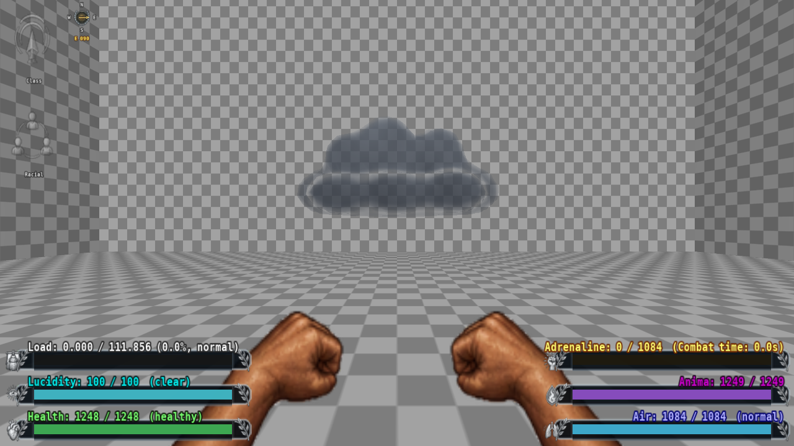

# 5.4.5 / #251 - Reusable cloud asset checkpoint (in progress)

Baseline: fcaf6e7b / 5.4.4, the separate #238 preparation/HUD checkpoint.
This patch supplies an original normalized 3D rain cloud, deterministic source,
palette and soft-edge material. It does not implement the Investigator ability:
seated rider, mounting, flight, rain, lightning, ownership and #238 lifecycle
integration remain pending. Preview scale/opacity are visual settings, not
approved gameplay dimensions or balance. No production actor or saved field is
added, so there is no new actor/save schema to migrate in this asset checkpoint.

## Integration on accepted 5.4.19 (2026-10-15)

The original asset checkpoint is integrated with accepted #250 baseline e9c79de8
without changing its geometry/material or any accepted gameplay source. Asset
verification still repeats identical bytes. Eight native Vulkan state/view checks
pass with the unchanged fixture; normal packaging matches source and the tested
runtime. The integrated side capture was visually inspected and retains the known
concave bands. Exact commands, package hashes and normal exit are recorded in
[integration_5419.json](integration_5419.json). This is not ability implementation
or author acceptance. The cloud lesson is now CA-KP-104 to avoid the independently
accepted #260 CA-KP-097 identifier.

## Native flight coexistence probe (2026-10-15)

`prepare_flight_probe.py` packages an isolated native `PowerFlight` experiment
against the integrated 5.4.19 runtime. Two independent flight inventories set the
same flags; removing either one clears FLY/NOGRAVITY even when the other remains
active. Restoring the survivor's native effect recovers flight, and removing the
last power restores gravity. Eight checks cover both removal orders, exit 0.
`flight_evidence.json` records exact commands, hashes and scope. These checks
establish a native limitation and feasibility, not a shipped fix or cloud ability.
Production integration must preserve other active sources without restarting their
timer, charging again or repeating native takeoff impulses. See CA-KP-105.

## Static asset checks

Run `python assets/validation_545/verify_asset.py`. Python 3.12 standard library,
no external art/model/texture dependencies. The written OBJ is independently
parsed: indices are valid, normals are finite/unit, every edge is paired with
opposite direction, all vertices belong to one connected shell, signed volume
is positive and Euler characteristic is 2. There are 3,752 vertices, 7,500
triangles and 11,250 edges; no zero-area triangle or internal handle/cavity is
reported. OBJ, palette PNG, shader and manifest regenerate byte-for-byte.
Exact numbers and hashes: static.json and assets/rain_cloud/manifest.json.

## Isolated native evidence

Windows 11 / GZDoom 4.14.2 / NVIDIA RTX 3070 Ti, 1280x720, unpaused in the
background with 5% audio and isolated configuration. Runtime SHA-256:
`920bc4b0fe638b4d5ea1dae9157985933a3334f56da69949b54510e589820c89`.
Fixture SHA-256:
`a09627bf2625f114df20cd88024f46a551c0020cb77d3cd40d9f734235661229`.

`build/issue251-release/vulkan-01` and `opengl-01` exit 0 and each pass eight
fixture checks (spawn, translucent/noncombat state and six orientations). These
are eight repeated state checks per backend, not sixteen distinct artistic or
gameplay criteria. Captures cover front, both sides, back, above and below.
Native images inspected by the agent show a view-dependent 3D silhouette and
the original checkerboard room behind it. The material compiles and renders in
both tested backends. Exact run settings, hashes and logs are in evidence.json.



## Visual limits and retained experiments

This is a surface-based cloud approximation, not ray-marched volumetric weather.
The soft-edge material reduces hard outlines and rejects back-facing fragments;
concave overlap bands remain visible and the shape/opacity need author review.
The seated character composition has not been implemented or accepted. No
weather-load benchmark, software-renderer/GLES support or full-ability result is
claimed. Production currently has no actor which spawns this model.

Earlier captures are preserved under build/issue251-preview-01 and preview-02:
the first volume was too smooth and the more strongly separated lobes had
unwanted interior contours. The winding-probe and cull-probe did not resolve
those contours; they are diagnostics, not fixes. material-probe established the
soft-edge material; final-shape precedes the final opacity/fade settings. The
final source blends a broad base into the lobes and reduces mesh detail. It is
the release runs, not those earlier packages, which identify this delivery.

## Reproduction

Use fresh directories/labels to preserve evidence:

```powershell
python assets/generators/generate_rain_cloud.py
python assets/validation_545/verify_asset.py
python assets/validation_545/prepare.py --directory issue251-review-vulkan
powershell -NoProfile -ExecutionPolicy Bypass -File assets/validation_545/run_native.ps1 -Directory issue251-review-vulkan -Label preview -Script preview.cfg -Backend 1
python assets/validation_545/prepare.py --directory issue251-review-gl
powershell -NoProfile -ExecutionPolicy Bypass -File assets/validation_545/run_native.ps1 -Directory issue251-review-gl -Label preview -Script preview.cfg -Backend 0
```

The preview room, actor, MODELDEF and package are isolated development fixtures;
only the cloud resources/material registration belong to src. No development
IWAD, executable, save or test PK3 is included. No author handoff is launched
while the author is away, and no incomplete gameplay acceptance test is added
to pending_test.txt. Existing CA259/261/254 checks remain outstanding.

## Delivery validation

The initial project validator caught two diagnostic labels still naming 5.4.4;
updating those release labels to 5.4.5 resolves the required gate. No hazard or
maze behavior changed. Final validation passes with errors: [] and 2,483 CONTEXT
words. Document/dialogue indexes are current. Normal build passes with 16,124
files and no directory entries; every member equals the release runtime used by
the final Vulkan/OpenGL runs. The earlier asset-final package had identical
model/material files but preceded those diagnostic release labels; its evidence
is retained separately. Unrelated local deletion/untracked files are untouched.
